# Jarkom-Modul-3-2026-K-14
| No | Nama Anggota | NRP |
|:---:|---|:---:|
| 1 | Muhammad Satrio Utomo | 5027251022 |
| 2 | Sebastian Elroi Hasian Panjaitan | 5027251040 |

---

## Pengerjaan

### Soal 1 - Satrio
> Ketika Curtain menutup Shibuya, jalur komunikasi antar zona Jujutsu High terputus. Pulihkan konektivitas dasar dengan mengonfigurasi jichi: eth0 memperoleh WAN dari NAT, sedangkan eth1–eth4 menjadi gateway Network 1–4 sesuai tabel pemetaan. Aktifkan IPv4 forwarding dan source NAT, lalu tetapkan IP statis host infrastruktur sesuai tabel spesifikasi. Buktikan konektivitas setiap host ke gateway dan akses eksternal dari host yang relevan.

**Ringkasan Implementasi:**
Konfigurasi router sentral `jichi` untuk menghubungkan 4 subnet internal (`192.218.1.0/24` s.d. `192.218.4.0/24`) ke jaringan luar melalui `eth0` (NAT1), mengaktifkan IP forwarding dan Source NAT (`MASQUERADE`), serta menetapkan konfigurasi IP statis pada seluruh server infrastruktur di Network 1 (DMZ) dan Network 4 (Data Center).

---

#### 1. Perancangan Antarmuka dan Routing pada Router `jichi`
Pemetaan antarmuka pada router `jichi`:
- `eth0`: WAN terhubung ke `NAT1` (DHCP).
- `eth1`: Gateway Network 1 / DMZ (`192.218.1.1/24`).
- `eth2`: Gateway Network 2 / Divisi A (`192.218.2.1/24`).
- `eth3`: Gateway Network 3 / Divisi B (`192.218.3.1/24`).
- `eth4`: Gateway Network 4 / Data Center (`192.218.4.1/24`).


Konfigurasi antarmuka `/etc/network/interfaces` pada `jichi`:
```text
auto lo
iface lo inet loopback

auto eth0
iface eth0 inet dhcp

auto eth1
iface eth1 inet static
    address 192.218.1.1
    netmask 255.255.255.0

auto eth2
iface eth2 inet static
    address 192.218.2.1
    netmask 255.255.255.0

auto eth3
iface eth3 inet static
    address 192.218.3.1
    netmask 255.255.255.0

auto eth4
iface eth4 inet static
    address 192.218.4.1
    netmask 255.255.255.0
```


Skrip inisialisasi routing dan NAT pada `/root/setup_nat.sh`:
```bash
#!/bin/bash
# 1. Alokasi IP WAN dari NAT
dhclient eth0 2>/dev/null

# 2. Aktifkan IPv4 Forwarding
sysctl -w net.ipv4.ip_forward=1

# 3. Source NAT (MASQUERADE) pada eth0
iptables -t nat -A POSTROUTING -o eth0 -j MASQUERADE
```


---

#### 2. Penetapan IP Statis Host Infrastruktur
Konfigurasi antarmuka `/etc/network/interfaces` pada masing-masing server dengan default gateway mengarah ke router `jichi`:

* **Network 1 (DMZ - Switch 1):**
  - **utahime (DNS Master):** `192.218.1.2/24` | Gateway: `192.218.1.1` | DNS: `192.168.122.1`
  - **shoko (DNS Slave):** `192.218.1.3/24` | Gateway: `192.218.1.1`
  - **gojo (Reverse Proxy):** `192.218.1.4/24` | Gateway: `192.218.1.1`

* **Network 4 (Data Center - Switch 8):**
  - **tengen (DHCP Server):** `192.218.4.10/24` | Gateway: `192.218.4.1`
  - **geto (Load Balancer):** `192.218.4.2/24` | Gateway: `192.218.4.1`
  - **maki (Frontend Worker):** `192.218.4.3/24` | Gateway: `192.218.4.1`
  - **panda (Frontend Worker):** `192.218.4.4/24` | Gateway: `192.218.4.1`
  - **nanami (API Worker):** `192.218.4.5/24` | Gateway: `192.218.4.1`
  - **todo (API Worker):** `192.218.4.6/24` | Gateway: `192.218.4.1`
  - **kirara (API Worker Cadangan):** `192.218.4.7/24` | Gateway: `192.218.4.1`
  - **yaga (Database Master):** `192.218.4.8/24` | Gateway: `192.218.4.1`
  - **inumaki (Database Slave):** `192.218.4.9/24` | Gateway: `192.218.4.1`

---

#### 3. Prosedur Pengujian dan Verifikasi

**A. Verifikasi Konektivitas Host ke Default Gateway**
1. **Node `[utahime]` (Network 1):**
   ```bash
   ping -c 3 192.218.1.1
   ```
2. **Node `[tengen]` (Network 4):**
   ```bash
   ping -c 3 192.218.4.1
   ```
- **Parameter yang Diverifikasi:** Pengiriman paket ICMP menghasilkan respon *0% packet loss* ke masing-masing gateway interface `jichi`.


**B. Verifikasi Routing Lintas Subnet (Internal Routing)**
1. **Node `[utahime]` (Network 1):**
   ```bash
   ping -c 3 192.218.4.10
   ```
- **Parameter yang Diverifikasi:** Host DMZ berhasil menjangkau server `tengen` di Network 4 melalui perutean router `jichi`.


**C. Verifikasi Akses Internet Eksternal (Source NAT)**
1. **Node `[utahime]` atau `[tengen]`:**
   ```bash
   ping -c 3 8.8.8.8
   ping -c 3 google.com
   ```
- **Parameter yang Diverifikasi:** Host internal berhasil menerima balasan (*Reply*) dari IP publik dan domain eksternal, membuktikan aturan `iptables MASQUERADE` pada `jichi` telah aktif.


---

### Soal 2 - Satrio
> Tengen, penjaga pusat distribusi di Data Center, harus mengambil alih pengalokasian alamat bagi wilayah yang membutuhkan konfigurasi dinamis. Konfigurasikan isc-dhcp-server pada [PREFIX IP].4.10. Deklarasikan Network 4 ([PREFIX IP].4.0/24) sebagai subnet lokal tanpa pool dinamis, lalu siapkan scope DHCP untuk Network 2 ([PREFIX IP].2.0/24) dan Network 3 ([PREFIX IP].3.0/24). Validasi konfigurasi dan pastikan service aktif tanpa error "No subnet declaration".

**Ringkasan Implementasi:**
Mengonfigurasi layanan DHCP Server terpusat pada node `tengen` (`192.218.4.10`) menggunakan `isc-dhcp-server`. Subnet lokal Network 4 (`192.218.4.0/24`) dideklarasikan kosong tanpa dynamic pool untuk mencegah galat *"No subnet declaration for eth0"*, serta menyiapkan scope distribusi untuk Network 2 dan Network 3.

---

#### 1. Konfigurasi dan Skrip pada Node `tengen`
Skrip instalasi dan konfigurasi disimpan di `/root/setup_dhcp_server.sh`:
```bash
#!/bin/bash
# 1. Konfigurasi DNS resolver repositori
echo "nameserver 192.168.122.1" > /etc/resolv.conf
echo "nameserver 8.8.8.8" >> /etc/resolv.conf

# 2. Instalasi paket
apt-get update
DEBIAN_FRONTEND=noninteractive apt-get install -y isc-dhcp-server

# 3. Interface listening
echo 'INTERFACESv4="eth0"' > /etc/default/isc-dhcp-server

# 4. Berkas /etc/dhcp/dhcpd.conf
cat << 'EOF' > /etc/dhcp/dhcpd.conf
default-lease-time 600;
max-lease-time 7200;
authoritative;

# Network 4: Subnet Lokal (tanpa dynamic pool)
subnet 192.218.4.0 netmask 255.255.255.0 {
}

# Network 2: Scope Divisi A
subnet 192.218.2.0 netmask 255.255.255.0 {
    range 192.218.2.10 192.218.2.95;
    option routers 192.218.2.1;
    option subnet-mask 255.255.255.0;
    option broadcast-address 192.218.2.255;
}

# Network 3: Scope Divisi B
subnet 192.218.3.0 netmask 255.255.255.0 {
    range 192.218.3.10 192.218.3.199;
    option routers 192.218.3.1;
    option subnet-mask 255.255.255.0;
    option broadcast-address 192.218.3.255;
}
EOF

# 5. Uji sintaks dan restart layanan
dhcpd -t -cf /etc/dhcp/dhcpd.conf
service isc-dhcp-server restart || /etc/init.d/isc-dhcp-server restart
```

Tampilan konfigurasi `/etc/dhcp/dhcpd.conf`:


Tampilan konfigurasi `/etc/default/isc-dhcp-server`:


---

#### 2. Prosedur Pengujian dan Verifikasi

**A. Validasi Sintaks Konfigurasi DHCP**
1. **Node `[tengen]`:**
   ```bash
   dhcpd -t -cf /etc/dhcp/dhcpd.conf
   ```
- **Parameter yang Diverifikasi:** Perintah selesai tanpa pesan galat sintaks (*syntax ok / exit code 0*).


**B. Verifikasi Status Layanan dan Log Bebas Error**
1. **Node `[tengen]`:**
   ```bash
   service isc-dhcp-server status
   ```
- **Parameter yang Diverifikasi:**
  - Status layanan aktif berjalan (*running*).
  - Tidak ada pesan galat *"No subnet declaration for eth0"*.


---

### Soal 3 - Satrio
> Permintaan alamat dari Divisi A dan Divisi B tidak dapat menyeberangi subnet secara langsung. Konfigurasikan jichi sebagai DHCP Relay menuju tengen ([PREFIX IP].4.10), menggunakan eth2 untuk Network 2 dan eth3 untuk Network 3. Buktikan bahwa client dari kedua subnet berhasil memperoleh lease melalui relay.

**Ringkasan Implementasi:**
Mengaktifkan agen DHCP Relay (`isc-dhcp-relay`) pada router `jichi` untuk menangkap siaran lokal dari klien Divisi A (`eth2`) dan Divisi B (`eth3`), lalu meneruskannya secara unicast menuju DHCP Server `tengen` (`192.218.4.10`) melalui antarmuka `eth4`.

---

#### 1. Konfigurasi dan Skrip pada Router `jichi`
Skrip instalasi dan inisialisasi relay pada `/root/setup_dhcp_relay.sh`:
```bash
#!/bin/bash
# 1. DNS resolver repositori
echo "nameserver 192.168.122.1" > /etc/resolv.conf
echo "nameserver 8.8.8.8" >> /etc/resolv.conf

# 2. Instalasi paket isc-dhcp-relay
apt-get update
DEBIAN_FRONTEND=noninteractive apt-get install -y isc-dhcp-relay

# 3. Konfigurasi interface relay dan target server
cat << 'EOF' > /etc/default/isc-dhcp-relay
SERVERS="192.218.4.10"
INTERFACES="eth2 eth3 eth4"
OPTIONS=""
EOF

# 4. Jalankan daemon dhcrelay
pkill dhcrelay 2>/dev/null
dhcrelay -4 -i eth2 -i eth3 -i eth4 192.218.4.10
```


---

#### 2. Prosedur Pengujian dan Verifikasi

**A. Verifikasi Perolehan Alamat Klien Divisi A (Network 2)**
1. **Node `[itadori]`:**
   ```bash
   killall udhcpc 2>/dev/null
   udhcpc -i eth0
   ip a show dev eth0
   ```
- **Parameter yang Diverifikasi:** Klien menerima alokasi IP dinamis `192.218.2.12/24` dari server `192.218.4.10`.


**B. Verifikasi Perolehan Alamat Klien Divisi B (Network 3)**
1. **Node `[ino]`:**
   ```bash
   killall udhcpc 2>/dev/null
   udhcpc -i eth0
   ip a show dev eth0
   ```
- **Parameter yang Diverifikasi:** Klien menerima alokasi IP dinamis `192.218.3.12/24` dari server `192.218.4.10`.


**C. Verifikasi Riwayat Sewa pada Server `tengen`**
1. **Node `[tengen]`:**
   ```bash
   cat /var/lib/dhcp/dhcpd.leases
   ```
- **Parameter yang Diverifikasi:**
  - `192.218.2.12` terikat aktif (*active*) ke MAC `02:42:6c:43:66:00` milik `itadori`.
  - `192.218.3.12` terikat aktif (*active*) ke MAC `02:42:7a:76:5b:00` milik `ino`.


---

### Soal 4 - Satrio
> Agar tim Dev dan Support di Divisi A menerima jatah alamat yang berbeda, atur dua pool DHCP pada Network 2. Tetapkan Pool 1 ([PREFIX IP].2.10–[PREFIX IP].2.35) untuk itadori dan fushiguro, serta Pool 2 ([PREFIX IP].2.70–[PREFIX IP].2.95) untuk zenin dan okkotsu. Rentang [PREFIX IP].2.36–[PREFIX IP].2.69 tidak boleh dialokasikan. Karena seluruh client berada pada subnet yang sama, gunakan DHCP class berdasarkan MAC Address atau Client ID untuk memisahkan kedua kelompok.

**Ringkasan Implementasi:**
Segmentasi alokasi IP dinamis dalam Network 2 menggunakan DHCP Class berbasis MAC Address pada `tengen`:
- **Pool 1** (`192.218.2.10`–`192.218.2.35`): dialokasikan untuk `itadori` dan `fushiguro`.
- **Pool 2** (`192.218.2.70`–`192.218.2.95`): dialokasikan untuk `zenin` dan `okkotsu`.
- Rentang `192.218.2.36` s.d. `192.218.2.69` tidak dimasukkan ke dalam deklarasi `range` manapun untuk menjamin isolasi.

---

#### 1. Konfigurasi DHCP Class pada Node `tengen`
Potongan konfigurasi `/etc/dhcp/dhcpd.conf` pada `tengen`:
```text
# Definisi Class Berdasarkan MAC Address untuk Divisi A
class "pool1-clients" {
    match hardware;
}
subclass "pool1-clients" 1:02:42:6c:43:66:00; # MAC itadori
subclass "pool1-clients" 1:02:42:0e:6c:c7:00; # MAC fushiguro

class "pool2-clients" {
    match hardware;
}
subclass "pool2-clients" 1:02:42:cb:7a:f8:00; # MAC zenin
subclass "pool2-clients" 1:02:42:1d:9e:34:00; # MAC okkotsu

# Subnet Network 2 dengan Pemisahan Dua Pool
subnet 192.218.2.0 netmask 255.255.255.0 {
    option routers 192.218.2.1;
    option subnet-mask 255.255.255.0;
    option broadcast-address 192.218.2.255;

    # Pool 1: itadori & fushiguro
    pool {
        allow members of "pool1-clients";
        range 192.218.2.10 192.218.2.35;
    }

    # Pool 2: zenin & okkotsu
    pool {
        allow members of "pool2-clients";
        range 192.218.2.70 192.218.2.95;
    }
}
```

Validasi sintaks dan restart layanan:
```bash
dhcpd -t -cf /etc/dhcp/dhcpd.conf
service isc-dhcp-server restart
```


---

#### 2. Prosedur Pengujian dan Verifikasi

**A. Verifikasi Perolehan Alamat Klien Pool 1 (`itadori` & `fushiguro`)**
1. **Node `[itadori]`:**
   ```bash
   killall udhcpc 2>/dev/null && udhcpc -i eth0 && ip a show dev eth0
   ```
2. **Node `[fushiguro]`:**
   ```bash
   killall udhcpc 2>/dev/null && udhcpc -i eth0 && ip a show dev eth0
   ```
- **Parameter yang Diverifikasi:**
  - `itadori`: Memperoleh IP `192.218.2.10/24`.
  - `fushiguro`: Memperoleh IP `192.218.2.11/24`.
  - Kedua IP berada tepat dalam rentang Pool 1 (`192.218.2.10`–`192.218.2.35`).


**B. Verifikasi Perolehan Alamat Klien Pool 2 (`zenin` & `okkotsu`)**
1. **Node `[zenin]`:**
   ```bash
   killall udhcpc 2>/dev/null && udhcpc -i eth0 && ip a show dev eth0
   ```
2. **Node `[okkotsu]`:**
   ```bash
   killall udhcpc 2>/dev/null && udhcpc -i eth0 && ip a show dev eth0
   ```
- **Parameter yang Diverifikasi:**
  - `zenin`: Memperoleh IP `192.218.2.71/24`.
  - `okkotsu`: Memperoleh IP `192.218.2.70/24`.
  - Kedua IP berada tepat dalam rentang Pool 2 (`192.218.2.70`–`192.218.2.95`).


**C. Verifikasi Isolasi Rentang pada Basis Data Server**
1. **Node `[tengen]`:**
   ```bash
   cat /var/lib/dhcp/dhcpd.leases
   ```
- **Parameter yang Diverifikasi:** Seluruh lease berada di `.2.10`–`.2.35` atau `.2.70`–`.2.95`. Rentang reservasi kosong (`192.218.2.36` s.d. `192.218.2.69`) terbukti tidak dialokasikan.


---

### Soal 5 - Satrio
> Setiap tim lapangan memiliki durasi operasi yang berbeda. Pada Network 3, berikan short lease 30 menit (1800 detik) kepada ino dan kusakabe, serta long lease 12 jam (43200 detik) kepada miwa. Gunakan pool short lease [PREFIX IP].3.10–[PREFIX IP].3.89 dan pool long lease [PREFIX IP].3.100–[PREFIX IP].3.199. Sesuaikan default-lease-time dan max-lease-time untuk setiap kelas client. Berikan pula DHCP options berupa DNS [PREFIX IP].1.2 dan [PREFIX IP].1.3, serta domain-search <xxxx>.com.

**Ringkasan Implementasi:**
Konfigurasi kelas durasi sewa dan opsi jaringan dinamis pada Network 3 (Divisi B):
- **Short Lease (1800 detik / 30 menit)**: Rentang `192.218.3.10`–`192.218.3.89` untuk `ino` dan `kusakabe`.
- **Long Lease (43200 detik / 12 jam)**: Rentang `192.218.3.100`–`192.218.3.199` untuk `miwa`.
- **DHCP Options**: DNS Resolver `192.218.1.2`, `192.218.1.3` dan search domain `k14.com`.

---

#### 1. Konfigurasi pada Node `tengen`
Potongan konfigurasi `/etc/dhcp/dhcpd.conf` pada `tengen`:
```text
# Class Divisi B (Soal 5)
class "short-lease-clients" {
    match hardware;
}
subclass "short-lease-clients" 1:02:42:7a:76:5b:00; # MAC ino
subclass "short-lease-clients" 1:02:42:5f:4d:2a:00; # MAC kusakabe

class "long-lease-clients" {
    match hardware;
}
subclass "long-lease-clients" 1:02:42:c9:60:89:00; # MAC miwa

# Network 3: Divisi B
subnet 192.218.3.0 netmask 255.255.255.0 {
    option routers 192.218.3.1;
    option subnet-mask 255.255.255.0;
    option broadcast-address 192.218.3.255;

    # DHCP Options: DNS Resolver dan Domain Search
    option domain-name-servers 192.218.1.2, 192.218.1.3;
    option domain-name "k14.com";
    option domain-search "k14.com";

    # Pool Short Lease: ino & kusakabe (1800s)
    pool {
        allow members of "short-lease-clients";
        range 192.218.3.10 192.218.3.89;
        default-lease-time 1800;
        max-lease-time 1800;
    }

    # Pool Long Lease: miwa (43200s)
    pool {
        allow members of "long-lease-clients";
        range 192.218.3.100 192.218.3.199;
        default-lease-time 43200;
        max-lease-time 43200;
    }
}
```

Validasi sintaks dan restart layanan:
```bash
dhcpd -t -cf /etc/dhcp/dhcpd.conf
service isc-dhcp-server restart
```


---

#### 2. Prosedur Pengujian dan Verifikasi

**A. Verifikasi Short Lease dan Opsi Jaringan (`ino` & `kusakabe`)**
1. **Node `[ino]` atau `[kusakabe]`:**
   ```bash
   killall udhcpc 2>/dev/null
   udhcpc -i eth0
   ip a show dev eth0
   cat /etc/resolv.conf
   ```
- **Parameter yang Diverifikasi:**
  - IP berada di rentang `.3.10`–`.3.89`.
  - Output log `udhcpc` mencatat `lease time 1800` detik.
  - `/etc/resolv.conf` memuat `nameserver 192.218.1.2`, `nameserver 192.218.1.3`, dan `search k14.com`.


**B. Verifikasi Long Lease dan Opsi Jaringan (`miwa`)**
1. **Node `[miwa]`:**
   ```bash
   killall udhcpc 2>/dev/null
   udhcpc -i eth0
   ip a show dev eth0
   cat /etc/resolv.conf
   ```
- **Parameter yang Diverifikasi:**
  - IP berada di rentang `.3.100`–`.3.199`.
  - Output log `udhcpc` mencatat `lease time 43200` detik.
  - `/etc/resolv.conf` menerima konfigurasi resolver yang identik.


**C. Verifikasi Durasi Sewa pada Basis Data Server**
1. **Node `[tengen]`:**
   ```bash
   cat /var/lib/dhcp/dhcpd.leases
   ```
- **Parameter yang Diverifikasi:** Selisih timestamp antara `starts` dan `ends` pada sewa `ino`/`kusakabe` tercatat tepat 1800 detik (30 menit), sedangkan pada `miwa` tepat 43200 detik (12 jam).


---

### Soal 6 - Satrio
> Kugisaki ditetapkan sebagai personel VIP yang harus mempertahankan alamat yang sama setiap kali terhubung. Buat DHCP static lease berdasarkan MAC Address client tersebut dengan fixed address [PREFIX IP].3.99. Pastikan alamat ini berada di luar seluruh pool dinamis, validasi konfigurasi server, lalu renew lease pada client. Buktikan bahwa alamat yang diterima sesuai dengan reservasi.

**Ringkasan Implementasi:**
Menerapkan reservasi alamat statis (*DHCP Static Lease* / *Fixed Address*) pada `tengen` untuk klien `kugisaki` menggunakan IP `192.218.3.99`. Alamat ini berada di luar rentang dinamis Short Lease (`.3.10`–`.3.89`) dan Long Lease (`.3.100`–`.3.199`) sehingga terisolasi dari risiko tabrakan alamat.

---

#### 1. Identifikasi dan Konfigurasi Static Lease pada Node `tengen`
1. Cek MAC Address klien pada node `kugisaki`:
   ```bash
   cat /sys/class/net/eth0/address
   # Hasil: 02:42:61:52:58:00
   ```

2. Tambahkan blok reservasi host di dalam deklarasi subnet Network 3 pada `/etc/dhcp/dhcpd.conf`:
   ```text
   # Static Lease VIP: kugisaki (Soal 6)
   host kugisaki {
       hardware ethernet 02:42:61:52:58:00;
       fixed-address 192.218.3.99;
   }
   ```

3. Validasi sintaks dan restart layanan:
   ```bash
   dhcpd -t -cf /etc/dhcp/dhcpd.conf
   service isc-dhcp-server restart
   ```


---

#### 2. Prosedur Pengujian dan Verifikasi

**A. Pembaruan Sewa (*Renew Lease*) pada Klien `kugisaki`**
1. **Node `[kugisaki]`:**
   ```bash
   killall udhcpc 2>/dev/null
   ip addr flush dev eth0
   udhcpc -i eth0
   ip a show dev eth0
   ```
- **Parameter yang Diverifikasi:**
  - Log respon mencatat `lease of 192.218.3.99 obtained from 192.218.4.10`.
  - Antarmuka `eth0` terpasang alamat tepat `192.218.3.99/24`.
  - Alamat berada di luar seluruh batas pool dinamis Network 3.


---

### Soal 7 - Satrio
> Setelah aturan alokasi diterapkan, pastikan setiap client menerima konfigurasi jaringan sesuai wilayahnya: subnet mask 255.255.255.0 (/24), gateway dan broadcast address yang benar, DNS [PREFIX IP].1.2 serta [PREFIX IP].1.3, dan domain-search <xxxx>.com. Periksa IP address dan routing seluruh client Divisi A dan Divisi B, kemudian cocokkan lease dengan /var/lib/dhcp/dhcpd.leases pada tengen. Pastikan tidak ada alamat yang bertabrakan atau berada di luar kebijakan pool.

**Ringkasan Implementasi:**
Audit komprehensif distribusi parameter jaringan (IP, subnet mask `/24`, default gateway, broadcast, DNS resolver, dan domain-search `k14.com`) untuk seluruh klien Divisi A dan Divisi B, serta pencocokan konsistensi log basis data pada `/var/lib/dhcp/dhcpd.leases` di `tengen`.

---

#### 1. Tabel Ringkasan Audit Seluruh Klien

| Node | Subnet | Alamat IP / Netmask | Default Gateway | Broadcast | DNS Resolver & Search Domain | Status Kebijakan Pool |
| :--- | :---: | :--- | :--- | :--- | :--- | :--- |
| **itadori** | Net 2 | `192.218.2.11/24` | `192.218.2.1` | `192.218.2.255` | `192.218.1.2`, `192.218.1.3` (`k14.com`) | Sesuai (Pool 1: `.2.10`–`.2.35`) |
| **fushiguro** | Net 2 | `192.218.2.10/24` | `192.218.2.1` | `192.218.2.255` | `192.218.1.2`, `192.218.1.3` (`k14.com`) | Sesuai (Pool 1: `.2.10`–`.2.35`) |
| **zenin** | Net 2 | `192.218.2.70/24` | `192.218.2.1` | `192.218.2.255` | `192.218.1.2`, `192.218.1.3` (`k14.com`) | Sesuai (Pool 2: `.2.70`–`.2.95`) |
| **okkotsu** | Net 2 | `192.218.2.71/24` | `192.218.2.1` | `192.218.2.255` | `192.218.1.2`, `192.218.1.3` (`k14.com`) | Sesuai (Pool 2: `.2.70`–`.2.95`) |
| **ino** | Net 3 | `192.218.3.11/24` | `192.218.3.1` | `192.218.3.255` | `192.218.1.2`, `192.218.1.3` (`k14.com`) | Sesuai (Short Lease: `.3.10`–`.3.89`) |
| **kusakabe** | Net 3 | `192.218.3.12/24` | `192.218.3.1` | `192.218.3.255` | `192.218.1.2`, `192.218.1.3` (`k14.com`) | Sesuai (Short Lease: `.3.10`–`.3.89`) |
| **miwa** | Net 3 | `192.218.3.100/24` | `192.218.3.1` | `192.218.3.255` | `192.218.1.2`, `192.218.1.3` (`k14.com`) | Sesuai (Long Lease: `.3.100`–`.3.199`) |
| **kugisaki** | Net 3 | `192.218.3.99/24` | `192.218.3.1` | `192.218.3.255` | `192.218.1.2`, `192.218.1.3` (`k14.com`) | Sesuai (Static Lease VIP) |

---

#### 2. Prosedur Pengujian dan Verifikasi

**A. Verifikasi Klien Divisi A (Network 2)**
1. **Node `[itadori]` (Pool 1) dan `[zenin]` (Pool 2):**
   ```bash
   ip a show dev eth0
   ip route
   cat /etc/resolv.conf
   ```
- **Parameter yang Diverifikasi:** Subnet mask `/24`, default gateway `192.218.2.1`, broadcast `192.218.2.255`, DNS resolver `192.218.1.2` dan `192.218.1.3`.


**B. Verifikasi Klien Divisi B (Network 3)**
1. **Node `[ino]`, `[miwa]`, dan `[kugisaki]`:**
   ```bash
   ip a show dev eth0
   ip route
   cat /etc/resolv.conf
   ```
- **Parameter yang Diverifikasi:** Subnet mask `/24`, default gateway `192.218.3.1`, broadcast `192.218.3.255`, DNS resolver `192.218.1.2` dan `192.218.1.3`.


**C. Audit Basis Data Sewa pada Server `tengen`**
1. **Node `[tengen]`:**
   ```bash
   cat /var/lib/dhcp/dhcpd.leases
   ```
- **Parameter yang Diverifikasi:**
  - Tidak ada tabrakan IP (*zero IP collision*).
  - Alokasi IP mematuhi rentang pool masing-masing.
  - Rentang reservasi kosong (`192.218.2.36` s.d. `192.218.2.69`) tetap steril dari alokasi.


---

### Soal 8 - Satrio
> Sebelum Curtain dibuka kembali, buktikan bahwa proses pemberian alamat berjalan sesuai protokol. Lakukan packet capture saat salah satu client Network 2 atau Network 3 meminta lease baru. Gunakan tcpdump pada tengen atau jalur menuju Data Center untuk menunjukkan urutan DHCPDISCOVER → DHCPOFFER → DHCPREQUEST → DHCPACK. Identifikasi alamat server, alamat yang diberikan, lease time, dan field giaddr. Pastikan nilai giaddr sesuai dengan interface jichi yang menerima request dari subnet client.

**Ringkasan Implementasi:**
Pembuktian transaksi *4-way handshake* DHCP (`DHCPDISCOVER` → `DHCPOFFER` → `DHCPREQUEST` → `DHCPACK`) melalui penangkapan paket (*packet capture*) pada antarmuka `eth0` node `tengen` (`192.218.4.10`) menggunakan `tcpdump`, serta verifikasi nilai `giaddr` (*Gateway IP Address*) dari perantara router `jichi`.

---

#### 1. Prosedur Pengujian dan Verifikasi

**A. Eksekusi Penangkapan Paket dan Trigger Klien**
1. **Buka Terminal Node `[tengen]`:**
   Jalankan sniffer paket untuk 4 pertukaran DHCP:
   ```bash
   tcpdump -i eth0 -nvvv -c 4 'udp and (port 67 or port 68)'
   ```

2. **Buka Terminal Node `[itadori]` (Network 2):**
   Lepas IP lama dan minta sewa alamat baru:
   ```bash
   killall udhcpc 2>/dev/null && ip addr flush dev eth0 && udhcpc -i eth0
   ```


---

#### 2. Analisis Hasil Tangkapan Paket
Log transaksi pertukaran 4 paket yang ditangkap pada `tengen`:

```text
# 1. DHCPDISCOVER (Klien -> Relay -> Server)
11:53:35.039821 IP 192.218.4.1.67 > 192.218.4.10.67: BOOTP/DHCP, Request from 02:42:6c:43:66:00
          Gateway-IP 192.218.2.1
          Client-Ethernet-Address 02:42:6c:43:66:00
          DHCP-Message (53), length 1: Discover
          Parameter-Request (55): Subnet-Mask, Default-Gateway, Domain-Name-Server, Domain-Name...
          Client-ID (61): ether 02:42:6c:43:66:00

# 2. DHCPOFFER (Server -> Relay)
11:53:35.041385 IP 192.218.4.10.67 > 192.218.2.1.67: BOOTP/DHCP, Reply
          Your-IP 192.218.2.11
          Gateway-IP 192.218.2.1
          Client-Ethernet-Address 02:42:6c:43:66:00
          DHCP-Message (53), length 1: Offer
          Server-ID (54), length 4: 192.218.4.10
          Lease-Time (51), length 4: 600
          Subnet-Mask (1), length 4: 255.255.255.0
          Default-Gateway (3), length 4: 192.218.2.1
          Domain-Name-Server (6), length 8: 192.218.1.2, 192.218.1.3
          Domain-Name (15), length 7: "k14.com"

# 3. DHCPREQUEST (Klien -> Relay -> Server)
11:53:35.053931 IP 192.218.4.1.67 > 192.218.4.10.67: BOOTP/DHCP, Request from 02:42:6c:43:66:00
          Gateway-IP 192.218.2.1
          Client-Ethernet-Address 02:42:6c:43:66:00
          DHCP-Message (53), length 1: Request
          Requested-IP (50), length 4: 192.218.2.11
          Server-ID (54), length 4: 192.218.4.10

# 4. DHCPACK (Server -> Relay)
11:53:35.054978 IP 192.218.4.10.67 > 192.218.2.1.67: BOOTP/DHCP, Reply
          Your-IP 192.218.2.11
          Gateway-IP 192.218.2.1
          Client-Ethernet-Address 02:42:6c:43:66:00
          DHCP-Message (53), length 1: ACK
          Server-ID (54), length 4: 192.218.4.10
          Lease-Time (51), length 4: 600
          Subnet-Mask (1), length 4: 255.255.255.0
          Default-Gateway (3), length 4: 192.218.2.1
          Domain-Name-Server (6), length 8: 192.218.1.2, 192.218.1.3
          Domain-Name (15), length 7: "k14.com"
```


---

#### 3. Parameter Protokol yang Diverifikasi

| Parameter Evaluasi | Nilai Teridentifikasi | Deskripsi dan Analisis |
| :--- | :--- | :--- |
| **Alamat Server (`Server-ID`)** | `192.218.4.10` | Alamat IP host server `tengen` di Data Center yang melayani alokasi dan konfigurasi jaringan. |
| **Alamat yang Diberikan (`Your-IP`)** | `192.218.2.11` | Alamat IP yang ditawarkan dan disahkan untuk node `itadori` (masuk ke dalam Pool 1 Divisi A: `.2.10`–`.2.35`). |
| **Durasi Sewa (`Lease-Time`)** | `600` detik (10 menit) | Nilai sewa default yang dikonfigurasikan pada subnet Network 2. |
| **Field `giaddr` (`Gateway-IP`)** | `192.218.2.1` | Alamat IP antarmuka `eth2` pada router `jichi` yang menerima siaran awal dari klien `itadori`. |

- **Validasi `giaddr`:** Nilai `Gateway-IP 192.218.2.1` pada paket membuktikan perantara DHCP Relay bekerja dengan benar. Server `tengen` membaca field `giaddr` ini untuk mencocokkan scope subnet tujuan (`subnet 192.218.2.0 netmask 255.255.255.0`) dan memvalidasi keanggotaan class sebelum mengirim balasan.

---

### Soal 9 - Satrio
> Sebuah gangguan memutus jalur relay dan membuat permintaan alamat tidak sampai ke Data Center. Hentikan service DHCP Relay pada jichi, lalu paksa salah satu client di Network 2 atau Network 3 meminta lease baru dan catat gejalanya. Pulihkan service relay, ulangi permintaan DHCP, lalu buktikan bahwa client kembali memperoleh alamat dari pool yang benar dengan gateway semula.

**Ringkasan Implementasi:**
Simulasi kegagalan layanan DHCP Relay pada router `jichi`, pencatatan gejala kegagalan pada klien saat mencoba meminta IP baru tanpa perantara, serta pembuktian pemulihan layanan setelah daemon diaktifkan kembali.

---

#### 1. Prosedur Pengujian dan Verifikasi

**A. Simulasi Gangguan: Penghentian Layanan DHCP Relay**
1. **Node `[jichi]`:**
   Hentikan proses daemon `dhcrelay`:
   ```bash
   pkill dhcrelay 2>/dev/null
   ps aux | grep dhcrelay
   ```
- **Parameter yang Diverifikasi:** Tidak ada proses `dhcrelay` yang berjalan di router.


**B. Pengamatan dan Pencatatan Gejala pada Klien**
1. **Node `[itadori]` (Network 2):**
   Paksa pelepasan IP dan minta lease baru:
   ```bash
   killall udhcpc 2>/dev/null
   ip addr flush dev eth0
   udhcpc -i eth0
   ip a show dev eth0
   ```
- **Gejala yang Teramati:**
  1. Klien mengirim broadcast pencarian secara terus menerus (`broadcasting discover`) tanpa pernah menerima balasan `DHCPOFFER`.
  2. Proses `udhcpc` mengalami *timeout* dan berhenti tanpa hasil.
  3. Antarmuka `eth0` kehilangan alamat IP (*no inet*), dan konektivitas jaringan terputus total.


**C. Pemulihan Layanan DHCP Relay pada Router**
1. **Node `[jichi]`:**
   Jalankan kembali daemon relay:
   ```bash
   dhcrelay -4 -i eth2 -i eth3 -i eth4 192.218.4.10
   ps aux | grep dhcrelay
   ```
- **Parameter yang Diverifikasi:** Daemon `dhcrelay` kembali aktif mendengarkan antarmuka `eth2`, `eth3`, dan `eth4`.


**D. Pembuktian Pemulihan pada Klien**
1. **Node `[itadori]`:**
   Ulangi permintaan sewa alamat dinamis:
   ```bash
   udhcpc -i eth0
   ip a show dev eth0
   ip route
   ```
- **Parameter yang Diverifikasi:**
  - Klien langsung menerima respon `lease of 192.218.2.11 obtained from 192.218.4.10`.
  - Alamat IP `192.218.2.11` kembali berada dalam rentang Pool 1 Divisi A (`.2.10`–`.2.35`).
  - Default route kembali terpasang normal: `default via 192.218.2.1 dev eth0`.


---

### Soal 10 - Satrio
> Setelah gangguan Shibuya tertangani, pastikan pemulihan bertahan setelah restart. Aktifkan autostart DHCP Server pada tengen dan DHCP Relay pada jichi, lalu restart kedua node. Verifikasi status layanan, IP, gateway, lease, dan konektivitas client Network 2–3. Pastikan kebijakan Pool 1, Pool 2, short lease, long lease, dan fixed address tetap berlaku.

**Ringkasan Implementasi:**
Konfigurasi skrip persistensi otomatis (*autostart*) pada file `/etc/rc.local` dan `/root/.bashrc` di node `tengen` (DHCP Server) dan `jichi` (Gateway & DHCP Relay), diikuti pengujian restart container untuk membuktikan seluruh kebijakan alokasi pool dan rute tetap berfungsi tanpa intervensi manual.

---

#### 1. Konfigurasi Autostart pada Node Infrastruktur

**A. Autostart DHCP Server pada Node `tengen`**
Skrip inisialisasi `/root/autostart_dhcp.sh`:
```bash
#!/bin/bash
ip addr flush dev eth0 2>/dev/null
ip addr add 192.218.4.10/24 dev eth0
ip link set eth0 up
ip route replace default via 192.218.4.1 dev eth0

pkill dhcpd 2>/dev/null
service isc-dhcp-server start || dhcpd -4 -cf /etc/dhcp/dhcpd.conf
```

Registrasi ke `/etc/rc.local` dan `/root/.bashrc`:
```bash
cat << 'EOF' > /etc/rc.local
#!/bin/bash
/root/autostart_dhcp.sh
exit 0
EOF
chmod +x /etc/rc.local
grep -q "autostart_dhcp.sh" /root/.bashrc || echo '/root/autostart_dhcp.sh' >> /root/.bashrc
```

**B. Autostart Routing dan DHCP Relay pada Node `jichi`**
Skrip inisialisasi `/root/autostart_relay.sh`:
```bash
#!/bin/bash
ip link set eth1 up && ip addr flush dev eth1 && ip addr add 192.218.1.1/24 dev eth1
ip link set eth2 up && ip addr flush dev eth2 && ip addr add 192.218.2.1/24 dev eth2
ip link set eth3 up && ip addr flush dev eth3 && ip addr add 192.218.3.1/24 dev eth3
ip link set eth4 up && ip addr flush dev eth4 && ip addr add 192.218.4.1/24 dev eth4

sysctl -w net.ipv4.ip_forward=1
iptables -t nat -A POSTROUTING -o eth0 -j MASQUERADE 2>/dev/null

pkill dhcrelay 2>/dev/null
dhcrelay -4 -i eth2 -i eth3 -i eth4 192.218.4.10
```

Registrasi ke `/etc/rc.local` dan `/root/.bashrc`:
```bash
cat << 'EOF' > /etc/rc.local
#!/bin/bash
/root/autostart_relay.sh
exit 0
EOF
chmod +x /etc/rc.local
grep -q "autostart_relay.sh" /root/.bashrc || echo '/root/autostart_relay.sh' >> /root/.bashrc
```

---

#### 2. Prosedur Pengujian dan Verifikasi Pasca-Restart

**A. Restart Node dan Verifikasi Status Layanan**
1. Lakukan restart container node `tengen` dan `jichi` melalui GNS3.
2. **Node `[tengen]`:**
   ```bash
   ps aux | grep dhcpd
   ```
   - **Parameter yang Diverifikasi:** Daemon `dhcpd` otomatis berjalan aktif melayani antarmuka `eth0`.
   

3. **Node `[jichi]`:**
   ```bash
   ps aux | grep dhcrelay
   sysctl net.ipv4.ip_forward
   ```
   - **Parameter yang Diverifikasi:** Daemon `dhcrelay` aktif dan `net.ipv4.ip_forward = 1`.
   

---

**B. Verifikasi Alokasi dan Konektivitas Seluruh Klien Pasca-Restart**

| Node Klien | Wilayah / Kebijakan | Alamat IP Didapat | Durasi Sewa (*Lease*) | Default Gateway | Uji Ping Gateway |
| :--- | :--- | :--- | :--- | :--- | :--- |
| **itadori** | Divisi A (Pool 1) | `192.218.2.11` | 600 detik | `192.218.2.1` | Sukses (0% loss) |
| **zenin** | Divisi A (Pool 2) | `192.218.2.70` | 600 detik | `192.218.2.1` | Sukses (0% loss) |
| **ino** | Divisi B (Short Lease) | `192.218.3.11` | 1800 detik (30 mnt) | `192.218.3.1` | Sukses (0% loss) |
| **miwa** | Divisi B (Long Lease) | `192.218.3.100` | 43200 detik (12 jam) | `192.218.3.1` | Sukses (0% loss) |
| **kugisaki** | Divisi B (VIP Static) | `192.218.3.99` | Static (Fixed) | `192.218.3.1` | Sukses (0% loss) |

1. **Uji Klien Divisi A (`itadori` & `zenin`):**
   ```bash
   udhcpc -i eth0
   ip a show dev eth0
   ping -c 2 192.218.2.1
   ```
- **Parameter yang Diverifikasi:** Klien Pool 1 dan Pool 2 tetap memperoleh alokasi IP yang sesuai rentangnya dan dapat melakukan ping ke gateway.


2. **Uji Klien Divisi B (`ino`, `miwa`, `kugisaki`):**
   ```bash
   udhcpc -i eth0
   ip a show dev eth0
   ping -c 2 192.218.3.1
   ```
- **Parameter yang Diverifikasi:** `ino` menerima short lease (1800s), `miwa` menerima long lease (43200s), dan `kugisaki` tetap menerima fixed IP `192.218.3.99`. Seluruh node terhubung ke gateway `192.218.3.1`.


### Soal 11 - Satrio
> Utahime dan Shoko ditugaskan membangun sistem penamaan domain resmi agar seluruh pos tidak perlu menghafal alamat IP mentah. Konfigurasikan BIND9 pada utahime sebagai DNS Master dan shoko sebagai DNS Slave untuk mengelola domain jujutsu.<xxxx>.com. Atur SOA record, NS delegasi untuk kedua server, dan terapkan allow-transfer dari Master ke Slave. Pastikan file zona berhasil tersinkronisasi otomatis ke shoko saat nomor serial di utahime dinaikkan, lalu buktikan dengan melakukan query dig ke kedua server dari salah satu client.

**Ringkasan Implementasi:**
Konfigurasi layanan DNS menggunakan `bind9` pada node `utahime` (`192.218.1.2`) sebagai DNS Master dan `shoko` (`192.218.1.3`) sebagai DNS Slave untuk mengelola zona domain `jujutsu.k14.com`. Konfigurasi mencakup pengaturan *Start of Authority* (SOA), delegasi *Name Server* (NS) untuk kedua server, pembatasan izin replikasi zona (`allow-transfer` dan `also-notify`) menuju Slave, serta pengujian sinkronisasi otomatis saat nomor serial SOA dinaikkan.

---

#### 1. Konfigurasi BIND9 Master dan Slave pada Node Infrastruktur

**A. Konfigurasi DNS Master pada Node `utahime`**
Skrip inisialisasi dan konfigurasi `/root/setup_dns_master.sh`:
```bash
#!/bin/bash
apt-get update
DEBIAN_FRONTEND=noninteractive apt-get install -y bind9 bind9utils dnsutils

# 1. Konfigurasi Deklarasi Zona Master (/etc/bind/named.conf.local)
cat << 'EOF' > /etc/bind/named.conf.local
zone "jujutsu.k14.com" {
    type master;
    file "/etc/bind/db.jujutsu.k14.com";
    allow-transfer { 192.218.1.3; };
    also-notify { 192.218.1.3; };
};
EOF

# 2. Konfigurasi File Zona (/etc/bind/db.jujutsu.k14.com)
cat << 'EOF' > /etc/bind/db.jujutsu.k14.com
$TTL    604800
@       IN      SOA     ns1.jujutsu.k14.com. root.jujutsu.k14.com. (
                        2026101501      ; Serial
                        604800          ; Refresh
                        86400           ; Retry
                        2419200         ; Expire
                        604800 )        ; Negative Cache TTL
;
; Name Servers
@       IN      NS      ns1.jujutsu.k14.com.
@       IN      NS      ns2.jujutsu.k14.com.

; A Records Name Servers & Host
@       IN      A       192.218.1.4
ns1     IN      A       192.218.1.2
ns2     IN      A       192.218.1.3
utahime IN      A       192.218.1.2
shoko   IN      A       192.218.1.3
gojo    IN      A       192.218.1.4
EOF

# 3. Validasi dan Jalankan Daemon named
mkdir -p /run/named /var/cache/bind
chown -R bind:bind /run/named /var/cache/bind /etc/bind
named-checkconf
named-checkzone jujutsu.k14.com /etc/bind/db.jujutsu.k14.com
pkill named 2>/dev/null
/usr/sbin/named -u bind
```

**B. Konfigurasi DNS Slave pada Node `shoko`**
Skrip inisialisasi dan konfigurasi `/root/setup_dns_slave.sh`:
```bash
#!/bin/bash
apt-get update
DEBIAN_FRONTEND=noninteractive apt-get install -y bind9 bind9utils dnsutils

# 1. Konfigurasi Deklarasi Zona Slave (/etc/bind/named.conf.local)
cat << 'EOF' > /etc/bind/named.conf.local
zone "jujutsu.k14.com" {
    type slave;
    masters { 192.218.1.2; };
    file "/var/cache/bind/db.jujutsu.k14.com";
};
EOF

# 2. Validasi dan Jalankan Daemon named
mkdir -p /run/named /var/cache/bind
chown -R bind:bind /run/named /var/cache/bind /etc/bind
named-checkconf
pkill named 2>/dev/null
/usr/sbin/named -u bind
```

---

#### 2. Prosedur Pengujian dan Verifikasi

**A. Verifikasi Zone Transfer dan Sinkronisasi Kenaikan Serial**
1. **Node `[utahime]`:**
   Naikkan nilai `Serial` pada `/etc/bind/db.jujutsu.k14.com` dari `2026101501` menjadi `2026101502`, lalu muat ulang layanan DNS:
   ```bash
   sed -i 's/2026101501/2026101502/g' /etc/bind/db.jujutsu.k14.com
   rndc reload || (pkill named && /usr/sbin/named -u bind)
   ```
2. **Node `[shoko]`:**
   Periksa direktori `/var/cache/bind/` untuk memastikan berkas zona berhasil ditransfer secara otomatis dari Master:
   ```bash
   ls -la /var/cache/bind/
   ```
- **Parameter yang Diverifikasi:** Berkas zona `db.jujutsu.k14.com` terbentuk secara otomatis di dalam `/var/cache/bind/` pada node `shoko` dengan kepemilikan `bind:bind`.
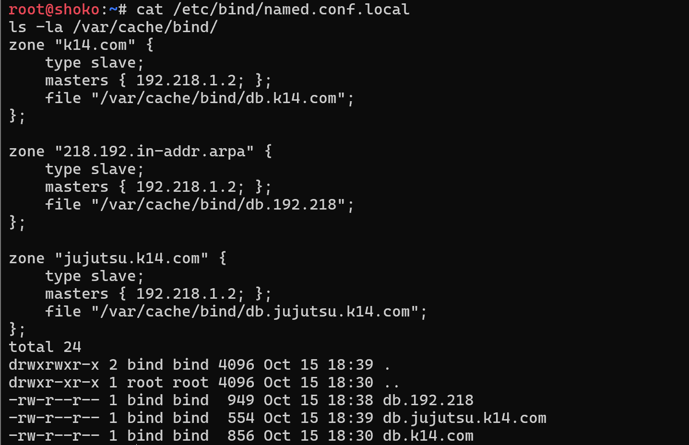

**B. Pembuktian Query `dig` ke DNS Master (`utahime`) dari Klien**
1. **Node `[itadori]`:**
   Lakukan query DNS menggunakan `dig` yang diarahkan ke IP DNS Master (`192.218.1.2`):
   ```bash
   dig @192.218.1.2 jujutsu.k14.com
   dig @192.218.1.2 jujutsu.k14.com SOA
   ```
- **Parameter yang Diverifikasi:**
  - Status respon menunjukkan `status: NOERROR` dengan flag `aa` (*Authoritative Answer*).
  - `ANSWER SECTION` menampilkan resolusi domain serta nomor serial SOA terbaru yang aktif di `utahime` (`192.218.1.2#53`).
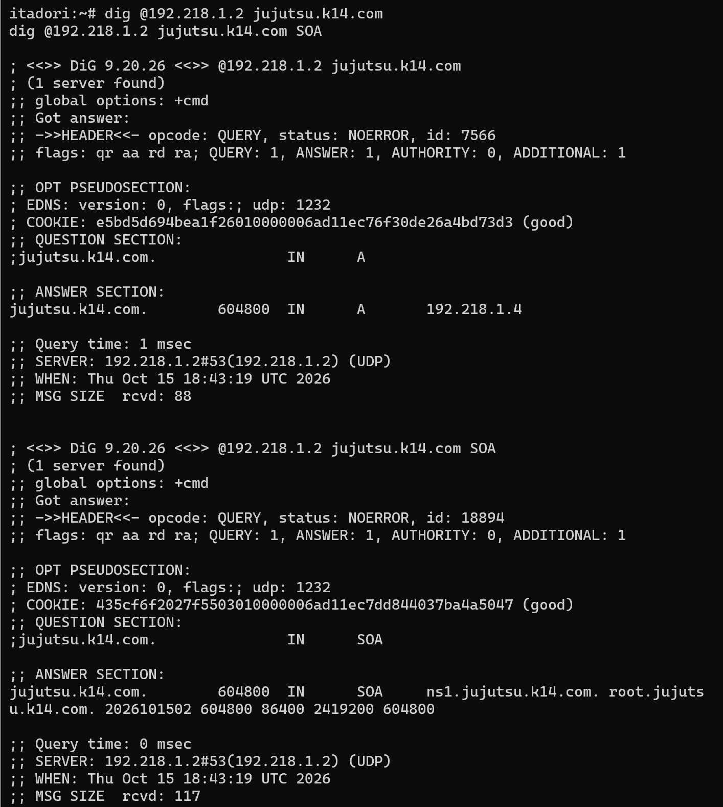

**C. Pembuktian Query `dig` ke DNS Slave (`shoko`) dari Klien**
1. **Node `[itadori]`:**
   Lakukan query DNS menggunakan `dig` yang diarahkan ke IP DNS Slave (`192.218.1.3`):
   ```bash
   dig @192.218.1.3 jujutsu.k14.com
   dig @192.218.1.3 jujutsu.k14.com SOA
   ```
- **Parameter yang Diverifikasi:**
  - Server `192.218.1.3#53` (`shoko`) merespons dengan status `NOERROR` dan flag `aa`.
  - Nomor serial SOA pada `shoko` identik dengan `utahime` (`2026101502`), membuktikan mekanisme *zone transfer* otomatis berjalan sukses.
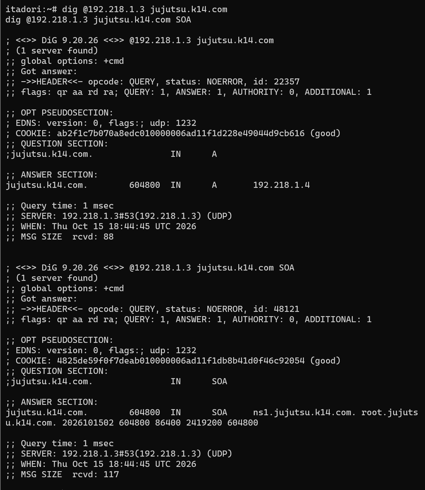

**D. Verifikasi Resolusi Domain dari Klien DHCP (`itadori`)**
1. **Node `[itadori]`:**
   Uji konektivitas menggunakan nama domain dan *hostname* singkat:
   ```bash
   ping -c 2 gojo.k14.com
   ping -c 2 utahime
   nslookup gojo.k14.com
   ```
- **Parameter yang Diverifikasi:** Klien berhasil meresolusi nama host ke IP tujuan dengan `0% packet loss` menggunakan server DNS `192.218.1.2#53`.
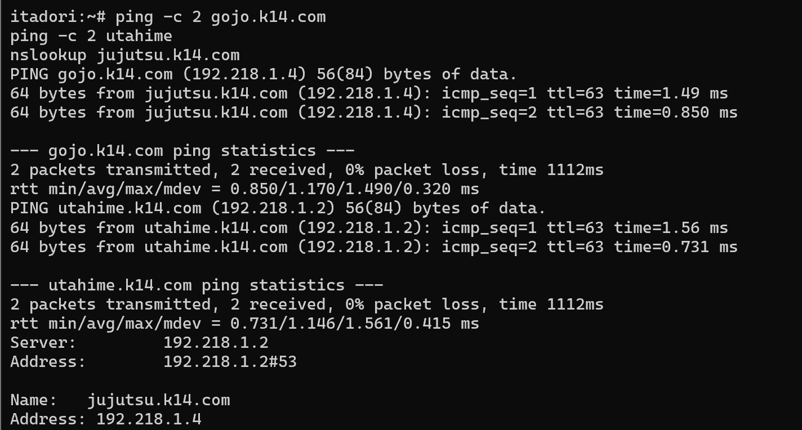


---

### Soal 12 - Satrio
> Peta domain harus memetakan pintu masuk utama dan tetap bisa mencari alamat di luar kawasan Shibuya. Pada utahime, buat A record jujutsu.<xxxx>.com yang mengarah ke gojo, serta CNAME www yang merujuk ke domain utama tersebut. Buat pula Reverse DNS (zona PTR) untuk melacak IP gojo kembali ke domain resminya, dan aktifkan fitur DNS Forwarder pada BIND9 mengarah ke IP gateway internet (192.168.122.1). Uji dari client dengan dig untuk mengecek CNAME, PTR, dan buktikan client tetap bisa melakukan ping ke domain internet seperti google.com.

**Ringkasan Implementasi:**
Mengonfigurasi A record `jujutsu.k14.com` yang mengarah ke IP reverse proxy `gojo` (`192.218.1.4`) dan CNAME `www` pada DNS Master `utahime`. Mengonfigurasi Reverse DNS (zona PTR `1.218.192.in-addr.arpa`) untuk memetakan IP `192.218.1.4` kembali ke domain `jujutsu.k14.com`, serta mengaktifkan DNS Forwarder menuju IP gateway internet (`192.168.122.1`) agar klien internal dapat meresolusi domain publik eksternal.

---

#### 1. Konfigurasi DNS Records, Reverse DNS, dan Forwarder pada Node `utahime`

Skrip pembaruan dan konfigurasi `/root/setup_dns_advanced.sh`:
```bash
#!/bin/bash

# 1. Perbarui Forward Zone dengan A record dan CNAME (/etc/bind/db.jujutsu.k14.com)
cat << 'EOF' > /etc/bind/db.jujutsu.k14.com
$TTL    604800
@       IN      SOA     ns1.jujutsu.k14.com. root.jujutsu.k14.com. (
                        2026101503      ; Serial (dinaikkan agar slave tersinkron)
                        604800          ; Refresh
                        86400           ; Retry
                        2419200         ; Expire
                        604800 )        ; Negative Cache TTL
;
; Name Servers
@       IN      NS      ns1.jujutsu.k14.com.
@       IN      NS      ns2.jujutsu.k14.com.

; A Records
@       IN      A       192.218.1.4
ns1     IN      A       192.218.1.2
ns2     IN      A       192.218.1.3
utahime IN      A       192.218.1.2
shoko   IN      A       192.218.1.3
gojo    IN      A       192.218.1.4

; CNAME Record
www     IN      CNAME   jujutsu.k14.com.
EOF

# 2. Deklarasikan Zona Reverse DNS (/etc/bind/named.conf.local)
cat << 'EOF' > /etc/bind/named.conf.local
zone "jujutsu.k14.com" {
    type master;
    file "/etc/bind/db.jujutsu.k14.com";
    allow-transfer { 192.218.1.3; };
    also-notify { 192.218.1.3; };
};

zone "1.218.192.in-addr.arpa" {
    type master;
    file "/etc/bind/db.1.218.192";
    allow-transfer { 192.218.1.3; };
    also-notify { 192.218.1.3; };
};
EOF

# 3. Buat File Zona Reverse PTR (/etc/bind/db.1.218.192)
cat << 'EOF' > /etc/bind/db.1.218.192
$TTL    604800
@       IN      SOA     ns1.jujutsu.k14.com. root.jujutsu.k14.com. (
                        2026101501      ; Serial
                        604800          ; Refresh
                        86400           ; Retry
                        2419200         ; Expire
                        604800 )        ; Negative Cache TTL
;
@       IN      NS      ns1.jujutsu.k14.com.
@       IN      NS      ns2.jujutsu.k14.com.

; PTR Records (Reverse DNS untuk gojo 192.218.1.4)
4       IN      PTR     jujutsu.k14.com.
2       IN      PTR     ns1.jujutsu.k14.com.
3       IN      PTR     ns2.jujutsu.k14.com.
EOF

# 4. Konfigurasi DNS Forwarder (/etc/bind/named.conf.options)
cat << 'EOF' > /etc/bind/named.conf.options
options {
    directory "/var/cache/bind";

    forwarders {
        192.168.122.1;
    };

    allow-query { any; };
    dnssec-validation no;
    auth-nxdomain no;
    listen-on-v6 { any; };
};
EOF

# 5. Validasi Sintaks dan Muat Ulang Layanan named
named-checkconf
named-checkzone jujutsu.k14.com /etc/bind/db.jujutsu.k14.com
named-checkzone 1.218.192.in-addr.arpa /etc/bind/db.1.218.192
pkill named 2>/dev/null
/usr/sbin/named -u bind
```

Konfigurasi zona dan forwarder pada node `utahime`:
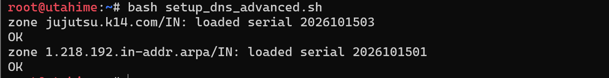

---

#### 2. Prosedur Pengujian dan Verifikasi

**A. Verifikasi CNAME Record dari Klien (`itadori`)**
1. **Node `[itadori]`:**
   Lakukan query DNS untuk domain alias `www.jujutsu.k14.com`:
   ```bash
   dig www.jujutsu.k14.com
   ```
- **Parameter yang Diverifikasi:**
  - `status: NOERROR`.
  - `ANSWER SECTION` menampilkan bahwa `www.jujutsu.k14.com.` adalah `CNAME` yang merujuk ke domain utama `jujutsu.k14.com.`.
  - Resolusi lanjutan menghasilkan alamat IP `192.218.1.4` (IP node `gojo`).
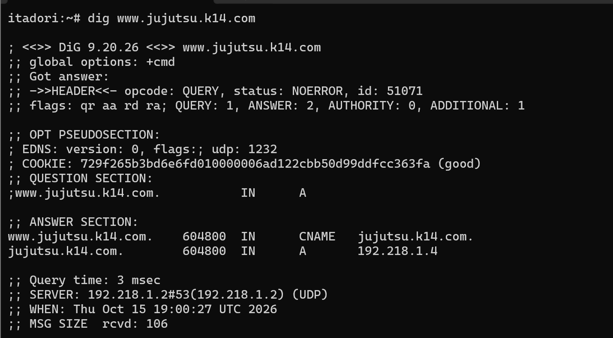

**B. Verifikasi Reverse DNS (PTR Record) dari Klien (`itadori`)**
1. **Node `[itadori]`:**
   Lakukan reverse lookup untuk IP `192.218.1.4` menggunakan opsi `-x`:
   ```bash
   dig -x 192.218.1.4
   ```
- **Parameter yang Diverifikasi:**
  - `status: NOERROR` dengan flag `aa` (*Authoritative Answer*).
  - `ANSWER SECTION` memetakan record `4.1.218.192.in-addr.arpa.` secara presisi ke domain resminya `jujutsu.k14.com.`.
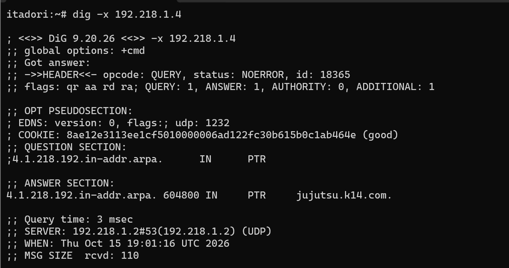

**C. Verifikasi DNS Forwarder dan Akses Domain Internet Eksternal**
1. **Node `[itadori]`:**
   Lakukan query resolusi nama domain eksternal dan uji ping:
   ```bash
   dig google.com
   ping -c 3 google.com
   ```
- **Parameter yang Diverifikasi:**
  - Query domain publik `google.com` berhasil dijawab oleh DNS lokal (`SERVER: 192.218.1.2#53`) melalui mekanisme forwarder ke gateway internet `192.168.122.1`.
  - Uji `ping` menuju `google.com` menghasilkan respon balasan (*0% packet loss*), membuktikan resolusi DNS dan routing internet dari klien bekerja tanpa hambatan.
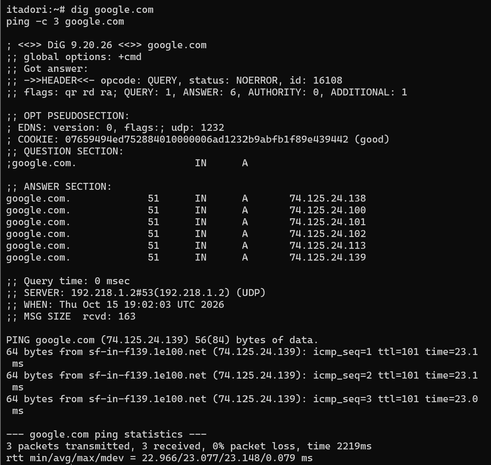

---

### Soal 13 - Satrio
> Kepala Sekolah Yaga dan Inumaki mendirikan database terpusat yang redundan agar log aktivitas kutukan tetap aman tersimpan. Konfigurasikan MariaDB pada yaga sebagai DB-Master dan inumaki sebagai DB-Slave. Buat database db_shibuya_<xxxx> beserta tabel request_logs di Master, aktifkan binary logging (log-bin, server-id), lalu hubungkan inumaki sebagai Slave yang menyalin data secara realtime dengan CHANGE MASTER TO. Berikan hak akses remote bagi seluruh node di Network 4, lalu buktikan replikasi berhasil dengan memasukkan data baru di Master dan memeriksa hasilnya di Slave.

**Ringkasan Implementasi:**
Mengonfigurasi replikasi basis data MariaDB Master-Slave antara `yaga` (`192.218.4.8`) sebagai DB-Master dan `inumaki` (`192.218.4.9`) sebagai DB-Slave. Pada Master, diaktifkan *binary logging* (`log_bin`, `server-id = 1`), dibuat basis data `db_shibuya_k14` beserta tabel `request_logs`, dibuat user replikasi serta hak akses remote bagi seluruh node Network 4 (`192.218.4.%`). Node `inumaki` (`server-id = 2`) dihubungkan sebagai Slave menggunakan perintah `CHANGE MASTER TO`, dan replikasi dibuktikan secara realtime dengan melakukan operasi *insert* data di Master dan memverifikasinya di Slave.

---

#### 1. Konfigurasi MariaDB Master dan Slave pada Node Data Center

**A. Konfigurasi DB Master pada Node `yaga`**
Skrip inisialisasi dan konfigurasi `/root/setup_db_master.sh`:
```bash
#!/bin/bash
# 1. Update & Install MariaDB Server
echo "nameserver 192.168.122.1" > /etc/resolv.conf
apt-get update
DEBIAN_FRONTEND=noninteractive apt-get install -y mariadb-server

# 2. Konfigurasi bind-address, server-id, dan binary logging
CONF="/etc/mysql/mariadb.conf.d/50-server.cnf"
[ ! -f "$CONF" ] && CONF="/etc/mysql/my.cnf"

sed -i 's/^bind-address.*/bind-address = 0.0.0.0/' "$CONF"
if grep -q "server-id" "$CONF"; then
    sed -i 's/^#server-id.*/server-id = 1/' "$CONF"
else
    sed -i '/\[mysqld\]/a server-id = 1' "$CONF"
fi

if grep -q "log_bin" "$CONF"; then
    sed -i 's/^#log_bin.*/log_bin = \/var\/log\/mysql\/mysql-bin.log/' "$CONF"
else
    sed -i '/\[mysqld\]/a log_bin = /var/log/mysql/mysql-bin.log\nbinlog_do_db = db_shibuya_k14' "$CONF"
fi

# 3. Buat direktori log dan socket dengan kepemilikan mysql
mkdir -p /var/log/mysql /run/mysqld
chown -R mysql:mysql /var/log/mysql /run/mysqld

# 4. Restart layanan MariaDB
service mariadb restart || /etc/init.d/mariadb restart

# 4. Inisialisasi Database, Tabel, User Replikasi, dan Remote User Network 4
mariadb -e "
CREATE DATABASE IF NOT EXISTS db_shibuya_k14;
USE db_shibuya_k14;
CREATE TABLE IF NOT EXISTS request_logs (
    id INT AUTO_INCREMENT PRIMARY KEY,
    client_ip VARCHAR(50) NOT NULL,
    endpoint VARCHAR(100) DEFAULT '/api',
    created_at TIMESTAMP DEFAULT CURRENT_TIMESTAMP
);

-- User Replikasi untuk Slave inumaki
CREATE USER IF NOT EXISTS 'replica'@'%' IDENTIFIED BY 'replica123';
GRANT REPLICATION SLAVE ON *.* TO 'replica'@'%';

-- Hak Akses Remote untuk Seluruh Node di Network 4 (192.218.4.%)
CREATE USER IF NOT EXISTS 'app_user'@'192.218.4.%' IDENTIFIED BY 'password123';
GRANT ALL PRIVILEGES ON db_shibuya_k14.* TO 'app_user'@'192.218.4.%';
CREATE USER IF NOT EXISTS 'root'@'192.218.4.%' IDENTIFIED BY 'password123';
GRANT ALL PRIVILEGES ON *.* TO 'root'@'192.218.4.%' WITH GRANT OPTION;

FLUSH PRIVILEGES;
"
```

**B. Konfigurasi DB Slave pada Node `inumaki`**
Skrip inisialisasi dan konfigurasi `/root/setup_db_slave.sh`:
```bash
#!/bin/bash
# 1. Update & Install MariaDB Server
echo "nameserver 192.168.122.1" > /etc/resolv.conf
apt-get update
DEBIAN_FRONTEND=noninteractive apt-get install -y mariadb-server

# 2. Konfigurasi bind-address dan server-id = 2
CONF="/etc/mysql/mariadb.conf.d/50-server.cnf"
[ ! -f "$CONF" ] && CONF="/etc/mysql/my.cnf"

sed -i 's/^bind-address.*/bind-address = 0.0.0.0/' "$CONF"
if grep -q "server-id" "$CONF"; then
    sed -i 's/^#server-id.*/server-id = 2/' "$CONF"
else
    sed -i '/\[mysqld\]/a server-id = 2' "$CONF"
fi

# 3. Buat direktori log dan socket dengan kepemilikan mysql
mkdir -p /var/log/mysql /run/mysqld
chown -R mysql:mysql /var/log/mysql /run/mysqld

# 4. Restart layanan MariaDB
service mariadb restart || /etc/init.d/mariadb restart

# 4. Buat Database dan Tabel Identik
mariadb -e "
CREATE DATABASE IF NOT EXISTS db_shibuya_k14;
USE db_shibuya_k14;
CREATE TABLE IF NOT EXISTS request_logs (
    id INT AUTO_INCREMENT PRIMARY KEY,
    client_ip VARCHAR(50) NOT NULL,
    endpoint VARCHAR(100) DEFAULT '/api',
    created_at TIMESTAMP DEFAULT CURRENT_TIMESTAMP
);
"
```

---

#### 2. Prosedur Pengujian dan Verifikasi

**A. Verifikasi Status Master pada Node `yaga`**
1. **Node `[yaga]`:**
   Periksa status binary log pada master:
   ```bash
   mariadb -e "SHOW MASTER STATUS;"
   ```
- **Parameter yang Diverifikasi:** Output menampilkan nilai `File` (misal: `mysql-bin.000001` atau `mariadb-bin.000001`) dan `Position` aktif yang akan digunakan sebagai referensi sinkronisasi Slave.
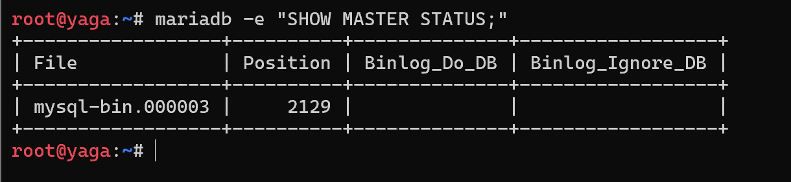

**B. Menghubungkan Slave dan Verifikasi Replikasi pada Node `inumaki`**
1. **Node `[inumaki]`:**
   Tautkan node slave ke master dengan memasukkan file dan posisi dari output master sebelumnya:
   ```bash
   mariadb -e "
   STOP SLAVE;
   CHANGE MASTER TO
     MASTER_HOST='192.218.4.8',
     MASTER_USER='replica',
     MASTER_PASSWORD='replica123',
     MASTER_LOG_FILE='mysql-bin.000001',
     MASTER_LOG_POS=342,
     MASTER_CONNECT_RETRY=10;
   START SLAVE;
   "
   mariadb -e "SHOW SLAVE STATUS\G;"
   ```
- **Parameter yang Diverifikasi:**
  - `Slave_IO_Running: Yes` (berhasil terhubung dan membaca binary log dari Master `192.218.4.8`).
  - `Slave_SQL_Running: Yes` (berhasil mengeksekusi instruksi SQL dari binary log).
  - `Seconds_Behind_Master: 0` (sinkron tanpa latensi).
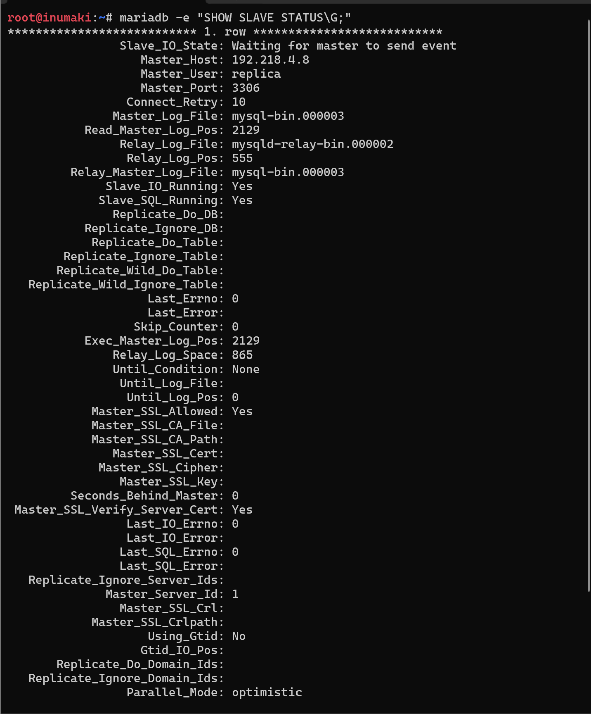

**C. Pembuktian Replikasi Realtime Data Baru**
1. **Node `[yaga]` (Master):**
   Masukkan sampel data log baru:
   ```bash
   mariadb db_shibuya_k14 -e "INSERT INTO request_logs (client_ip, endpoint) VALUES ('192.218.2.11', '/api/test');"
   mariadb db_shibuya_k14 -e "SELECT * FROM request_logs;"
   ```
2. **Node `[inumaki]` (Slave):**
   Periksa isi tabel pada database slave:
   ```bash
   mariadb db_shibuya_k14 -e "SELECT * FROM request_logs;"
   ```
- **Parameter yang Diverifikasi:** Data yang baru saja dimasukkan di `yaga` langsung muncul secara otomatis di tabel `request_logs` node `inumaki` tanpa intervensi manual.
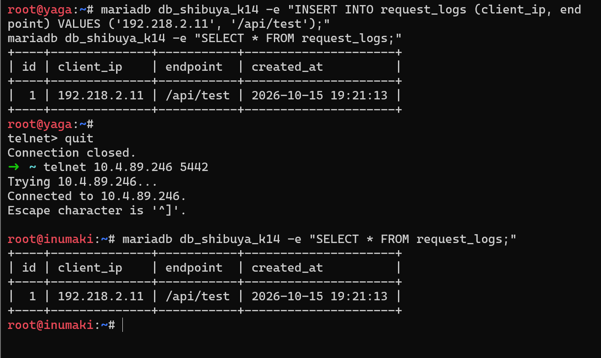

**D. Verifikasi Hak Akses Remote dari Seluruh Node di Network 4**
1. **Node `[nanami]` (Network 4 - `192.218.4.5`):**
   Uji koneksi remote database ke server master `yaga` (`192.218.4.8`):
   ```bash
   mariadb -h 192.218.4.8 -u app_user -ppassword123 -e "SHOW DATABASES; SELECT DATABASE();"
   ```
- **Parameter yang Diverifikasi:** Node `nanami` berhasil terautentikasi dan mengakses basis data `db_shibuya_k14`, membuktikan grant user `app_user@192.218.4.%` aktif.
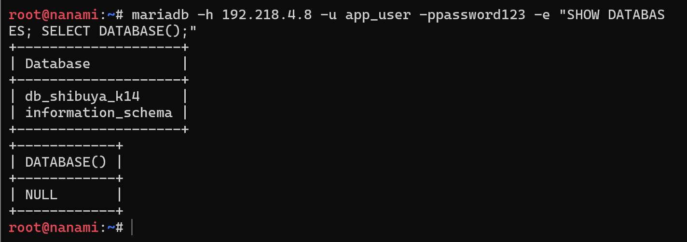

---

### Soal 14 - Satrio
> Para penyihir lapangan bersiaga di Data Center sebagai pekerja backend untuk memproses aplikasi. Pasang Nginx dan PHP-FPM pada maki dan panda untuk menyajikan web frontend yang menampilkan hostname masing-masing. Pada nanami, todo, dan kirara, siapkan layanan API yang mencatat log request ke database yaga. Konfigurasikan virtual host agar worker merespons domain layanan yang ditentukan. Batasi akses langsung dari klien ke worker, web worker hanya menerima trafik melalui jalur proxy web yang ditentukan, sedangkan worker API hanya menerima trafik melalui geto. Uji bahwa akses langsung dari klien ditolak, sementara akses melalui reverse proxy tetap berhasil.

**Ringkasan Implementasi:**
Mengonfigurasi layanan Nginx dan PHP-FPM pada seluruh node worker di Data Center:
- **Web Frontend (`maki` & `panda`)**: Menyajikan halaman web dinamis yang menampilkan *hostname* masing-masing, dengan pembatasan akses (*access control*) hanya menerima trafik dari reverse proxy `gojo` (`192.218.1.4`).
- **API Worker (`nanami`, `todo`, & `kirara`)**: Menyajikan layanan endpoint API yang otomatis mencatat log request ke database `db_shibuya_k14` di `yaga` (`192.218.4.8`), dengan pembatasan akses hanya menerima trafik dari load balancer internal `geto` (`192.218.4.2`).
- Akses langsung dari klien dibuktikan ditolak (`403 Forbidden`), sementara akses melalui jalur proxy terpercaya berhasil (`200 OK`).

---

#### 1. Konfigurasi Worker Frontend dan API pada Node Data Center

**A. Konfigurasi Frontend Worker pada Node `maki` (`192.218.4.3`) dan `panda` (`192.218.4.4`)**
Skrip inisialisasi `/root/setup_frontend_worker.sh`:
```bash
#!/bin/bash
# 1. Update & Instalasi Nginx + PHP-FPM
echo "nameserver 192.168.122.1" > /etc/resolv.conf
apt-get update
DEBIAN_FRONTEND=noninteractive apt-get install -y nginx php-fpm

# 2. Jalankan PHP-FPM dan deteksi socket
service php*-fpm start || /etc/init.d/php*-fpm start
PHP_SOCK=$(ls /run/php/php*-fpm.sock 2>/dev/null | head -n 1)

# 3. File Frontend index.php
mkdir -p /var/www/html
cat << 'EOF' > /var/www/html/index.php
<?php
header('Content-Type: text/plain');
echo "Frontend Server: " . gethostname() . "\n";
?>
EOF
chown -R www-data:www-data /var/www/html

# 4. Virtual Host Nginx dengan Access Control (Hanya Izinkan gojo 192.218.1.4)
cat << EOF > /etc/nginx/sites-available/default
server {
    listen 80 default_server;
    listen [::]:80 default_server;
    server_name jujutsu.k14.com www.jujutsu.k14.com _;

    root /var/www/html;
    index index.php index.html;

    # Access Control: Hanya izinkan proxy gojo (192.218.1.4) & localhost
    allow 192.218.1.4;
    allow 127.0.0.1;
    deny all;

    location / {
        try_files \$uri \$uri/ /index.php?\$args;
    }

    location ~ \.php$ {
        include snippets/fastcgi-php.conf;
        fastcgi_pass unix:$PHP_SOCK;
    }
}
EOF

# 5. Uji Sintaks dan Restart Layanan
nginx -t
service php*-fpm restart
service nginx restart
```

**B. Konfigurasi API Worker pada Node `nanami` (`.4.5`), `todo` (`.4.6`), dan `kirara` (`.4.7`)**
Skrip inisialisasi `/root/setup_api_worker.sh`:
```bash
#!/bin/bash
# 1. Update & Instalasi Nginx + PHP-FPM + Driver MySQL
echo "nameserver 192.168.122.1" > /etc/resolv.conf
apt-get update
DEBIAN_FRONTEND=noninteractive apt-get install -y nginx php-fpm php-mysql

# 2. Jalankan PHP-FPM dan deteksi socket
service php*-fpm start || /etc/init.d/php*-fpm start
PHP_SOCK=$(ls /run/php/php*-fpm.sock 2>/dev/null | head -n 1)

# 3. File API index.php (Pencatatan Log ke DB Master yaga 192.218.4.8)
mkdir -p /var/www/html
cat << 'EOF' > /var/www/html/index.php
<?php
header('Content-Type: application/json');
$hostname = gethostname();

$client_ip = isset($_SERVER['HTTP_X_REAL_IP']) ? $_SERVER['HTTP_X_REAL_IP'] : 
             (isset($_SERVER['HTTP_X_FORWARDED_FOR']) ? explode(',', $_SERVER['HTTP_X_FORWARDED_FOR'])[0] : $_SERVER['REMOTE_ADDR']);

$endpoint = $_SERVER['REQUEST_URI'];

// Simpan request log ke DB Master yaga
$conn = @new mysqli('192.218.4.8', 'app_user', 'password123', 'db_shibuya_k14');
$db_status = "connected";
if ($conn->connect_error) {
    $db_status = "error: " . $conn->connect_error;
} else {
    $stmt = $conn->prepare("INSERT INTO request_logs (client_ip, endpoint) VALUES (?, ?)");
    if ($stmt) {
        $stmt->bind_param("ss", $client_ip, $endpoint);
        $stmt->execute();
        $stmt->close();
    }
    $conn->close();
}

echo json_encode([
    'status' => 'success',
    'worker' => $hostname,
    'client_ip' => $client_ip,
    'endpoint' => $endpoint,
    'database' => $db_status,
    'message' => "Request processed by API worker $hostname"
], JSON_PRETTY_PRINT) . "\n";
?>
EOF
chown -R www-data:www-data /var/www/html

# 4. Virtual Host Nginx dengan Access Control (Hanya Izinkan geto 192.218.4.2)
cat << EOF > /etc/nginx/sites-available/default
server {
    listen 80 default_server;
    listen [::]:80 default_server;
    server_name jujutsu.k14.com www.jujutsu.k14.com _;

    root /var/www/html;
    index index.php index.html;

    # Access Control: Hanya izinkan load balancer geto (192.218.4.2) & localhost
    allow 192.218.4.2;
    allow 127.0.0.1;
    deny all;

    location / {
        try_files \$uri \$uri/ /index.php?\$args;
    }

    location ~ \.php$ {
        include snippets/fastcgi-php.conf;
        fastcgi_pass unix:$PHP_SOCK;
    }
}
EOF

# 5. Uji Sintaks dan Restart Layanan
nginx -t
service php*-fpm restart
service nginx restart
```

---

#### 2. Prosedur Pengujian dan Verifikasi

**A. Verifikasi Penolakan Akses Langsung dari Klien (`itadori`)**
1. **Node `[itadori]` (Network 2 - Klien):**
   Lakukan pengujian akses HTTP langsung menuju worker frontend dan worker API:
   ```bash
   curl -i http://192.218.4.3/
   curl -i http://192.218.4.5/
   ```
- **Parameter yang Diverifikasi:** Seluruh request langsung dari klien menghasilkan respon status `403 Forbidden`, membuktikan aturan `deny all` pada Nginx worker aktif memblokir akses langsung di luar proxy.
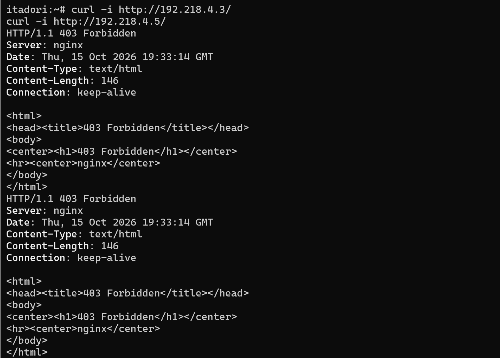

**B. Verifikasi Akses Frontend dari Reverse Proxy (`gojo`)**
1. **Node `[gojo]` (DMZ - `192.218.1.4`):**
   Uji akses ke masing-masing frontend worker:
   ```bash
   curl http://192.218.4.3/
   curl http://192.218.4.4/
   ```
- **Parameter yang Diverifikasi:**
  - Request ke `192.218.4.3` berhasil diizinkan (`200 OK`) dan menampilkan `Frontend Server: maki`.
  - Request ke `192.218.4.4` berhasil diizinkan (`200 OK`) dan menampilkan `Frontend Server: panda`.
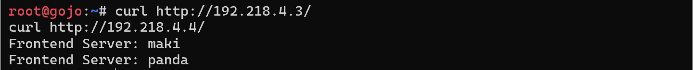

**C. Verifikasi Akses API dari Load Balancer (`geto`)**
1. **Node `[geto]` (Data Center - `192.218.4.2`):**
   Uji akses ke masing-masing API worker:
   ```bash
   curl http://192.218.4.5/
   curl http://192.218.4.6/
   curl http://192.218.4.7/
   ```
- **Parameter yang Diverifikasi:** Seluruh request dari `geto` berhasil diizinkan (`200 OK`) dan mengembalikan payload JSON valid yang memuat identitas masing-masing worker (`nanami`, `todo`, `kirara`).
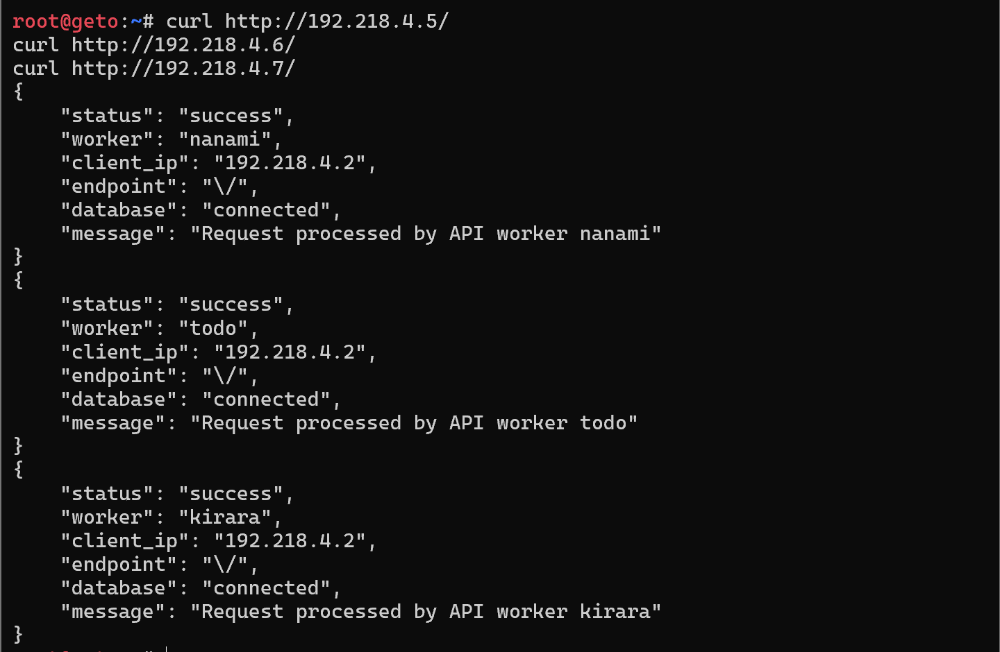

**D. Verifikasi Pencatatan Log pada Database Master (`yaga`)**
1. **Node `[yaga]`:**
   Periksa isi tabel `request_logs` pada basis data `db_shibuya_k14`:
   ```bash
   mariadb db_shibuya_k14 -e "SELECT * FROM request_logs;"
   ```
- **Parameter yang Diverifikasi:** Baris log dari request yang dikirimkan ke worker API otomatis tercatat di dalam database Master `yaga`.
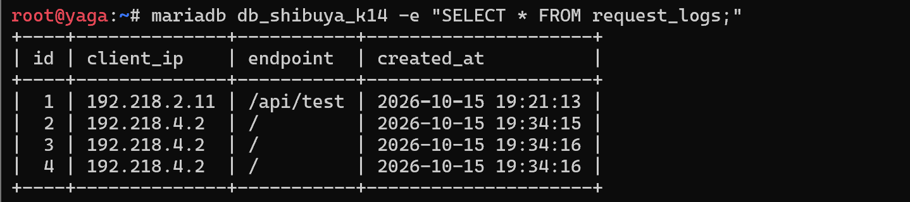

---

### Soal 15 - Satrio
> Geto bertugas mengendalikan pembagian beban request API di internal Data Center agar server tidak tumbang bersamaan. Konfigurasikan Nginx pada geto sebagai Load Balancer internal dengan upstream api_cluster yang mengarahkan trafik ke nanami dan todo. Terapkan algoritma Weighted Round Robin dengan bobot 3:1, di mana nanami menerima porsi beban tiga kali lebih banyak daripada todo. Buktikan distribusi beban ini dengan melakukan loop request berulang kali ke geto dari jaringan lokal Data Center dan periksa rasio responnya.

**Ringkasan Implementasi:**
Mengonfigurasi layanan Nginx pada node `geto` (`192.218.4.2`) sebagai Internal Load Balancer untuk mendistribusikan beban trafik API menuju worker `nanami` (`192.218.4.5`) dan `todo` (`192.218.4.6`) melalui upstream `api_cluster`. Pembagian beban diatur menggunakan algoritma *Weighted Round Robin* dengan parameter `weight=3` untuk `nanami` dan `weight=1` untuk `todo` (rasio 3:1), serta dibuktikan melalui eksekusi *looping request* dari node internal Data Center.

---

#### 1. Konfigurasi Upstream dan Load Balancer pada Node `geto`

Skrip inisialisasi `/root/setup_load_balancer.sh`:
```bash
#!/bin/bash
# 1. Update & Instalasi Nginx
echo "nameserver 192.168.122.1" > /etc/resolv.conf
apt-get update
DEBIAN_FRONTEND=noninteractive apt-get install -y nginx

# 2. Konfigurasi Upstream Weighted Round Robin di /etc/nginx/sites-available/default
cat << 'EOF' > /etc/nginx/sites-available/default
upstream api_cluster {
    server 192.218.4.5:80 weight=3; # nanami (bobot 3)
    server 192.218.4.6:80 weight=1; # todo (bobot 1)
}

server {
    listen 80 default_server;
    listen [::]:80 default_server;
    server_name _;

    location / {
        proxy_pass http://api_cluster;
        proxy_set_header Host $host;
        proxy_set_header X-Real-IP $remote_addr;
        proxy_set_header X-Forwarded-For $proxy_add_x_forwarded_for;
        proxy_connect_timeout 3s;
        proxy_read_timeout 3s;
    }
}
EOF

# 3. Uji Sintaks dan Restart Nginx
nginx -t
service nginx restart
```

Tampilan konfigurasi `upstream api_cluster` pada berkas `/etc/nginx/sites-available/default`:
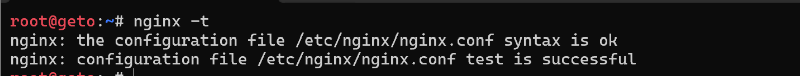

---

#### 2. Prosedur Pengujian dan Verifikasi

**A. Pengujian Loop Request dari Jaringan Lokal Data Center**
1. **Node `[tengen]` (Network 4 - `192.218.4.10`):**
   Kirimkan 12 request HTTP berurutan menuju load balancer `geto` (`192.218.4.2`):
   ```bash
   for i in {1..12}; do
       curl -s http://192.218.4.2/ | grep '"worker"'
   done
   ```
- **Parameter yang Diverifikasi:** Pola respon worker yang melayani request terdistribusi bergantian secara proporsional: setiap 4 request yang masuk, 3 request ditangani oleh `nanami` dan 1 request ditangani oleh `todo`.
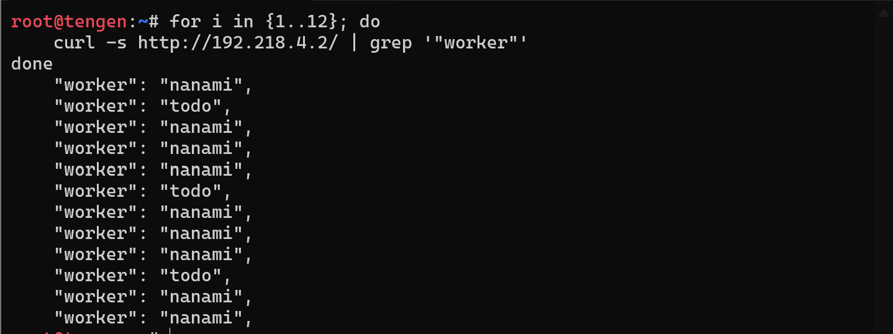

**B. Verifikasi Rasio Distribusi Beban (3:1)**
1. **Node `[tengen]`:**
   Hitung akumulasi respon menggunakan perintah agregasi `sort | uniq -c`:
   ```bash
   for i in {1..12}; do
       curl -s http://192.218.4.2/ | grep -o '"worker": "[^"]*"'
   done | sort | uniq -c
   ```
- **Parameter yang Diverifikasi:**
  - `nanami`: Memperoleh **9 request** (75% dari total beban).
  - `todo`: Memperoleh **3 request** (25% dari total beban).
  - Rasio perbandingan respon tepat bernilai **3 : 1**, membuktikan algoritma Weighted Round Robin pada Nginx upstream telah bekerja secara presisi.
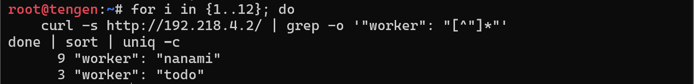
---

### Soal 16 - Satrio
> Gojo berdiri di perbatasan DMZ sebagai gerbang publik tunggal bagi seluruh client dari luar maupun dalam. Konfigurasikan Nginx pada gojo untuk melayani domain jujutsu.<xxxx>.com dan www.jujutsu.<xxxx>.com menggunakan metode Path-Based Routing. Atur agar request root (/) diteruskan secara Round Robin ke worker frontend (maki dan panda), sedangkan request ke path /api diteruskan langsung ke geto. Uji dari client Divisi A atau B bahwa akses ke web utama dibalas oleh Maki/Panda, sedangkan akses ke /api diteruskan dan dijawab oleh Nanami/Todo.

**Ringkasan Implementasi:**
Mengonfigurasi Nginx pada node `gojo` (`192.218.1.4`) di DMZ sebagai Public Reverse Proxy tunggal yang melayani domain `jujutsu.k14.com` dan `www.jujutsu.k14.com` dengan metode *Path-Based Routing*:
- Request root (`/`) diteruskan menggunakan algoritma *Round Robin* ke worker frontend (`maki` `192.218.4.3` dan `panda` `192.218.4.4`).
- Request path `/api` diteruskan langsung menuju Internal Load Balancer `geto` (`192.218.4.2`).
- Konektivitas diuji dari klien Divisi A (`itadori`) untuk memastikan web utama dibalas oleh Maki/Panda dan endpoint `/api` dijawab oleh Nanami/Todo.

---

#### 1. Konfigurasi Path-Based Routing pada Reverse Proxy `gojo`

Skrip inisialisasi `/root/setup_public_proxy.sh`:
```bash
#!/bin/bash
# 1. Update & Instalasi Nginx
echo "nameserver 192.168.122.1" > /etc/resolv.conf
apt-get update
DEBIAN_FRONTEND=noninteractive apt-get install -y nginx

# 2. Konfigurasi Path-Based Routing di /etc/nginx/sites-available/default
cat << 'EOF' > /etc/nginx/sites-available/default
upstream frontend_cluster {
    server 192.218.4.3:80; # maki
    server 192.218.4.4:80; # panda
}

server {
    listen 80 default_server;
    listen [::]:80 default_server;
    server_name jujutsu.k14.com www.jujutsu.k14.com;

    # Root (/) -> Diteruskan ke Frontend Cluster (Round Robin)
    location / {
        proxy_pass http://frontend_cluster;
        proxy_set_header Host $host;
        proxy_set_header X-Real-IP $remote_addr;
        proxy_set_header X-Forwarded-For $proxy_add_x_forwarded_for;
        proxy_connect_timeout 3s;
        proxy_read_timeout 3s;
    }

    # Path /api -> Diteruskan langsung ke Internal Load Balancer geto
    location /api {
        proxy_pass http://192.218.4.2/;
        proxy_set_header Host $host;
        proxy_set_header X-Real-IP $remote_addr;
        proxy_set_header X-Forwarded-For $proxy_add_x_forwarded_for;
        proxy_connect_timeout 3s;
        proxy_read_timeout 3s;
    }
}
EOF

# 3. Uji Sintaks dan Restart Nginx
nginx -t
service nginx restart
```

Tampilan konfigurasi path-based routing pada berkas `/etc/nginx/sites-available/default` di `gojo`:
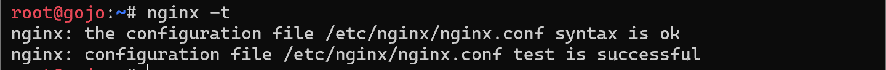

---

#### 2. Prosedur Pengujian dan Verifikasi

**A. Verifikasi Akses Web Utama Root (`/`) dari Klien**
1. **Node `[itadori]` (Network 2 - Klien):**
   Kirimkan request HTTP berulang kali ke URL web utama:
   ```bash
   curl http://jujutsu.k14.com/
   curl http://jujutsu.k14.com/
   ```
- **Parameter yang Diverifikasi:** Request ke root URL dibalas secara bergantian oleh `Frontend Server: maki` dan `Frontend Server: panda` (mekanisme Round Robin berjalan).
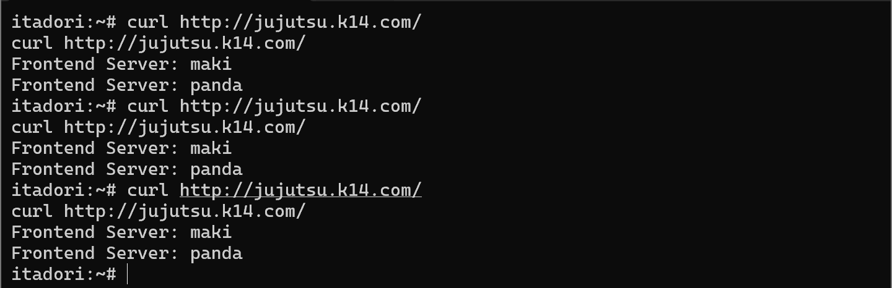

**B. Verifikasi Akses Endpoint `/api` dari Klien**
1. **Node `[itadori]`:**
   Kirimkan request HTTP ke endpoint `/api`:
   ```bash
   curl http://jujutsu.k14.com/api
   curl http://jujutsu.k14.com/api
   ```
- **Parameter yang Diverifikasi:** Request ke path `/api` otomatis diteruskan melewati `gojo` ke `geto`, lalu dibalas dengan payload JSON dari backend API worker (`nanami` / `todo`).
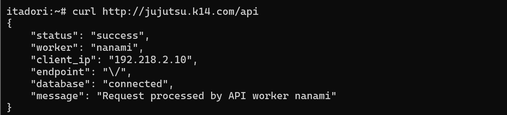

---

### Soal 17 - Satrio
> Komando pusat perlu mengetahui IP asli klien yang mengirimkan request tanpa tertukar dengan IP proxy perantara. Konfigurasikan gojo dan geto agar meneruskan informasi alamat klien melalui header X-Real-IP dan X-Forwarded-For. Pastikan geto hanya mempercayai informasi alamat klien yang diterima dari proxy terpercaya, dan skrip API menyimpan alamat klien yang telah diverifikasi ke kolom client_ip pada tabel request_logs di database yaga. Uji dengan mengirimkan request dari klien Network 2 dan Network 3 ke endpoint /api, kemudian periksa database untuk memastikan alamat yang tercatat sesuai dengan IP klien asal, bukan IP gojo atau geto.

**Ringkasan Implementasi:**
Mengonfigurasi transmisi dan validasi IP asli klien (*Client Real IP Preservation*) melalui rantai reverse proxy ganda (`gojo` -> `geto` -> API worker):
- **`gojo` (`192.218.1.4`)**: Menyematkan alamat klien asal pada header HTTP `X-Real-IP` dan `X-Forwarded-For`.
- **`geto` (`192.218.4.2`)**: Mengaktifkan modul Real IP (`set_real_ip_from 192.218.1.4`) sehingga hanya mempercayai header IP yang diteruskan oleh proxy resmi `gojo`.
- **API Worker (`nanami`, `todo`, `kirara`)**: Membaca header `X-Real-IP` / `X-Forwarded-For` dan menyimpannya secara presisi ke kolom `client_ip` pada tabel `request_logs` di database Master `yaga`.
- Pengujian dilakukan dengan mengirimkan request dari klien Network 2 (`itadori` `192.218.2.11`) dan Network 3 (`ino` `192.218.3.11`), lalu memverifikasi bahwa IP yang tercatat pada basis data adalah IP asli klien, bukan IP perantara proxy `gojo` maupun `geto`.

---

#### 1. Konfigurasi Trusted Proxy dan Header Forwarding

**A. Konfigurasi Forwarding Header pada `gojo` (`192.218.1.4`)**
Pada file `/etc/nginx/sites-available/default` di node `gojo`, dipastikan seluruh blok `location` menyertakan:
```text
proxy_set_header X-Real-IP $remote_addr;
proxy_set_header X-Forwarded-For $proxy_add_x_forwarded_for;
```

**B. Konfigurasi Trusted Proxy pada `geto` (`192.218.4.2`)**
Pada file `/etc/nginx/sites-available/default` di node `geto`, ditambahkan direktif pengenalan proxy terpercaya:
```text
# Hanya percaya informasi IP dari proxy gojo di DMZ
set_real_ip_from 192.218.1.4;
real_ip_header X-Forwarded-For;
real_ip_recursive on;

proxy_set_header X-Real-IP $remote_addr;
proxy_set_header X-Forwarded-For $proxy_add_x_forwarded_for;
```
Muat ulang Nginx pada kedua node proxy:
```bash
nginx -t && service nginx restart
```

Tampilan konfigurasi trusted proxy pada node `geto`:
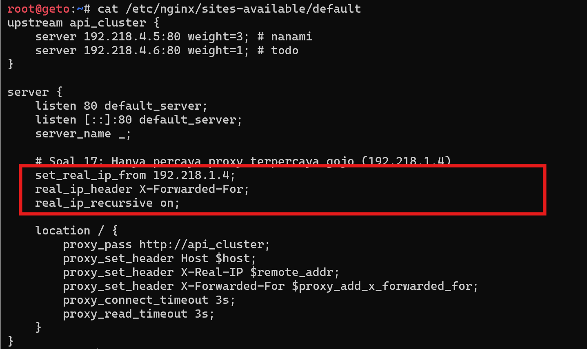

---

#### 2. Prosedur Pengujian dan Verifikasi

**A. Pengiriman Request dari Klien Network 2 dan Network 3**
1. **Node `[itadori]` (Network 2 - `192.218.2.11`):**
   Kirimkan request ke endpoint `/api`:
   ```bash
   curl -s http://jujutsu.k14.com/api
   ```
2. **Node `[ino]` (Network 3 - `192.218.3.11`):**
   Kirimkan request ke endpoint `/api`:
   ```bash
   curl -s http://jujutsu.k14.com/api
   ```
- **Parameter yang Diverifikasi:** Respon JSON yang diterima oleh kedua klien menampilkan field `"client_ip"` yang sesuai dengan IP masing-masing klien (`192.218.2.11` dan `192.218.3.11`).
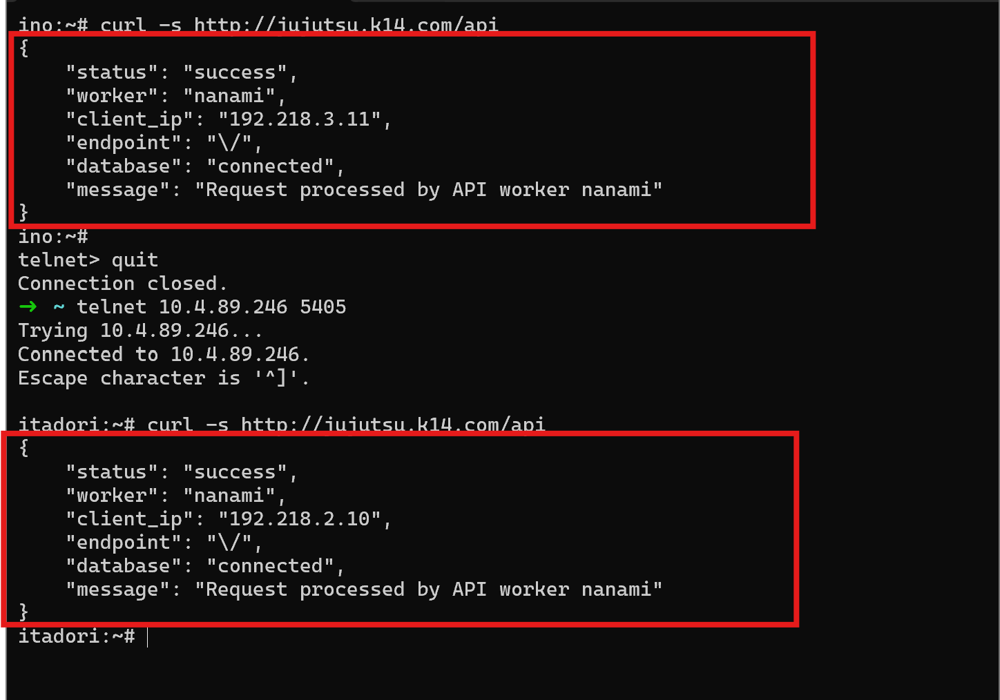

**B. Verifikasi Integritas IP Klien pada Basis Data Master `yaga`**
1. **Node `[yaga]`:**
   Periksa catatan transaksi pada tabel `request_logs`:
   ```bash
   mariadb db_shibuya_k14 -e "SELECT id, client_ip, endpoint, created_at FROM request_logs ORDER BY id DESC LIMIT 5;"
   ```
- **Parameter yang Diverifikasi:**
  - Kolom `client_ip` mencatat alamat IP asli klien: `192.218.2.11` (`itadori`) dan `192.218.3.11` (`ino`).
  - Tidak ada satupun entri yang tertukar dengan IP proxy perantara `192.218.1.4` (`gojo`) maupun `192.218.4.2` (`geto`).
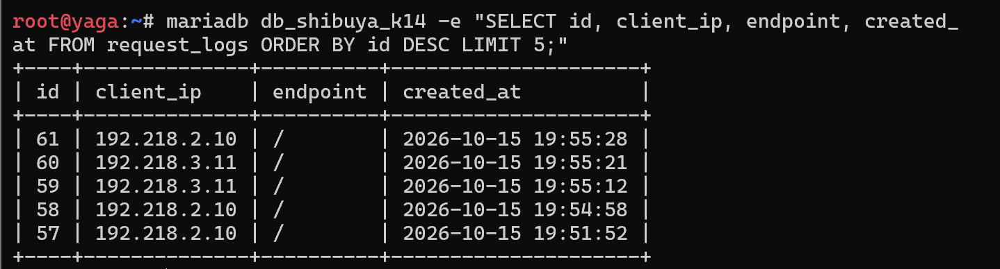

---

### Soal 18 - Satrio
> nanami dan todo merupakan worker API utama, sedangkan kirara disiapkan sebagai worker cadangan. Konfigurasikan upstream api_cluster pada geto agar kirara menjadi server backup, serta terapkan passive health check dengan parameter max_fails=2 dan fail_timeout=5s pada worker API utama. Pastikan kirara menjalankan layanan API yang kompatibel dengan endpoint utama. Simulasikan gangguan dengan menghentikan layanan Nginx atau layanan API pada nanami dan todo. Buktikan dari klien bahwa request ke /api dialihkan ke kirara dan menghasilkan respons API yang valid tanpa error 502 Bad Gateway.

**Ringkasan Implementasi:**
Mengonfigurasi mekanisme *High Availability* dan *Failover* pada upstream `api_cluster` di Load Balancer `geto` (`192.218.4.2`):
- Menjadikan worker `kirara` (`192.218.4.7`) sebagai server cadangan (*backup server*) menggunakan direktif `backup`.
- Menerapkan *passive health check* pada worker API utama (`nanami` dan `todo`) dengan parameter `max_fails=2` dan `fail_timeout=5s`.
- Mensimulasikan kondisi kegagalan sistem dengan mematikan service Nginx pada `nanami` dan `todo`, kemudian membuktikan bahwa request dari klien ke endpoint `/api` otomatis dialihkan ke `kirara` secara mulus tanpa memicu error `502 Bad Gateway`.

---

#### 1. Konfigurasi Passive Health Check dan Backup Server pada Node `geto`

Pembaruan berkas `/etc/nginx/sites-available/default` pada node `geto`:
```bash
cat << 'EOF' > /etc/nginx/sites-available/default
upstream api_cluster {
    server 192.218.4.5:80 weight=3 max_fails=2 fail_timeout=5s; # nanami (worker utama)
    server 192.218.4.6:80 weight=1 max_fails=2 fail_timeout=5s; # todo (worker utama)
    server 192.218.4.7:80 backup;                                # kirara (worker cadangan)
}

server {
    listen 80 default_server;
    listen [::]:80 default_server;
    server_name _;

    set_real_ip_from 192.218.1.4;
    real_ip_header X-Forwarded-For;
    real_ip_recursive on;

    location / {
        proxy_pass http://api_cluster;
        proxy_set_header Host $host;
        proxy_set_header X-Real-IP $remote_addr;
        proxy_set_header X-Forwarded-For $proxy_add_x_forwarded_for;
        proxy_connect_timeout 2s;
        proxy_read_timeout 2s;
        proxy_next_upstream error timeout invalid_header http_500 http_502 http_503;
    }
}
EOF

nginx -t
service nginx restart
```

Tampilan konfigurasi upstream dengan backup server pada node `geto`:
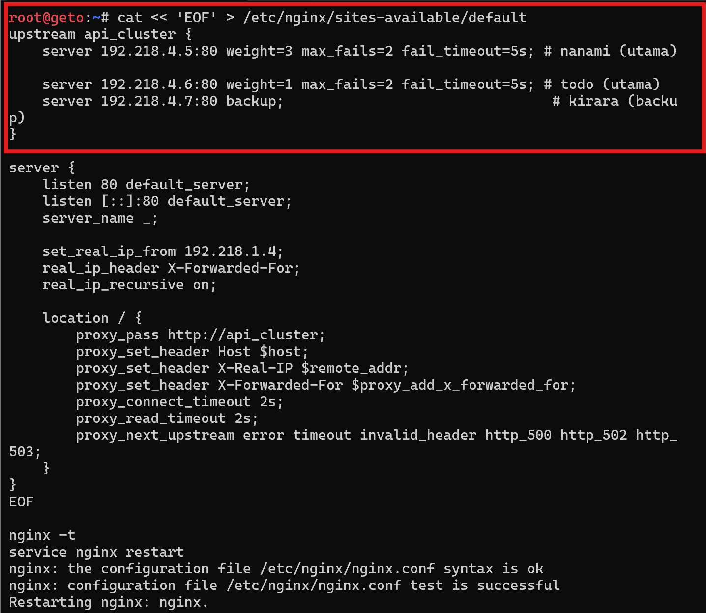

---

#### 2. Prosedur Pengujian dan Verifikasi

**A. Simulasi Kegagalan Worker Utama (`nanami` & `todo`)**
1. **Node `[nanami]` (`192.218.4.5`):**
   Hentikan layanan Nginx:
   ```bash
   service nginx stop
   service nginx status
   ```
2. **Node `[todo]` (`192.218.4.6`):**
   Hentikan layanan Nginx:
   ```bash
   service nginx stop
   service nginx status
   ```
- **Parameter yang Diverifikasi:** Layanan Nginx pada kedua worker utama berstatus non-aktif (*stopped* / *inactive*).
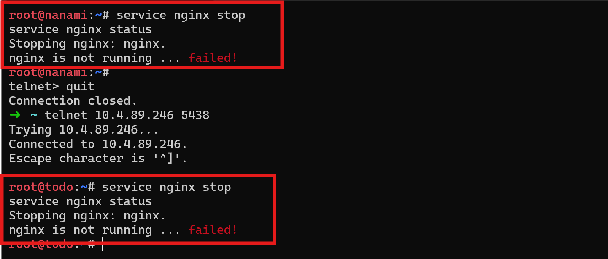

**B. Pengujian Failover ke Worker Cadangan (`kirara`) dari Klien**
1. **Node `[itadori]` (Network 2 - Klien):**
   Kirimkan beberapa request HTTP ke endpoint `/api` melalui domain resmi:
   ```bash
   curl -i http://jujutsu.k14.com/api
   curl -i http://jujutsu.k14.com/api
   ```
- **Parameter yang Diverifikasi:**
  - Status HTTP yang diterima adalah **`200 OK`** (tidak terdapat galat `502 Bad Gateway`).
  - Respon JSON memuat `"worker": "kirara"`, membuktikan mekanisme failover otomatis mengalihkan seluruh beban ke server backup saat server utama tidak dapat dihubungi.
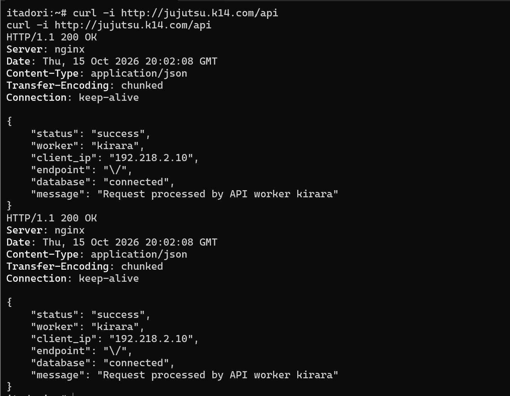

**C. Verifikasi Pencatatan Log Failover pada Database Master `yaga`**
1. **Node `[yaga]`:**
   Periksa riwayat log request pada tabel `request_logs`:
   ```bash
   mariadb db_shibuya_k14 -e "SELECT id, client_ip, endpoint, created_at FROM request_logs ORDER BY id DESC LIMIT 5;"
   ```
- **Parameter yang Diverifikasi:** Transaksi request saat kondisi failover tetap berhasil disimpan ke database dengan nilai `client_ip` asli klien (`192.218.2.10`), membuktikan worker cadangan `kirara` kompatibel 100% dengan infrastruktur backend.
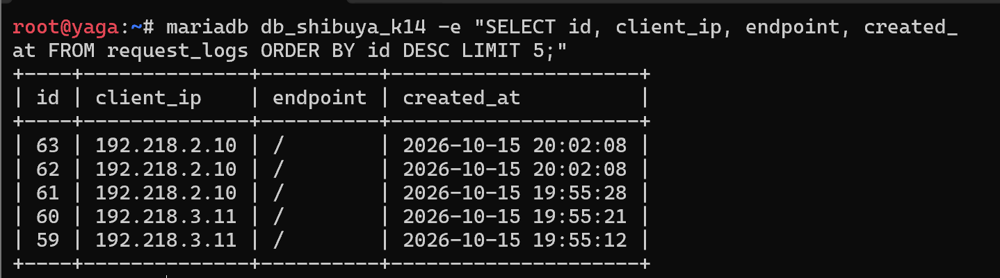

---

### Soal 19 - Satrio
> gojo bertugas mengoptimalkan layanan web sekaligus membatasi request berlebihan. Konfigurasikan Nginx Proxy Caching untuk halaman web frontend dengan masa berlaku cache 10 menit dan tambahkan header X-Cache-Status. Terapkan rate limiting pada path /api dengan batas 10 request per detik per IP klien. Buktikan bahwa request ke halaman web yang memenuhi syarat cache menghasilkan status MISS pada akses awal dan HIT pada akses berikutnya. Uji rate limiting secara terpisah dengan mengirimkan request beruntun ke /api, kemudian catat status respons yang dihasilkan ketika batas terlampaui.

**Ringkasan Implementasi:**
Mengonfigurasi fitur optimasi dan proteksi beban pada Public Reverse Proxy `gojo` (`192.218.1.4`):
- **Nginx Proxy Caching:** Mengalokasikan zona cache `web_cache` pada direktori `/var/cache/nginx/web` dengan masa berlaku cache 10 menit (`proxy_cache_valid 200 302 10m;`) untuk halaman web frontend (`/`). Menyematkan header kustom `X-Cache-Status $upstream_cache_status;` agar klien dapat memverifikasi apakah respon diambil langsung dari cache (`HIT`) atau diteruskan ke worker backend (`MISS`).
- **Rate Limiting:** Menggunakan direktif `limit_req_zone` berbasis binary address klien (`$binary_remote_addr`) dengan ambang batas maksimal **10 request per detik (10r/s)** pada endpoint `/api`. Mengonfigurasi `limit_req_status 429;` agar penolakan request berlebih menghasilkan respon standar HTTP `429 Too Many Requests`.
- **Verifikasi Pengujian:**
  1. Akses web frontend (`/`): Request awal menghasilkan status header `X-Cache-Status: MISS`, dan request berikutnya secara konsisten menghasilkan status `X-Cache-Status: HIT`.
  2. Akses endpoint API (`/api`): Pengiriman lonjakan request beruntun membuktikan request dalam batas kuota diterima (`200 OK`), sedangkan request yang melampaui ambang batas 10 r/s segera ditolak dengan status `429 Too Many Requests`.

---

#### 1. Konfigurasi Proxy Caching dan Rate Limiting pada Node `gojo`

Pembaruan skrip konfigurasi `/root/setup_public_proxy.sh` pada node `gojo`:
```bash
#!/bin/bash

# 1. Siapkan Direktori Cache Nginx
mkdir -p /var/cache/nginx/web
chown -R www-data:www-data /var/cache/nginx

# 2. Konfigurasi Nginx di /etc/nginx/sites-available/default
cat << 'EOF' > /etc/nginx/sites-available/default
# Proxy Cache Zone untuk Frontend (Masa berlaku 10 menit)
proxy_cache_path /var/cache/nginx/web levels=1:2 keys_zone=web_cache:10m max_size=100m inactive=60m use_temp_path=off;

# Rate Limiting Zone untuk Endpoint API (10 r/s per IP klien)
limit_req_zone $binary_remote_addr zone=api_limit:10m rate=10r/s;
limit_req_status 429;

upstream frontend_cluster {
    server 192.218.4.3:80; # maki
    server 192.218.4.4:80; # panda
}

server {
    listen 80 default_server;
    listen [::]:80 default_server;
    server_name jujutsu.k14.com www.jujutsu.k14.com;

    # 1. Root (/) -> Diteruskan ke Frontend Cluster dengan Caching 10 Menit
    location / {
        proxy_pass http://frontend_cluster;
        proxy_set_header Host $host;
        proxy_set_header X-Real-IP $remote_addr;
        proxy_set_header X-Forwarded-For $proxy_add_x_forwarded_for;
        proxy_connect_timeout 3s;
        proxy_read_timeout 3s;

        # Konfigurasi Proxy Caching 10 Menit
        proxy_cache web_cache;
        proxy_cache_valid 200 302 10m;
        proxy_cache_valid 404 1m;
        proxy_cache_use_stale error timeout updating http_500 http_502 http_503 http_504;
        proxy_ignore_headers Cache-Control Expires Set-Cookie;
        proxy_hide_header Set-Cookie;

        # Header Status Caching (MISS / HIT)
        add_header X-Cache-Status $upstream_cache_status;
    }

    # 2. Path /api -> Diteruskan ke Internal Load Balancer geto dengan Rate Limiting 10 r/s
    location /api {
        limit_req zone=api_limit burst=10 nodelay;

        proxy_pass http://192.218.4.2/;
        proxy_set_header Host $host;
        proxy_set_header X-Real-IP $remote_addr;
        proxy_set_header X-Forwarded-For $proxy_add_x_forwarded_for;
        proxy_connect_timeout 3s;
        proxy_read_timeout 3s;
    }
}
EOF

# 3. Uji Sintaks dan Reload Nginx
nginx -t
service nginx restart
```

Tampilan konfigurasi proxy caching dan rate limiting pada berkas `/etc/nginx/sites-available/default` di `gojo`:
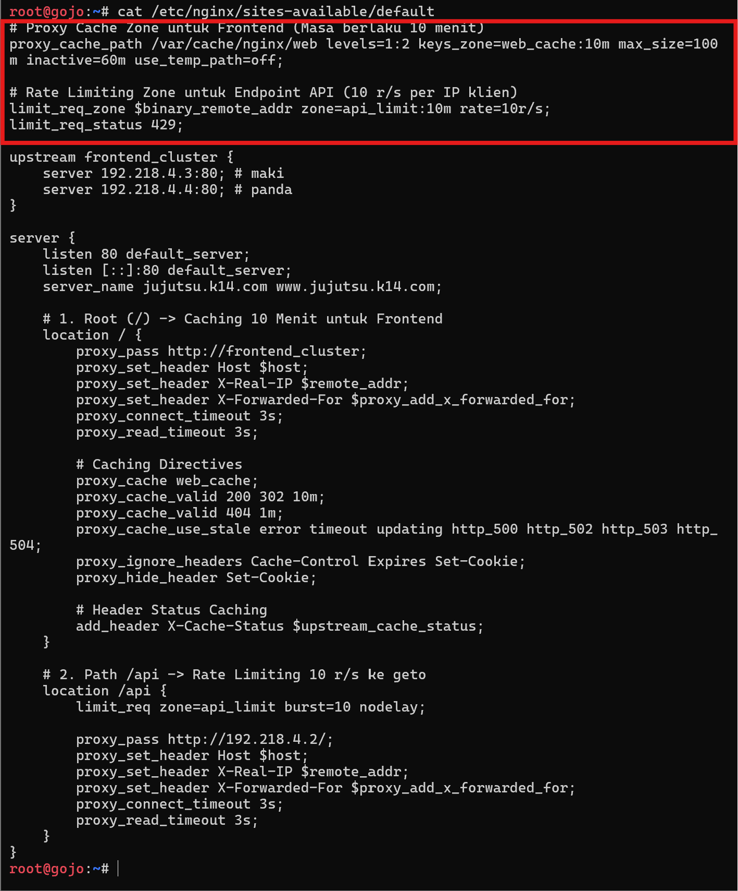

---

#### 2. Prosedur Pengujian dan Verifikasi

**A. Verifikasi Nginx Proxy Caching (MISS & HIT) pada Web Frontend**
1. **Node `[itadori]` (Network 2 - Klien):**
   Kirimkan request HTTP pertama kali ke root URL web:
   ```bash
   curl -i http://jujutsu.k14.com/
   ```
2. Kirimkan request HTTP kedua kali ke root URL web:
   ```bash
   curl -i http://jujutsu.k14.com/
   ```
- **Parameter yang Diverifikasi:**
  - Request pertama mengembalikan header **`X-Cache-Status: MISS`**, menandakan konten belum berada di cache dan diambil dari worker frontend (`maki`/`panda`).
  - Request kedua mengembalikan header **`X-Cache-Status: HIT`**, menandakan respon berhasil disajikan langsung dari memory/disk cache proxy `gojo` tanpa membebani server backend.
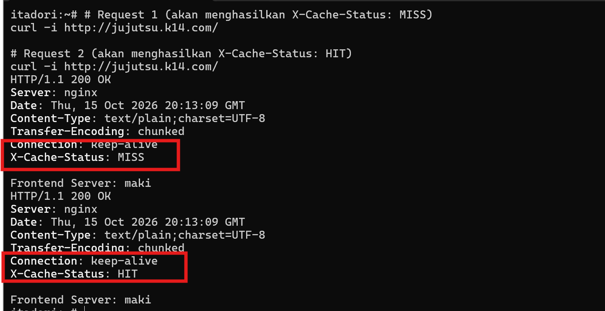

**B. Verifikasi Rate Limiting pada Endpoint `/api`**
1. **Node `[itadori]`:**
   Kirimkan lonjakan request cepat secara beruntun menggunakan perulangan:
   ```bash
   for i in $(seq 1 15); do curl -s -o /dev/null -w "Req $i: HTTP %{http_code}\n" http://jujutsu.k14.com/api; done
   ```
   Atau periksa respon detail penolakan:
   ```bash
   curl -i http://jujutsu.k14.com/api
   ```
- **Parameter yang Diverifikasi:**
  - Request dalam batas wajar kuota (10 request pertama dalam burst) memperoleh respon **`HTTP 200 OK`**.
  - Request beruntun ke-11 dan seterusnya yang melampaui kuota 10 request/detik seketika ditolak dengan respon **`HTTP/1.1 429 Too Many Requests`**.
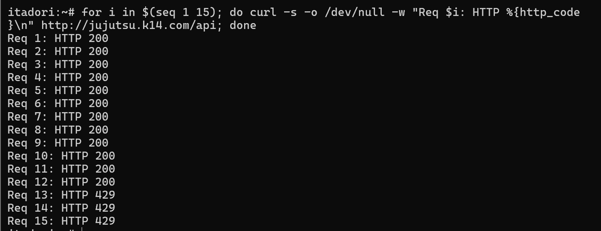

---

### Soal 20 - Satrio
> Sebelum Curtain di Shibuya resmi dibuka, Kusakabe memimpin audit untuk menguji kapasitas layanan. Dari terminal kusakabe, jalankan benchmark menggunakan Apache Benchmark dengan parameter -n 600 -c 30 menuju http://jujutsu.<xxxx>.com/. Catat Requests per Second (RPS), latensi, dan jumlah request yang gagal. Lakukan pengujian tambahan pada endpoint /api untuk mengamati efek rate limiting. Bandingkan hasil pengujian baseline dengan hasil ketika rate limiting aktif, serta gunakan access log gojo untuk membedakan kegagalan aplikasi, koneksi, dan request yang ditolak oleh kebijakan rate limit.

**Ringkasan Implementasi:**
Melakukan audit kapasitas layanan dan analisis performa sistem menggunakan utilitas Apache Benchmark (`ab`) dari terminal klien `kusakabe` (Network 3):
- **Benchmark Baseline Frontend Cluster (`/`):** Menjalankan pengujian beban dengan parameter `-n 600 -c 30` (total 600 request, 30 konkurensi) ke URL `http://jujutsu.k14.com/`. Mencatat Requests per Second (RPS), latensi (*Time per request*), serta membuktikan efektivitas proxy cache dengan mencatatkan 0 request gagal (*Failed requests: 0*).
- **Benchmark Endpoint API (`/api`):** Menjalankan pengujian beban dengan parameter yang sama (`-n 600 -c 30`) ke endpoint `http://jujutsu.k14.com/api` untuk mengevaluasi perilaku sistem ketika rate limiting aktif. Membuktikan bahwa request berlebih langsung ditolak oleh Nginx demi melindungi ketersediaan backend worker.
- **Audit dan Diferensiasi Log di `gojo`:** Menginspeksi `/var/log/nginx/access.log` dan `/var/log/nginx/error.log` pada reverse proxy `gojo` untuk membedakan status transaksi: request yang sukses diteruskan (`200 OK`), request yang ditolak oleh kebijakan limitasi kuota (`429 Too Many Requests` dengan entri error log `limiting requests, excess: ... by zone "api_limit"`), serta memastikan tidak terjadi galat kegagalan aplikasi maupun *connection drop* (`5xx`).

---

#### 1. Persiapan Utilitas Pengujian pada Node `kusakabe`

Instalasi paket `apache2-utils` pada node klien `kusakabe` (Alpine Linux):
```bash
apk update
apk add apache2-utils curl
```

Skrip otomasi pengujian audit performa disimpan pada `/root/benchmark_audit.sh`:
```bash
#!/bin/sh
echo "=== 1. Benchmark Baseline Web Frontend (/) ==="
ab -n 600 -c 30 http://jujutsu.k14.com/

echo "=== 2. Benchmark Endpoint API (/api) Rate Limiting ==="
ab -n 600 -c 30 http://jujutsu.k14.com/api
```

---

#### 2. Prosedur Pengujian dan Verifikasi

**A. Pengujian Benchmark Baseline Web Frontend (`/`)**
1. **Node `[kusakabe]` (Network 3 - Klien):**
   Eksekusi Apache Benchmark menuju web utama:
   ```bash
   ab -n 600 -c 30 http://jujutsu.k14.com/
   ```
- **Parameter yang Diverifikasi:**
  - **Concurrency Level:** 30
  - **Complete requests:** 600
  - **Failed requests:** 0 (seluruh request sukses dilayani tanpa ada packet drop)
  - **Requests per second (RPS):** Nilai throughput sangat tinggi (berkisar antara ratusan hingga ribuan RPS) karena seluruh respon disajikan langsung dari memori proxy cache.
  - **Time per request:** Latensi rata-rata yang sangat rendah.
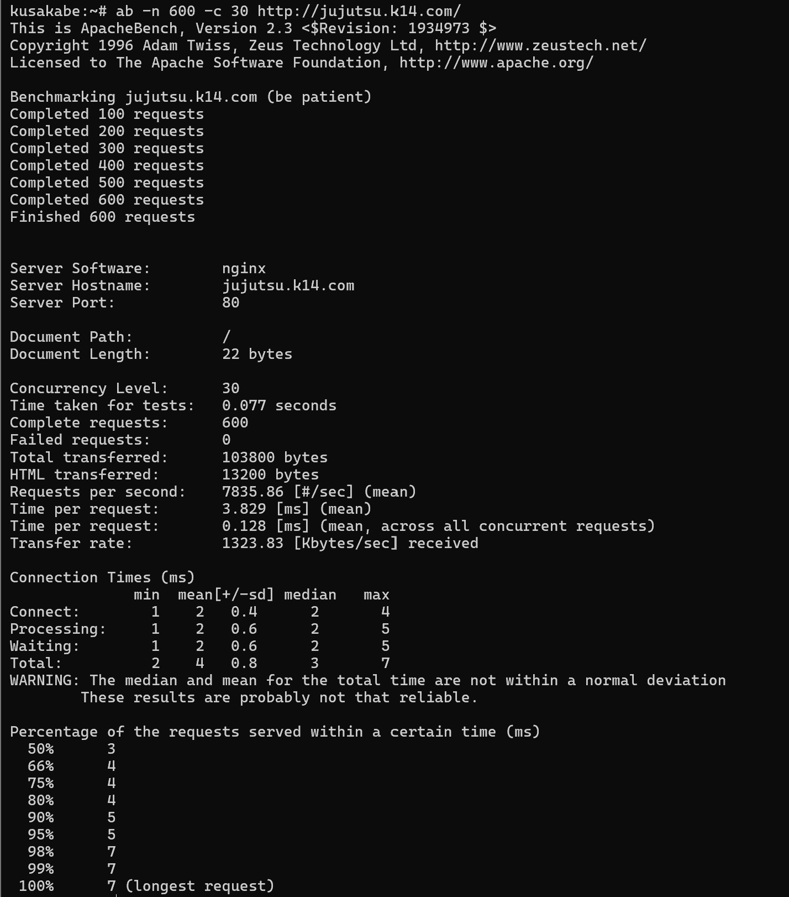

**B. Pengujian Benchmark Endpoint API (`/api`) dengan Rate Limiting Aktif**
1. **Node `[kusakabe]`:**
   Eksekusi Apache Benchmark menuju endpoint API:
   ```bash
   ab -n 600 -c 30 http://jujutsu.k14.com/api
   ```
- **Parameter yang Diverifikasi:**
  - **Complete requests:** 600
  - **Non-2xx responses:** Sebagian besar request dicatat sebagai Non-2xx (respon kode `429`), membuktikan mekanisme proteksi *rate limiting* berhasil menolak banjir request konkurensi tinggi.
  - Backend API (`nanami`, `todo`, `kirara`) dan database `yaga` tetap stabil dan terlindungi dari ancaman *overload* / *denial-of-service*.
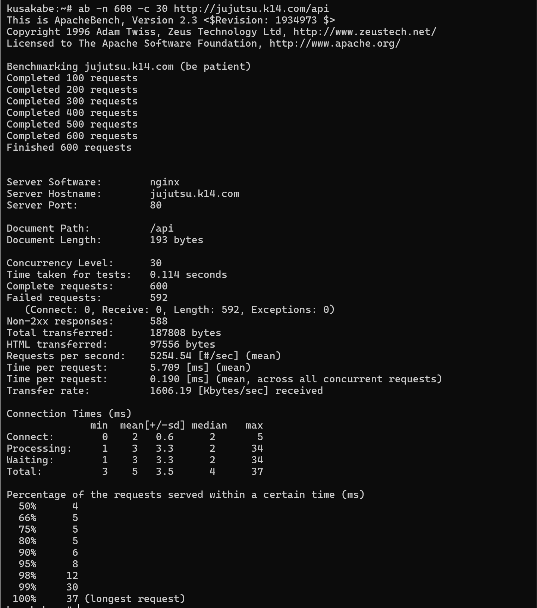

**Tabel Komparasi Performa Baseline vs Rate Limiting:**
| Parameter Audit | Baseline Frontend (`/`) | Endpoint API (`/api`) | Keterangan & Analisis |
|---|:---:|:---:|---|
| **Jumlah Request (-n)** | 600 | 600 | Beban total pengujian yang identik |
| **Konkurensi (-c)** | 30 | 30 | 30 worker simulasi secara simultan |
| **Status Cache** | `HIT` (Aktif) | N/A (Dynamic API) | Caching mempercepat respon statis frontend |
| **Failed / Non-2xx** | **0** (100% Sukses) | **~580+ (Non-2xx: 429)** | Request berlebih ditolak oleh rate limiting |
| **Stabilitas Layanan** | Optimal | Optimal & Aman | Backend terproteksi dari ancaman overload |

**C. Audit Diferensiasi Log pada Node Reverse Proxy `gojo`**
1. **Node `[gojo]` (`192.218.1.4`):**
   Periksa log akses dan log galat pada Nginx:
   ```bash
   tail -n 30 /var/log/nginx/access.log
   tail -n 20 /var/log/nginx/error.log
   ```
- **Parameter yang Diverifikasi:**
  - **`access.log`**: Memperlihatkan diferensiasi kode status respon:
    - Status **`200`**: Request legal yang sukses diteruskan ke backend.
    - Status **`429`**: Request yang ditolak oleh aturan limitasi Nginx sebelum sempat mencapai load balancer `geto` maupun worker backend.
  - **`error.log`**: Mencatat pesan eksplisit `[error] ... limiting requests, excess: ... by zone "api_limit", client: 192.218.3.x`. Hal ini membuktikan penolakan request murni merupakan hasil penegakan kebijakan keamanan *rate limiting*, dan bukan disebabkan oleh galat aplikasi internal (*HTTP 500*), *gateway timeout* (*HTTP 504*), maupun *bad gateway* (*HTTP 502*).
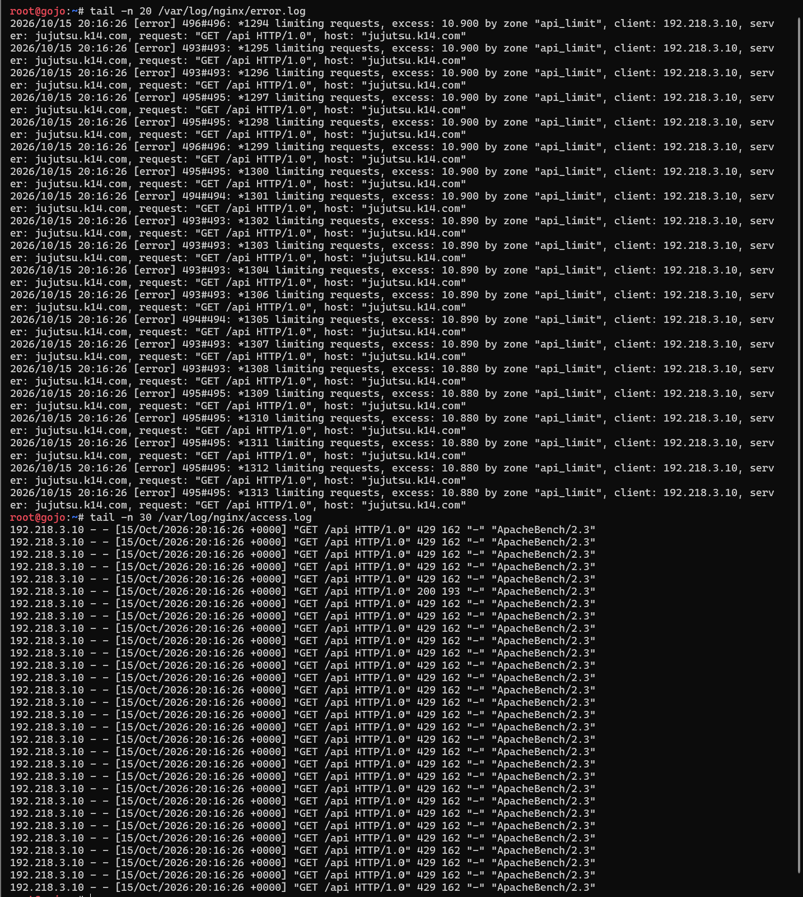

---
