# Jarkom-Modul-3-2026-K-14
|No|Nama Anggota|NRP|
|---|---|---|
|1|Muhammad Satrio Utomo|5027251022|
|2|Sebastian Elroi Hasian Panjaitan|5027251040|

## Pengerjaan

### Soal 1 - Satrio
> Ketika Curtain menutup Shibuya, jalur komunikasi antar zona Jujutsu High terputus. Pulihkan konektivitas dasar dengan mengonfigurasi jichi: eth0 memperoleh WAN dari NAT, sedangkan eth1-eth4 menjadi gateway Network 1-4 sesuai tabel pemetaan. Aktifkan IPv4 forwarding dan source NAT, lalu tetapkan IP statis host infrastruktur sesuai tabel spesifikasi. Buktikan konektivitas setiap host ke gateway dan akses eksternal dari host yang relevan.

Penyelesaian soal ini berfokus pada pembangunan fondasi infrastruktur jaringan utama dengan mengonfigurasi router utama `jichi`, menerapkan IP statis pada seluruh server infrastruktur (Network 1 DMZ dan Network 4 Data Center), serta mengaktifkan fungsi penerusan paket (*routing*) dan Source NAT (*MASQUERADE*) agar seluruh host internal dapat menjangkau internet luar melalui antarmuka WAN NAT1.

Prefix IP yang digunakan kelompok adalah `192.218.X.X`.

---

#### 1. Perancangan Topologi dan Antarmuka Router
Topologi dirancang dengan `jichi` sebagai router sentral yang menghubungkan 4 subnet internal dan 1 koneksi keluar ke NAT1:
- `eth0`: Antarmuka WAN terhubung ke `NAT1` (memperoleh IP dinamis dari DHCP NAT).
- `eth1`: Gateway Network 1 / DMZ (`192.218.1.1/24`).
- `eth2`: Gateway Network 2 / Divisi A (`192.218.2.1/24`).
- `eth3`: Gateway Network 3 / Divisi B (`192.218.3.1/24`).
- `eth4`: Gateway Network 4 / Data Center (`192.218.4.1/24`).

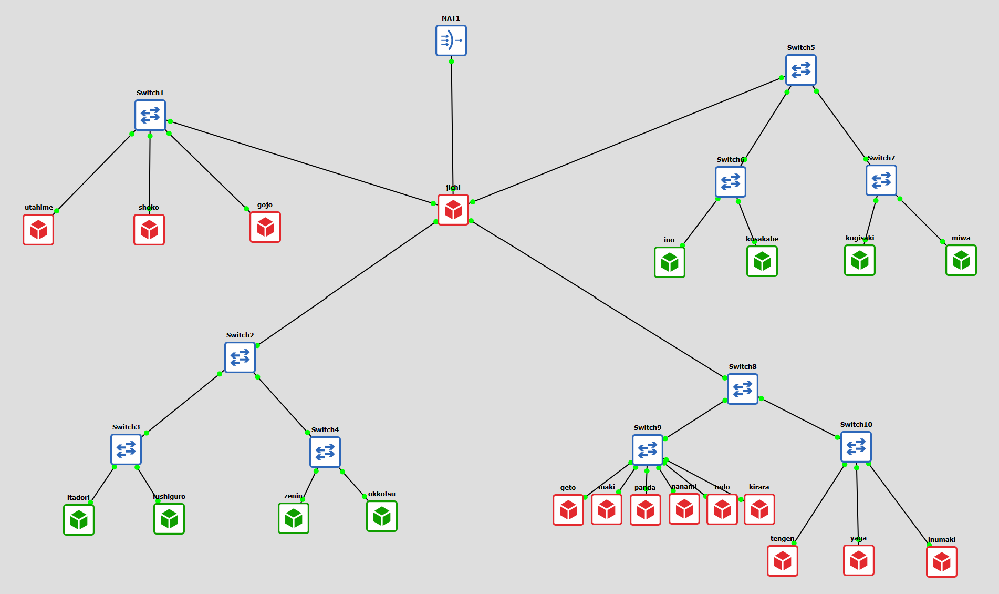

Konfigurasi antarmuka pada router `jichi` diatur melalui berkas `/etc/network/interfaces`:
```text
auto lo
iface lo inet loopback

auto eth0
iface eth0 inet dhcp

auto eth1
iface eth1 inet static
    address 192.218.1.1
    netmask 255.255.255.0

auto eth2
iface eth2 inet static
    address 192.218.2.1
    netmask 255.255.255.0

auto eth3
iface eth3 inet static
    address 192.218.3.1
    netmask 255.255.255.0

auto eth4
iface eth4 inet static
    address 192.218.4.1
    netmask 255.255.255.0
```
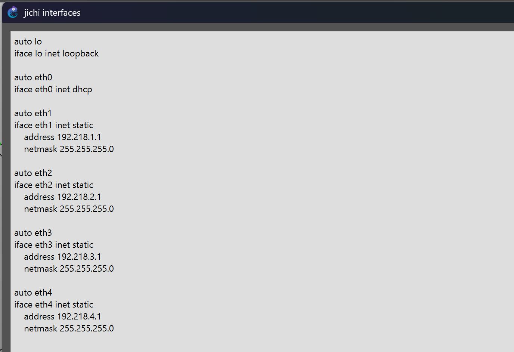

---

#### 2. Konfigurasi Routing dan Source NAT pada jichi
Agar `jichi` dapat meneruskan lalu lintas antar-subnet dan mentranslasikan alamat IP lokal ke antarmuka internet WAN, dibuat skrip pada `/root/setup_nat.sh`:

```bash
#!/bin/bash
# Meminta alokasi IP WAN dari NAT
dhclient eth0 2>/dev/null

# Mengaktifkan IPv4 Forwarding
sysctl -w net.ipv4.ip_forward=1

# Mengonfigurasi Source NAT (MASQUERADE) pada eth0
iptables -t nat -A POSTROUTING -o eth0 -j MASQUERADE
```
Eksekusi dan verifikasi aturan iptables:
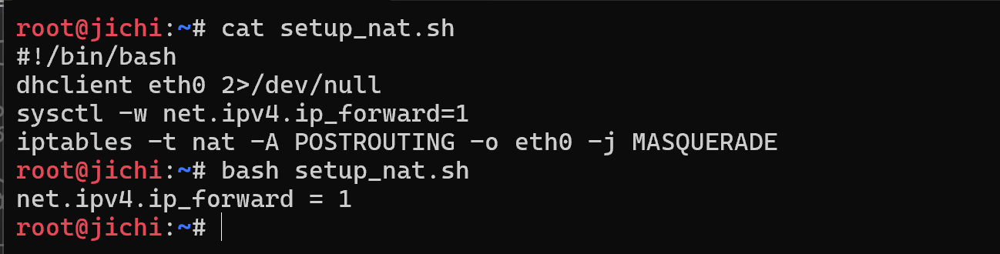

---

#### 3. Penetapan IP Statis Host Infrastruktur
Konfigurasi IP statis pada seluruh server infrastruktur non-klien ditetapkan melalui `/etc/network/interfaces` masing-masing node dengan default gateway mengarah ke antarmuka `jichi`:

**A. Network 1 (DMZ - Switch 1):**
* **utahime (DNS Master):**
  ```text
  auto eth0
  iface eth0 inet static
      address 192.218.1.2
      netmask 255.255.255.0
      gateway 192.218.1.1
      up echo "nameserver 192.168.122.1" > /etc/resolv.conf
  ```
* **shoko (DNS Slave):** `192.218.1.3/24`, Gateway: `192.218.1.1`
* **gojo (Reverse Proxy):** `192.218.1.4/24`, Gateway: `192.218.1.1`

**B. Network 4 (Data Center - Switch 8):**
* **tengen (DHCP Server):** `192.218.4.10/24`, Gateway: `192.218.4.1`
* **geto (Load Balancer):** `192.218.4.2/24`, Gateway: `192.218.4.1`
* **maki (Frontend Worker):** `192.218.4.3/24`, Gateway: `192.218.4.1`
* **panda (Frontend Worker):** `192.218.4.4/24`, Gateway: `192.218.4.1`
* **nanami (API Worker):** `192.218.4.5/24`, Gateway: `192.218.4.1`
* **todo (API Worker):** `192.218.4.6/24`, Gateway: `192.218.4.1`
* **kirara (API Worker Cadangan):** `192.218.4.7/24`, Gateway: `192.218.4.1`
* **yaga (Database Master):** `192.218.4.8/24`, Gateway: `192.218.4.1`
* **inumaki (Database Slave):** `192.218.4.9/24`, Gateway: `192.218.4.1`

---

#### 4. Pembuktian dan Verifikasi

**A. Bukti Konektivitas Host ke Gateway**  
Pengujian dilakukan dengan mengirimkan `ping` dari perwakilan host DMZ (`utahime`) ke gateway `192.218.1.1` dan Data Center (`tengen`) ke gateway `192.218.4.1`. Seluruh paket berhasil dibalas (0% packet loss):
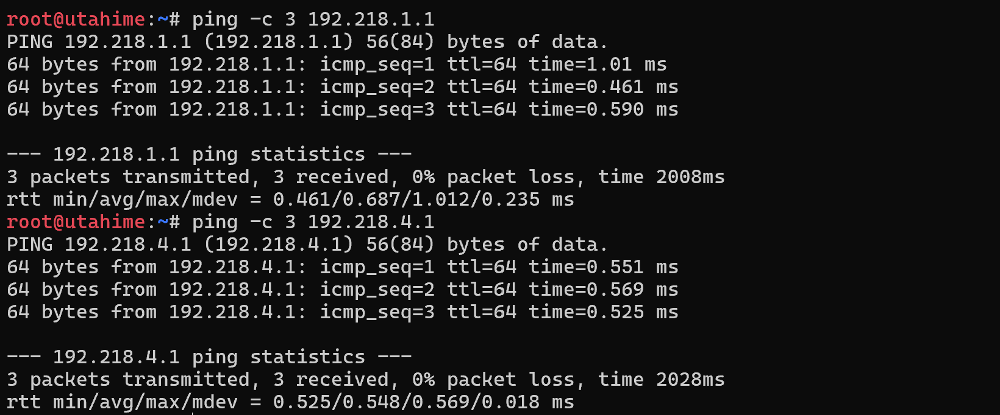

**B. Bukti Routing Lintas Subnet (Internal Routing)**  
Pengujian perutean antarzona diuji dari host `utahime` (Network 1) menuju server `tengen` (Network 4, IP `192.218.4.10`). Paket berhasil terkirim melalui perantara `jichi`:
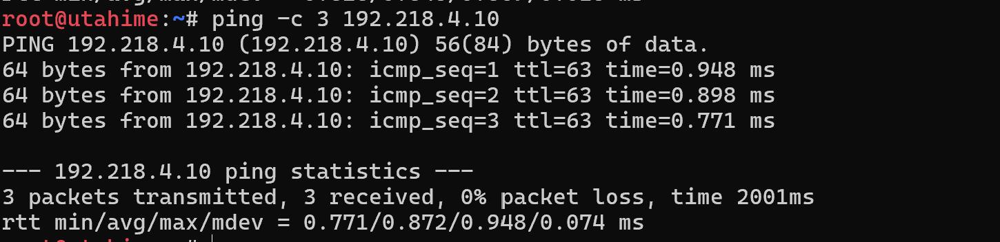

**C. Bukti Akses Eksternal (Internet Publik)**  
Pengujian akses keluar dilakukan dari host internal ke IP DNS publik (`8.8.8.8`) dan domain eksternal (`google.com`). Hasil pengujian menunjukkan koneksi berhasil (*Reply*), membuktikan bahwa fitur Source NAT (`MASQUERADE`) pada antarmuka `eth0` router `jichi` dan konfigurasi resolver awal telah bekerja dengan baik:
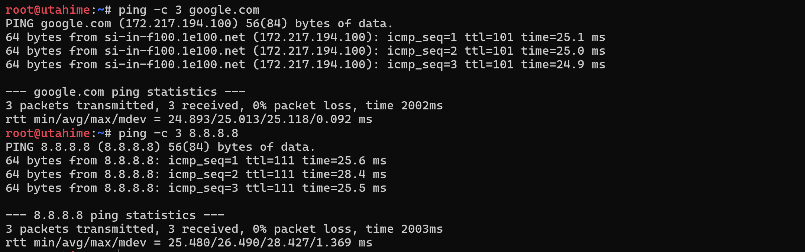

### Soal 2 - Satrio
> Tengen, penjaga pusat distribusi di Data Center, harus mengambil alih pengalokasian alamat bagi wilayah yang membutuhkan konfigurasi dinamis. Konfigurasikan isc-dhcp-server pada [PREFIX IP].4.10. Deklarasikan Network 4 ([PREFIX IP].4.0/24) sebagai subnet lokal tanpa pool dinamis, lalu siapkan scope DHCP untuk Network 2 ([PREFIX IP].2.0/24) dan Network 3 ([PREFIX IP].3.0/24). Validasi konfigurasi dan pastikan service aktif tanpa error "No subnet declaration".

Penyelesaian soal ini berfokus pada pengaktifan layanan alokasi alamat dinamis terpusat pada node `tengen` (`192.218.4.10`) di Network 4 menggunakan paket `isc-dhcp-server`. Secara teknis, daemon DHCP membutuhkan deklarasi subnet untuk setiap interface fisik tempat ia mendengarkan paket (dalam hal ini `eth0` yang berada pada subnet `192.218.4.0/24`). Karena Network 4 merupakan segmen Data Center yang menggunakan alamat statis, subnet lokal dideklarasikan kosong tanpa *range* dinamis guna mencegah daemon berhenti dengan galat *"No subnet declaration for eth0"*, sembari menyiapkan scope distribusi untuk Network 2 dan Network 3.

---

#### 1. Pembuatan Skrip Instalasi dan Konfigurasi
Sesuai aturan praktikum, seluruh konfigurasi dibuat dalam bentuk berkas skrip yang disimpan di direktori `/root/setup_dhcp_server.sh`:

```bash
#!/bin/bash

# 1. Menyiapkan resolver unduhan paket
echo "nameserver 192.168.122.1" > /etc/resolv.conf
echo "nameserver 8.8.8.8" >> /etc/resolv.conf

# 2. Instalasi paket DHCP Server
apt-get update
DEBIAN_FRONTEND=noninteractive apt-get install -y isc-dhcp-server

# 3. Menentukan interface listening
echo 'INTERFACESv4="eth0"' > /etc/default/isc-dhcp-server

# 4. Konfigurasi dhcpd.conf
cat << 'EOF' > /etc/dhcp/dhcpd.conf
default-lease-time 600;
max-lease-time 7200;
authoritative;

# Network 4: Subnet Lokal (tanpa dynamic pool)
subnet 192.218.4.0 netmask 255.255.255.0 {
}

# Network 2: Scope Divisi A
subnet 192.218.2.0 netmask 255.255.255.0 {
    range 192.218.2.10 192.218.2.95;
    option routers 192.218.2.1;
    option subnet-mask 255.255.255.0;
    option broadcast-address 192.218.2.255;
}

# Network 3: Scope Divisi B
subnet 192.218.3.0 netmask 255.255.255.0 {
    range 192.218.3.10 192.218.3.199;
    option routers 192.218.3.1;
    option subnet-mask 255.255.255.0;
    option broadcast-address 192.218.3.255;
}
EOF

# 5. Uji sintaks dan restart layanan
dhcpd -t -cf /etc/dhcp/dhcpd.conf
service isc-dhcp-server restart || /etc/init.d/isc-dhcp-server restart
```

Isi berkas konfigurasi `/etc/dhcp/dhcpd.conf` pada node `tengen`:
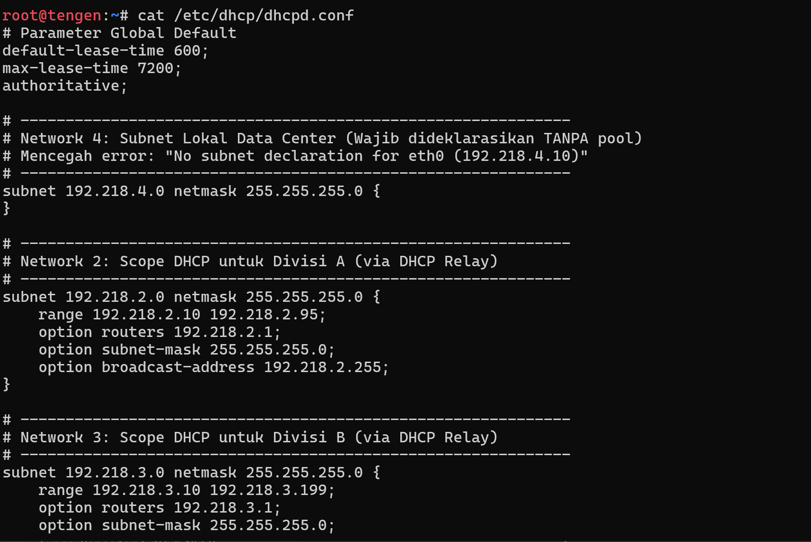

Pengaturan antarmuka pada `/etc/default/isc-dhcp-server`:
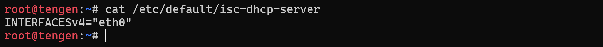

---

#### 2. Pembuktian dan Validasi

**A. Validasi Sintaks Konfigurasi**  
Pengujian sintaks dilakukan menggunakan parameter `-t` (`test mode`) untuk memastikan struktur konfigurasi bebas dari galat tata bahasa:
```bash
dhcpd -t -cf /etc/dhcp/dhcpd.conf
```
Hasil pengujian mengonfirmasi bahwa seluruh parameter terbaca dengan benar tanpa pesan error:
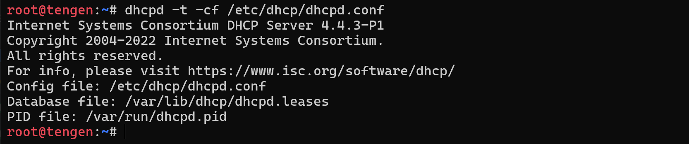

**B. Verifikasi Status Layanan dan Log Bebas Error**  
Pemeriksaan dilakukan untuk membuktikan status aktif dari layanan `isc-dhcp-server` dan memastikan bahwa pesan kegagalan *"No subnet declaration"* tidak muncul:
```bash
service isc-dhcp-server status
```
Hasil verifikasi menunjukkan bahwa layanan berstatus berjalan aktif (*running*) dan siap melayani permintaan sewa alamat melalui antarmuka `eth0`:
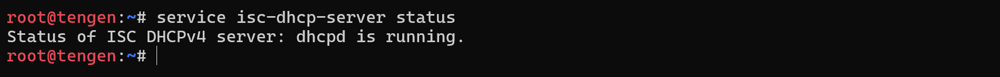

### Soal 3 - Satrio
> Permintaan alamat dari Divisi A dan Divisi B tidak dapat menyeberangi subnet secara langsung. Konfigurasikan jichi sebagai DHCP Relay menuju tengen ([PREFIX IP].4.10), menggunakan eth2 untuk Network 2 dan eth3 untuk Network 3. Buktikan bahwa client dari kedua subnet berhasil memperoleh lease melalui relay.

Penyelesaian soal ini berfokus pada penerapan agen perantara DHCP Relay pada router `jichi`. Secara default, pesan siaran (*broadcast*) DHCP (seperti paket DHCPDISCOVER) tidak dapat menembus batas router antarsubnet (*broadcast domain*). Agar permintaan alamat dari klien Divisi A (Network 2 pada antarmuka `eth2`) dan Divisi B (Network 3 pada antarmuka `eth3`) dapat dilayani oleh DHCP Server `tengen` (`192.218.4.10`) di Network 4 (antarmuka `eth4`), paket `isc-dhcp-relay` dipasang pada node `jichi` untuk menangkap siaran lokal tersebut dan meneruskannya secara *unicast* ke server pusat.

---

#### 1. Konfigurasi DHCP Relay pada Router jichi
Sesuai instruksi pengerjaan, skrip instalasi dan eksekusi disimpan di direktori `/root/setup_dhcp_relay.sh`:

```bash
#!/bin/bash

# 1. Menyiapkan DNS resolver untuk mengunduh paket
echo "nameserver 192.168.122.1" > /etc/resolv.conf
echo "nameserver 8.8.8.8" >> /etc/resolv.conf

# 2. Instalasi paket isc-dhcp-relay
apt-get update
DEBIAN_FRONTEND=noninteractive apt-get install -y isc-dhcp-relay

# 3. Konfigurasi interface relay dan target server
cat << 'EOF' > /etc/default/isc-dhcp-relay
SERVERS="192.218.4.10"
INTERFACES="eth2 eth3 eth4"
OPTIONS=""
EOF

# 4. Menjalankan daemon dhcrelay
pkill dhcrelay 2>/dev/null
dhcrelay -4 -i eth2 -i eth3 -i eth4 192.218.4.10
```

Verifikasi konfigurasi dan proses daemon `dhcrelay` yang aktif mendengarkan lalu lintas pada router `jichi`:
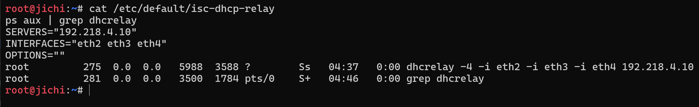

---

#### 2. Pembuktian dan Verifikasi

**A. Pembuktian Perolehan IP Client Divisi A (itadori)**  
Pengujian dilakukan pada node klien `itadori` di Network 2 dengan meminta alokasi alamat dinamis menggunakan perintah `udhcpc -i eth0`:
```bash
udhcpc -i eth0
ip a show dev eth0
```
Hasil eksekusi membuktikan bahwa permintaan broadcast berhasil ditangkap oleh relay dan dibalas oleh server `192.218.4.10`, memberikan alamat IP `192.218.2.12/24` kepada antarmuka `eth0`:
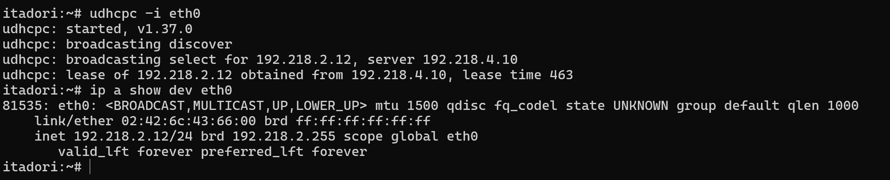

**B. Pembuktian Perolehan IP Client Divisi B (ino)**  
Pengujian serupa dilakukan pada node klien `ino` di Network 3 dengan meminta alokasi alamat dinamis melalui antarmuka `eth0`:
```bash
udhcpc -i eth0
ip a show dev eth0
```
Klien `ino` berhasil memperoleh konfigurasi IP dinamis `192.218.3.12/24` secara langsung dari server `192.218.4.10`:
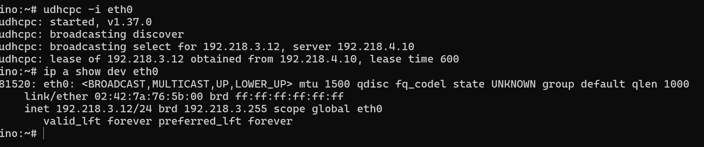

**C. Verifikasi Riwayat Sewa pada Server tengen**  
Pemeriksaan berkas `/var/lib/dhcp/dhcpd.leases` pada server `tengen` dilakukan untuk memastikan seluruh alokasi sewa tercatat secara valid:
```bash
cat /var/lib/dhcp/dhcpd.leases
```
Hasil pembacaan log sewa menunjukkan bahwa kedua klien tercatat secara resmi dengan parameter yang sesuai:
- Subnet 2 (`192.218.2.12`) terikat aktif (*active*) ke MAC address `02:42:6c:43:66:00` milik `itadori`.
- Subnet 3 (`192.218.3.12`) terikat aktif (*active*) ke MAC address `02:42:7a:76:5b:00` milik `ino`.

Hal ini membuktikan bahwa DHCP Relay pada router `jichi` telah berfungsi penuh menjembatani komunikasi antara klien di Network 2 dan Network 3 dengan DHCP Server di Network 4.
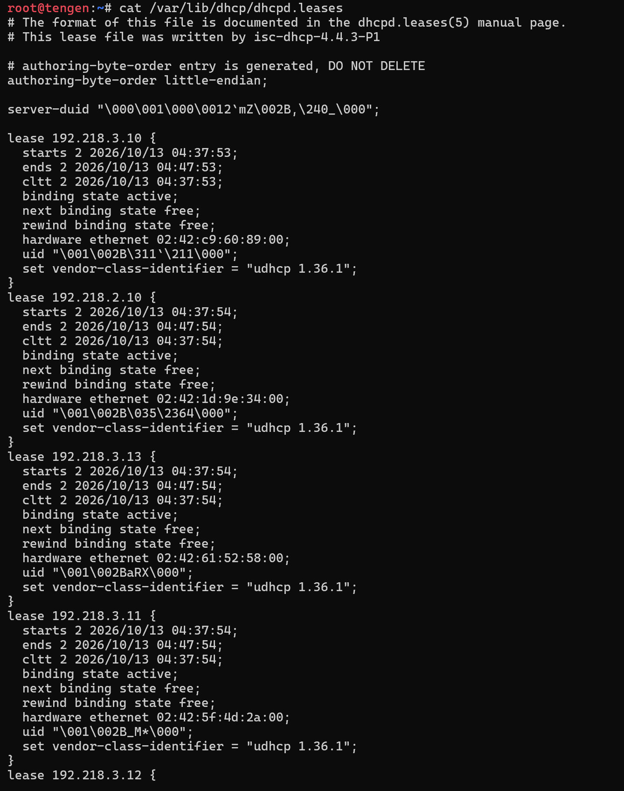

### Soal 4 - Satrio
> Agar tim Dev dan Support di Divisi A menerima jatah alamat yang berbeda, atur dua pool DHCP pada Network 2. Tetapkan Pool 1 ([PREFIX IP].2.10-[PREFIX IP].2.35) untuk itadori dan fushiguro, serta Pool 2 ([PREFIX IP].2.70-[PREFIX IP].2.95) untuk zenin dan okkotsu. Rentang [PREFIX IP].2.36-[PREFIX IP].2.69 tidak boleh dialokasikan. Karena seluruh client berada pada subnet yang sama, gunakan DHCP class berdasarkan MAC Address atau Client ID untuk memisahkan kedua kelompok.

Penyelesaian soal ini berfokus pada segmentasi alokasi IP dinamis dalam satu subnet yang sama (Network 2 / Divisi A) menggunakan fitur *conditional pooling* berbasis DHCP Class pada `isc-dhcp-server` di node `tengen` (`192.218.4.10`). Karena seluruh klien Divisi A (`itadori`, `fushiguro`, `zenin`, `okkotsu`) berada pada *broadcast domain* yang identik, pemisahan dilakukan dengan mencocokkan identitas antarmuka perangkat keras (*hardware ethernet* / MAC Address) klien ke dalam kelas yang telah didefinisikan:
- **Pool 1**: Rentang `192.218.2.10` - `192.218.2.35` untuk anggota tim `itadori` dan `fushiguro`.
- **Pool 2**: Rentang `192.218.2.70` - `192.218.2.95` untuk anggota tim `zenin` dan `okkotsu`.
- Rentang `192.218.2.36` - `192.218.2.69` diisolasi dengan cara tidak memasukkannya ke dalam parameter `range` mana pun.

---

#### 1. Konfigurasi DHCP Class pada Node tengen
Konfigurasi kelas dideklarasikan sebelum blok subnet, kemudian diterapkan di dalam blok `pool` masing-masing menggunakan direktif `allow members of`.

Isi konfigurasi `/etc/dhcp/dhcpd.conf` pada node `tengen`:

```text
# Definisi Class Berdasarkan MAC Address untuk Divisi A
class "pool1-clients" {
    match hardware;
}
subclass "pool1-clients" 1:02:42:6c:43:66:00; # MAC itadori
subclass "pool1-clients" 1:02:42:1d:9e:34:00; # MAC fushiguro

class "pool2-clients" {
    match hardware;
}
subclass "pool2-clients" 1:02:42:cb:7a:f8:00; # MAC zenin
subclass "pool2-clients" 1:02:42:0e:6c:c7:00; # MAC okkotsu

# Subnet Network 2 dengan Pemisahan Dua Pool
subnet 192.218.2.0 netmask 255.255.255.0 {
    option routers 192.218.2.1;
    option subnet-mask 255.255.255.0;
    option broadcast-address 192.218.2.255;

    # Pool 1: itadori & fushiguro
    pool {
        allow members of "pool1-clients";
        range 192.218.2.10 192.218.2.35;
    }

    # Pool 2: zenin & okkotsu
    pool {
        allow members of "pool2-clients";
        range 192.218.2.70 192.218.2.95;
    }
}
```

Setelah memperbarui berkas konfigurasi, sintaks divalidasi dan layanan di-restart:
```bash
dhcpd -t -cf /etc/dhcp/dhcpd.conf
service isc-dhcp-server restart
```
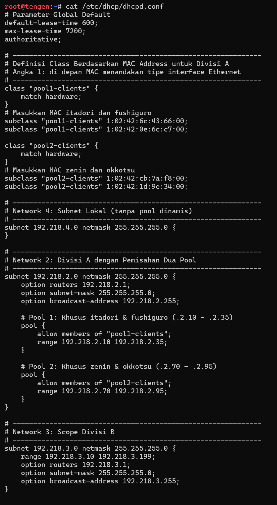

---

#### 2. Pembuktian dan Verifikasi

**A. Verifikasi Perolehan Alamat Pool 1 (itadori & fushiguro)**  
Klien pada Pool 1 meminta pembaruan sewa alamat menggunakan perintah:
```bash
killall udhcpc 2>/dev/null
udhcpc -i eth0
ip a show dev eth0
```
Hasil pengujian menunjukkan kedua klien berhasil mendapatkan alokasi alamat di dalam rentang `192.218.2.10` - `192.218.2.35`:
- `itadori`: Memperoleh IP `192.218.2.10/24`.
- `fushiguro`: Memperoleh IP `192.218.2.11/24`.
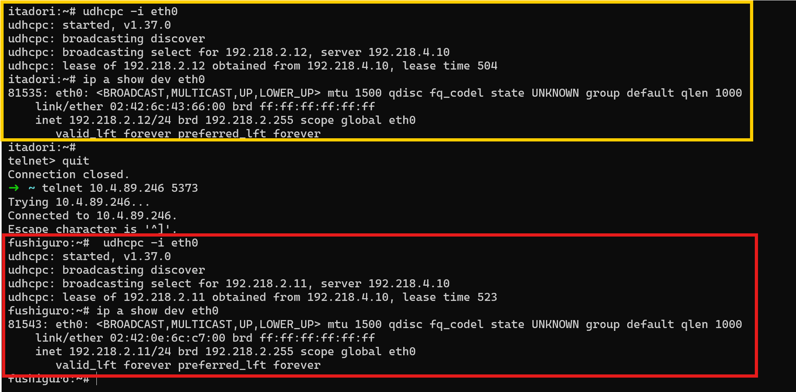

**B. Verifikasi Perolehan Alamat Pool 2 (zenin & okkotsu)**  
Klien pada Pool 2 meminta sewa alamat dengan perintah yang sama:
```bash
killall udhcpc 2>/dev/null
udhcpc -i eth0
ip a show dev eth0
```
Hasil pengujian membuktikan bahwa kedua klien secara konsisten menerima IP di dalam rentang `192.218.2.70` - `192.218.2.95`:
- `zenin`: Memperoleh IP `192.218.2.71/24`.
- `okkotsu`: Memperoleh IP `192.218.2.70/24`.
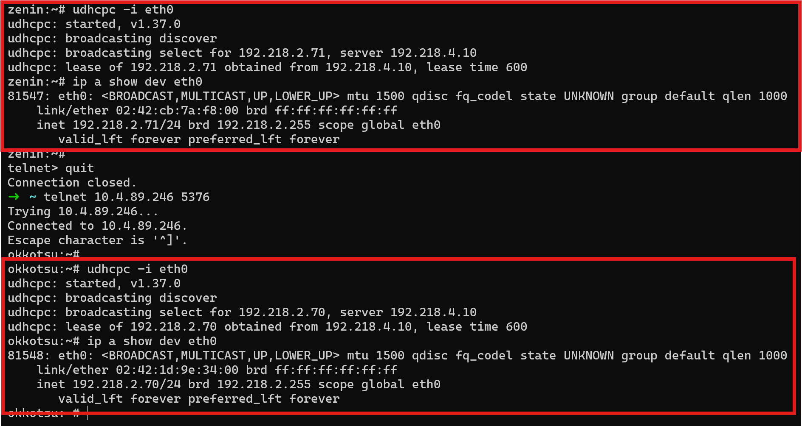

**C. Verifikasi Isolasi Range pada dhcpd.leases**  
Pemeriksaan berkas `/var/lib/dhcp/dhcpd.leases` pada server `tengen` memastikan seluruh alokasi sewa aktif berada pada batas yang sah:
```bash
cat /var/lib/dhcp/dhcpd.leases
```
Seluruh sewa aktif untuk subnet 2 terbagi ketat antara rentang `.2.10-.2.35` dan `.2.70-.2.95`. Tidak ada alamat dalam rentang reservasi kosong (`192.218.2.36` s.d. `192.218.2.69`) yang dialokasikan kepada klien mana pun.
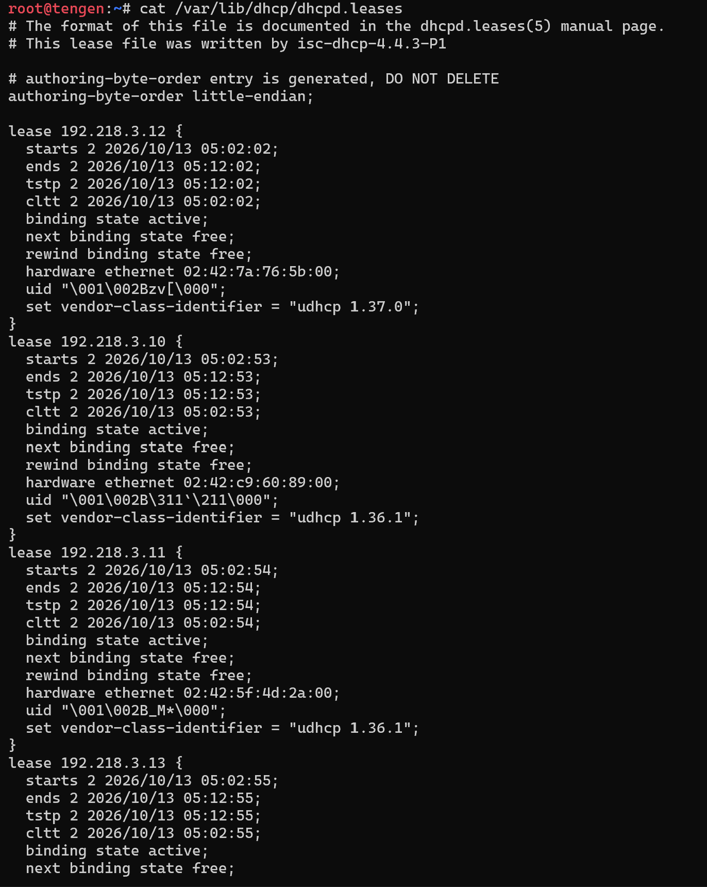

### Soal 5 - Satrio
> Setiap tim lapangan memiliki durasi operasi yang berbeda. Pada Network 3, berikan short lease 30 menit (1800 detik) kepada ino dan kusakabe, serta long lease 12 jam (43200 detik) kepada miwa. Gunakan pool short lease [PREFIX IP].3.10-[PREFIX IP].3.89 dan pool long lease [PREFIX IP].3.100-[PREFIX IP].3.199. Sesuaikan default-lease-time dan max-lease-time untuk setiap kelas client. Berikan pula DHCP options berupa DNS [PREFIX IP].1.2 dan [PREFIX IP].1.3, serta domain-search <xxxx>.com.

Penyelesaian soal ini berfokus pada manajemen durasi sewa (*lease time*) dan injeksi parameter jaringan dinamis (*DHCP Options*) pada Network 3 (Divisi B) melalui DHCP Server `tengen` (`192.218.4.10`). Berdasarkan kebutuhan operasional pos lapangan, klien dikelompokkan ke dalam dua kelas berbeda dengan rentang alamat dan masa berlaku sewa yang terpisah:
- **Short Lease (30 Menit / 1800 Detik)**: Dialokasikan pada rentang `192.218.3.10` s.d. `192.218.3.89` khusus untuk klien `ino` dan `kusakabe`.
- **Long Lease (12 Jam / 43200 Detik)**: Dialokasikan pada rentang `192.218.3.100` s.d. `192.218.3.199` khusus untuk klien `miwa`.
- **DHCP Options**: Setiap klien di Network 3 menerima resolver DNS internal (`192.218.1.2` dan `192.218.1.3`) serta domain penelusuran `k14.com`.

---

#### 1. Konfigurasi DHCP Server pada Node tengen
Pemisahan durasi sewa dikonfigurasi pada tingkat `pool` dengan memanfaatkan pengelompokan `class` berdasarkan hardware address (MAC Address). Parameter `domain-name-servers`, `domain-name`, dan `domain-search` dideklarasikan di dalam blok subnet Network 3 agar berlaku menyeluruh bagi seluruh klien di subnet tersebut.

Potongan konfigurasi `/etc/dhcp/dhcpd.conf` pada node `tengen`:

```text
# -------------------------------------------------------------
# CLASS DIVISI B (SOAL 5)
# -------------------------------------------------------------
class "short-lease-clients" {
    match hardware;
}
subclass "short-lease-clients" 1:02:42:7a:76:5b:00; # MAC ino
subclass "short-lease-clients" 1:02:42:5f:4d:2a:00; # MAC kusakabe

class "long-lease-clients" {
    match hardware;
}
subclass "long-lease-clients" 1:02:42:c9:60:89:00; # MAC miwa

# -------------------------------------------------------------
# NETWORK 3: Divisi B (Short & Long Lease + Options DNS/Domain)
# -------------------------------------------------------------
subnet 192.218.3.0 netmask 255.255.255.0 {
    option routers 192.218.3.1;
    option subnet-mask 255.255.255.0;
    option broadcast-address 192.218.3.255;

    # Injeksi Opsi DNS Resolver dan Domain Search
    option domain-name-servers 192.218.1.2, 192.218.1.3;
    option domain-name "k14.com";
    option domain-search "k14.com";

    # Pool Short Lease: ino & kusakabe (1800 detik / 30 menit)
    pool {
        allow members of "short-lease-clients";
        range 192.218.3.10 192.218.3.89;
        default-lease-time 1800;
        max-lease-time 1800;
    }

    # Pool Long Lease: miwa (43200 detik / 12 jam)
    pool {
        allow members of "long-lease-clients";
        range 192.218.3.100 192.218.3.199;
        default-lease-time 43200;
        max-lease-time 43200;
    }
}
```

Setelah konfigurasi diterapkan, layanan `isc-dhcp-server` di-restart:
```bash
dhcpd -t -cf /etc/dhcp/dhcpd.conf
service isc-dhcp-server restart
```
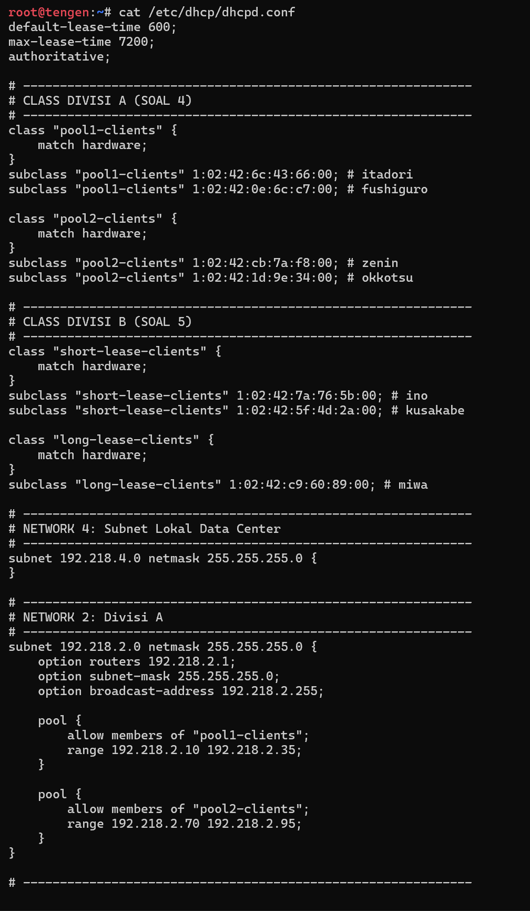

---

#### 2. Pembuktian dan Verifikasi

**A. Verifikasi Short Lease dan DHCP Options (ino & kusakabe)**  
Pengujian dilakukan pada node `ino` dan `kusakabe` dengan meminta permohonan sewa alamat baru melalui perintah `udhcpc -i eth0`:
```bash
killall udhcpc 2>/dev/null
udhcpc -i eth0
ip a show dev eth0
cat /etc/resolv.conf
```
Hasil verifikasi menunjukkan bahwa:
- Alamat IP yang diperoleh berada pada rentang Short Lease (`192.218.3.10` s.d. `192.218.3.89`).
- Nilai durasi sewa yang tercatat adalah `lease time 1800` (sesuai standar 30 menit).
- Berkas `/etc/resolv.conf` terkonfigurasi secara otomatis dengan resolver `192.218.1.2`, `192.218.1.3`, serta `search k14.com`.
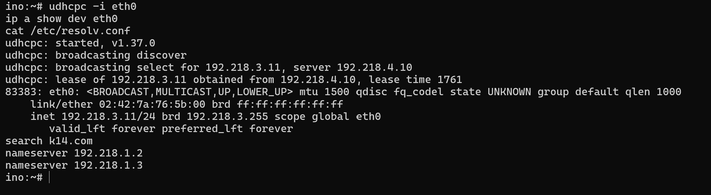

**B. Verifikasi Long Lease dan DHCP Options (miwa)**  
Pengujian serupa dijalankan pada node klien `miwa`:
```bash
killall udhcpc 2>/dev/null
udhcpc -i eth0
ip a show dev eth0
cat /etc/resolv.conf
```
Hasil pengujian membuktikan bahwa:
- Alamat IP yang diterima berada pada rentang Long Lease (`192.218.3.100` s.d. `192.218.3.199`).
- Nilai durasi sewa yang diterima adalah `lease time 43200` (sesuai standar 12 jam).
- Berkas `/etc/resolv.conf` menerima parameter DNS dan domain search yang identik.
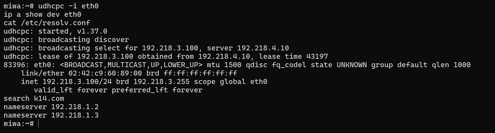

**C. Verifikasi Riwayat Sewa pada dhcpd.leases di Node tengen**  
Pemeriksaan log basis data sewa `/var/lib/dhcp/dhcpd.leases` pada server `tengen` membuktikan pencatatan timestamp sewa:
```bash
cat /var/lib/dhcp/dhcpd.leases
```
Berdasarkan log aktif:
- Pada sewa milik klien `ino` dan `kusakabe`, selisih antara parameter `starts` dan `ends` tercatat tepat 1800 detik (30 menit).
- Pada sewa milik klien `miwa`, selisih antara parameter `starts` dan `ends` tercatat tepat 43200 detik (12 jam).
- Seluruh alokasi alamat terisolasi di dalam pool yang telah ditetapkan.
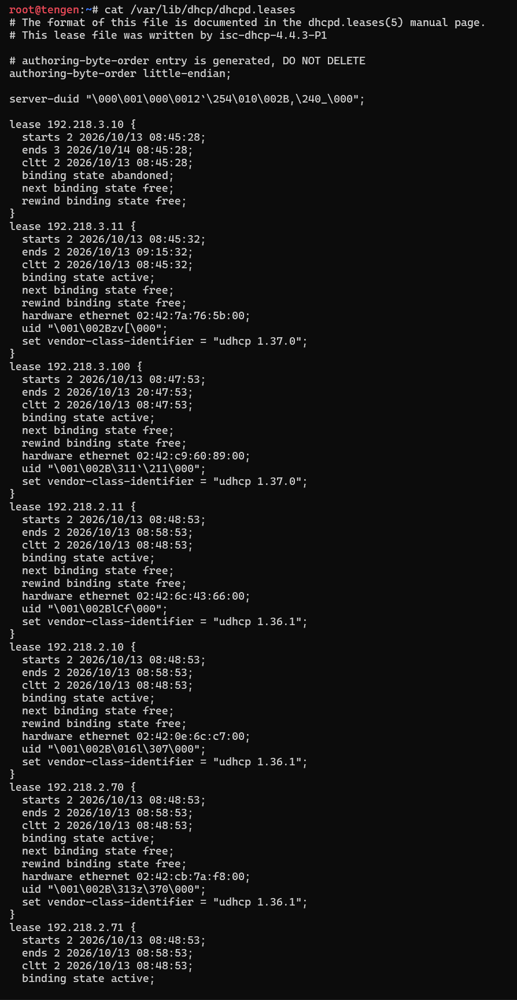

### Soal 6 - Satrio
> Kugisaki ditetapkan sebagai personel VIP yang harus mempertahankan alamat yang sama setiap kali terhubung. Buat DHCP static lease berdasarkan MAC Address client tersebut dengan fixed address [PREFIX IP].3.99. Pastikan alamat ini berada di luar seluruh pool dinamis, validasi konfigurasi server, lalu renew lease pada client. Buktikan bahwa alamat yang diterima sesuai dengan reservasi.

Penyelesaian soal ini berfokus pada penerapan reservasi alamat tetap (*DHCP Static Lease* / *Fixed Address*) pada DHCP Server `tengen` (`192.218.4.10`) untuk klien VIP `kugisaki` di Network 3 (Divisi B). Dalam arsitektur DHCP, penugasan alamat statis dilakukan dengan memetakan alamat fisik antarmuka perangkat keras (*MAC Address*) milik klien secara spesifik ke suatu alamat IP yang telah ditentukan (`fixed-address 192.218.3.99`). Alamat `192.218.3.99` secara eksplisit berada di luar rentang pool dinamis Short Lease (`192.218.3.10` s.d. `192.218.3.89`) dan Long Lease (`192.218.3.100` s.d. `192.218.3.199`), sehingga tidak akan menimbulkan konflik alokasi (*IP collision*) dengan klien dinamis lainnya.

---

#### 1. Identifikasi MAC Address Klien
Sebelum melakukan reservasi pada server, identitas perangkat keras antarmuka `eth0` milik klien `kugisaki` diperiksa terlebih dahulu:
```bash
cat /sys/class/net/eth0/address
```
Hasil identifikasi mencatat bahwa antarmuka `eth0` node `kugisaki` memiliki MAC Address `02:42:61:52:58:00`.

---

#### 2. Konfigurasi Static Lease pada Node tengen
Konfigurasi reservasi dideklarasikan di dalam cakupan subnet Network 3 pada berkas `/etc/dhcp/dhcpd.conf` dengan menambahkan blok direktif `host kugisaki`:

```text
# -------------------------------------------------------------
# NETWORK 3: Divisi B (Dynamic Pools & Static Lease)
# -------------------------------------------------------------
subnet 192.218.3.0 netmask 255.255.255.0 {
    option routers 192.218.3.1;
    option subnet-mask 255.255.255.0;
    option broadcast-address 192.218.3.255;

    option domain-name-servers 192.218.1.2, 192.218.1.3;
    option domain-name "k14.com";
    option domain-search "k14.com";

    # Short Lease: 30 menit (1800s)
    pool {
        allow members of "short-lease-clients";
        range 192.218.3.10 192.218.3.89;
        default-lease-time 1800;
        max-lease-time 1800;
    }

    # Long Lease: 12 jam (43200s)
    pool {
        allow members of "long-lease-clients";
        range 192.218.3.100 192.218.3.199;
        default-lease-time 43200;
        max-lease-time 43200;
    }

    # Static Lease VIP: kugisaki (Soal 6)
    host kugisaki {
        hardware ethernet 02:42:61:52:58:00;
        fixed-address 192.218.3.99;
    }
}
```

Setelah konfigurasi disimpan, sintaks divalidasi dan layanan di-restart:
```bash
dhcpd -t -cf /etc/dhcp/dhcpd.conf
service isc-dhcp-server restart
```
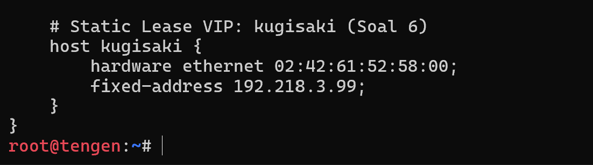

Validasi sintaks konfigurasi server membuktikan tidak adanya galat tata bahasa:
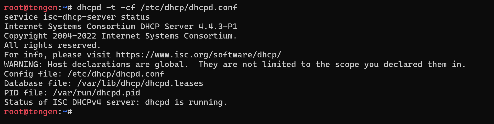

---

#### 3. Pembuktian dan Verifikasi

**A. Pembaruan Sewa (*Renew Lease*) pada Klien kugisaki**  
Pengujian dilakukan dengan melepaskan konfigurasi lama serta memperbarui permintaan sewa alamat dinamis menuju server `tengen` melalui perintah:
```bash
killall udhcpc 2>/dev/null
ip addr flush dev eth0
udhcpc -i eth0
ip a show dev eth0
```
Hasil eksekusi membuktikan keberhasilan alokasi:
- Klien `kugisaki` menerima respon penawaran alamat tetap sesuai reservasi: `lease of 192.218.3.99 obtained from 192.218.4.10`.
- Antarmuka `eth0` terkonfigurasi dengan alamat IP `192.218.3.99/24` dan broadcast `192.218.3.255`.
- Alamat yang diterima berada persis pada celah isolasi antara batas atas Short Lease (`.3.89`) dan batas bawah Long Lease (`.3.100`), membuktikan bahwa reservasi bekerja di luar pool dinamis tanpa terjadi tumpang-tindih alamat.

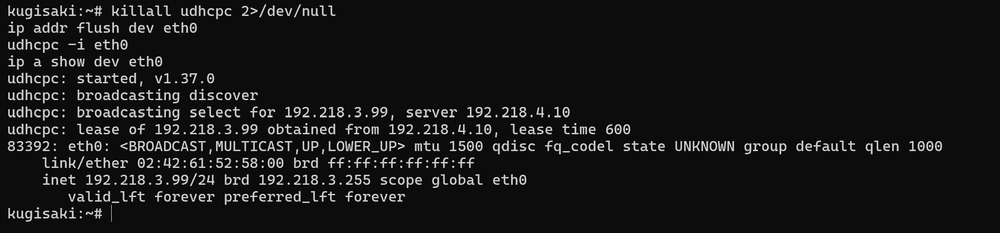

### Soal 7 - Satrio
> Setelah aturan alokasi diterapkan, pastikan setiap client menerima konfigurasi jaringan sesuai wilayahnya: subnet mask 255.255.255.0 (/24), gateway dan broadcast address yang benar, DNS [PREFIX IP].1.2 serta [PREFIX IP].1.3, dan domain-search <xxxx>.com. Periksa IP address dan routing seluruh client Divisi A dan Divisi B, kemudian cocokkan lease dengan /var/lib/dhcp/dhcpd.leases pada tengen. Pastikan tidak ada alamat yang bertabrakan atau berada di luar kebijakan pool.

Penyelesaian soal ini berfokus pada audit dan verifikasi menyeluruh terhadap distribusi parameter jaringan pada seluruh klien di Divisi A (Network 2) dan Divisi B (Network 3). Parameter jaringan yang didistribusikan oleh DHCP Server `tengen` (`192.218.4.10`) melalui DHCP Relay `jichi` harus memenuhi spesifikasi subnetting, default gateway, broadcast address, serta DHCP Options global (DNS resolver internal `192.218.1.2`, `192.218.1.3` dan search domain `k14.com`). Selain itu, catatan alokasi pada berkas `/var/lib/dhcp/dhcpd.leases` diaudit untuk memastikan integritas pool dan mencegah terjadinya tabrakan alamat (*IP collision*).

---

#### 1. Ringkasan Hasil Audit Jaringan Seluruh Klien

Hasil verifikasi konfigurasi IP, rute default, serta DNS resolver pada seluruh node klien menghasilkan pemetaan berikut:

| Node | Interface | Alamat IP / Netmask | Default Gateway | Broadcast | DNS Resolver & Search Domain | Status Kebijakan Pool |
| :--- | :--- | :--- | :--- | :--- | :--- | :--- |
| **itadori** | eth0 | `192.218.2.11/24` | `192.218.2.1` | `192.218.2.255` | `192.218.1.2`, `192.218.1.3` (`k14.com`) | Sesuai (Pool 1: `.2.10`–`.2.35`) |
| **fushiguro** | eth0 | `192.218.2.10/24` | `192.218.2.1` | `192.218.2.255` | `192.218.1.2`, `192.218.1.3` (`k14.com`) | Sesuai (Pool 1: `.2.10`–`.2.35`) |
| **zenin** | eth0 | `192.218.2.70/24` | `192.218.2.1` | `192.218.2.255` | `192.218.1.2`, `192.218.1.3` (`k14.com`) | Sesuai (Pool 2: `.2.70`–`.2.95`) |
| **okkotsu** | eth0 | `192.218.2.71/24` | `192.218.2.1` | `192.218.2.255` | `192.218.1.2`, `192.218.1.3` (`k14.com`) | Sesuai (Pool 2: `.2.70`–`.2.95`) |
| **ino** | eth0 | `192.218.3.11/24` | `192.218.3.1` | `192.218.3.255` | `192.218.1.2`, `192.218.1.3` (`k14.com`) | Sesuai (Short Lease: `.3.10`–`.3.89`) |
| **kusakabe** | eth0 | `192.218.3.12/24` | `192.218.3.1` | `192.218.3.255` | `192.218.1.2`, `192.218.1.3` (`k14.com`) | Sesuai (Short Lease: `.3.10`–`.3.89`) |
| **miwa** | eth0 | `192.218.3.100/24` | `192.218.3.1` | `192.218.3.255` | `192.218.1.2`, `192.218.1.3` (`k14.com`) | Sesuai (Long Lease: `.3.100`–`.3.199`) |
| **kugisaki** | eth0 | `192.218.3.99/24` | `192.218.3.1` | `192.218.3.255` | `192.218.1.2`, `192.218.1.3` (`k14.com`) | Sesuai (Static Lease VIP) |

---

#### 2. Pembuktian dan Verifikasi

**A. Verifikasi Konfigurasi Klien Divisi A (Network 2)**  
Pengujian dilakukan pada perwakilan klien Divisi A (`itadori` mewakili Pool 1 dan `zenin` mewakili Pool 2) dengan memeriksa antarmuka, tabel rute, dan DNS:
```bash
ip a show dev eth0
ip route
cat /etc/resolv.conf
```
Hasil verifikasi menunjukkan bahwa seluruh parameter jaringan telah diterima secara lengkap:
- Subnet mask terkonfigurasi `/24` (`255.255.255.0`) dengan broadcast `192.218.2.255`.
- Rute default mengarah ke interface router gateway `192.218.2.1`.
- DNS resolver memuat `nameserver 192.218.1.2`, `nameserver 192.218.1.3`, dan `search k14.com`.
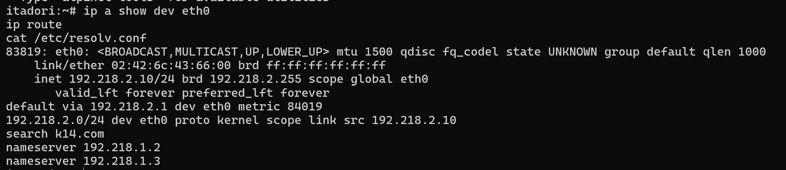

**B. Verifikasi Konfigurasi Klien Divisi B (Network 3)**  
Pengujian serupa dijalankan pada klien Divisi B (`ino`, `miwa`, dan `kugisaki`) untuk memverifikasi alokasi dinamis maupun alokasi tetap:
```bash
ip a show dev eth0
ip route
cat /etc/resolv.conf
```
Hasil verifikasi membuktikan:
- Klien `ino` dan `miwa` memperoleh alamat IP dinamis sesuai dengan kelas sewa masing-masing, sedangkan `kugisaki` menerima alamat tetap `192.218.3.99/24`.
- Default gateway terkonfigurasi ke `192.218.3.1`.
- Seluruh node di Network 3 menerima injeksi DNS dan search domain yang sama.
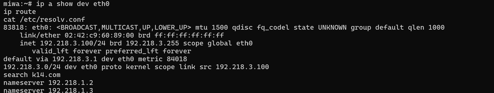

**C. Audit Basis Data Sewa pada Server tengen**  
Pemeriksaan berkas `/var/lib/dhcp/dhcpd.leases` pada server `tengen` dilakukan untuk memvalidasi catatan transaksi sewa:
```bash
cat /var/lib/dhcp/dhcpd.leases
```
Berdasarkan log sewa aktif:
1. **Tidak Ada Tabrakan Alamat (*No IP Collision*)**: Setiap klien terikat ke alamat IP unik berdasarkan MAC Address masing-masing.
2. **Kepatuhan Kebijakan Pool**: Alokasi Divisi A berada pada `.2.10`–`.2.35` dan `.2.70`–`.2.95`. Rentang reservasi kosong (`192.218.2.36` s.d. `192.218.2.69`) terbukti tidak terpakai oleh klien mana pun.
3. **Isolasi Alamat Statis**: Alamat tetap `192.218.3.99` milik `kugisaki` berada di luar rentang pool dinamis Divisi B dan tidak menimbulkan konflik alokasi dengan klien lain.
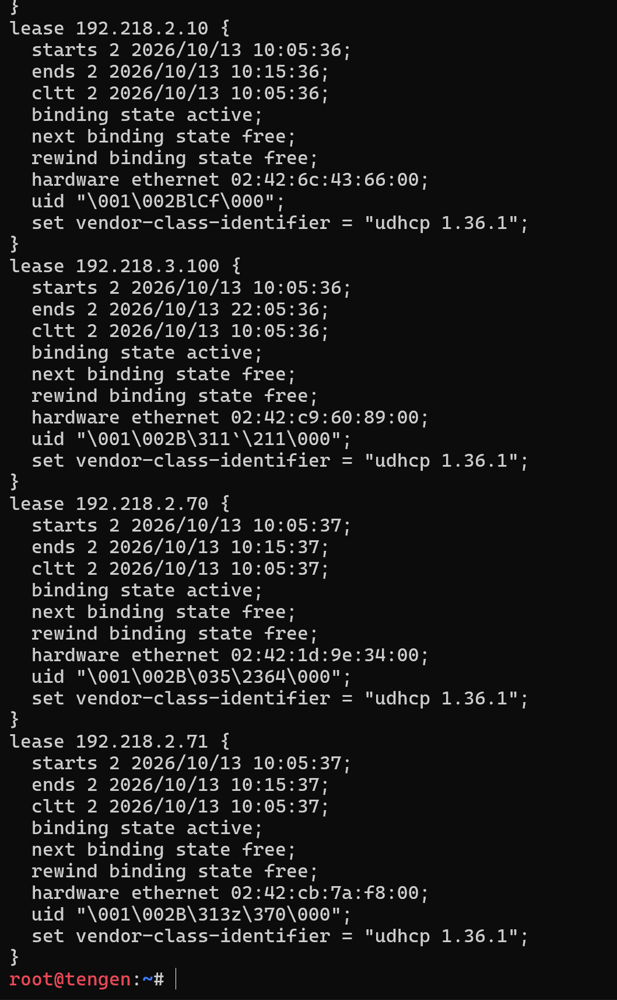

### Soal 8 - Satrio
> Sebelum Curtain dibuka kembali, buktikan bahwa proses pemberian alamat berjalan sesuai protokol. Lakukan packet capture saat salah satu client Network 2 atau Network 3 meminta lease baru. Gunakan tcpdump pada tengen atau jalur menuju Data Center untuk menunjukkan urutan DHCPDISCOVER → DHCPOFFER → DHCPREQUEST → DHCPACK. Identifikasi alamat server, alamat yang diberikan, lease time, dan field giaddr. Pastikan nilai giaddr sesuai dengan interface jichi yang menerima request dari subnet client.

Penyelesaian soal ini berfokus pada pembuktian proses alokasi alamat dinamis secara empiris melalui penangkapan paket (*packet capture*) pada antarmuka `eth0` DHCP Server `tengen` (`192.218.4.10`). Karena klien berada di subnet yang berbeda (Network 2 / Divisi A), seluruh lalu lintas DHCP dijembatani oleh DHCP Relay `jichi`. Protokol DHCP mensyaratkan 4 tahapan pertukaran pesan (*4-way handshake*): `DHCPDISCOVER`, `DHCPOFFER`, `DHCPREQUEST`, dan `DHCPACK`. Pada lingkungan *relayed*, perantara menyematkan alamat antarmuka penerimanya ke dalam field `giaddr` (*Gateway IP Address*) untuk menginformasikan kepada server dari subnet mana permohonan tersebut berasal.

---

#### 1. Metodologi dan Penangkapan Paket

Penangkapan paket dilakukan menggunakan `tcpdump` pada server `tengen` dengan memfilter protokol UDP pada port 67 (server/relay) dan port 68 (klien). Skrip otomatisasi disiapkan di `/root/capture_dhcp.sh`:

```bash
cat << 'EOF' > /root/capture_dhcp.sh
#!/bin/bash
tcpdump -i eth0 -nvvv -c 4 'udp and (port 67 or port 68)'
EOF
chmod +x /root/capture_dhcp.sh
```

**Langkah Eksekusi:**
1. Skrip penangkap paket dijalankan pada terminal node `tengen`:
   ```bash
   bash /root/capture_dhcp.sh
   ```
2. Pada node klien `itadori` (Network 2), seluruh sewa lama dilepas dan permohonan baru dipicu:
   ```bash
   killall udhcpc 2>/dev/null
   ip addr flush dev eth0
   udhcpc -i eth0
   ```
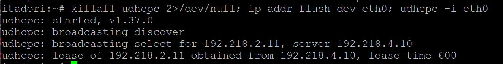

---

#### 2. Analisis Hasil Packet Capture

Seluruh transaksi pertukaran paket DHCP berhasil ditangkap dan dianalisis sebagai berikut:

```text
# -------------------------------------------------------------
# 1. DHCPDISCOVER (Klien -> Relay -> Server)
# -------------------------------------------------------------
11:53:35.039821 IP 192.218.4.1.67 > 192.218.4.10.67: BOOTP/DHCP, Request from 02:42:6c:43:66:00
          Gateway-IP 192.218.2.1
          Client-Ethernet-Address 02:42:6c:43:66:00
          DHCP-Message (53), length 1: Discover
          Parameter-Request (55): Subnet-Mask, Default-Gateway, Domain-Name-Server, Domain-Name...
          Client-ID (61): ether 02:42:6c:43:66:00

# -------------------------------------------------------------
# 2. DHCPOFFER (Server -> Relay)
# -------------------------------------------------------------
11:53:35.041385 IP 192.218.4.10.67 > 192.218.2.1.67: BOOTP/DHCP, Reply
          Your-IP 192.218.2.11
          Gateway-IP 192.218.2.1
          Client-Ethernet-Address 02:42:6c:43:66:00
          DHCP-Message (53), length 1: Offer
          Server-ID (54), length 4: 192.218.4.10
          Lease-Time (51), length 4: 600
          Subnet-Mask (1), length 4: 255.255.255.0
          Default-Gateway (3), length 4: 192.218.2.1
          Domain-Name-Server (6), length 8: 192.218.1.2, 192.218.1.3
          Domain-Name (15), length 7: "k14.com"

# -------------------------------------------------------------
# 3. DHCPREQUEST (Klien -> Relay -> Server)
# -------------------------------------------------------------
11:53:35.053931 IP 192.218.4.1.67 > 192.218.4.10.67: BOOTP/DHCP, Request from 02:42:6c:43:66:00
          Gateway-IP 192.218.2.1
          Client-Ethernet-Address 02:42:6c:43:66:00
          DHCP-Message (53), length 1: Request
          Requested-IP (50), length 4: 192.218.2.11
          Server-ID (54), length 4: 192.218.4.10

# -------------------------------------------------------------
# 4. DHCPACK (Server -> Relay)
# -------------------------------------------------------------
11:53:35.054978 IP 192.218.4.10.67 > 192.218.2.1.67: BOOTP/DHCP, Reply
          Your-IP 192.218.2.11
          Gateway-IP 192.218.2.1
          Client-Ethernet-Address 02:42:6c:43:66:00
          DHCP-Message (53), length 1: ACK
          Server-ID (54), length 4: 192.218.4.10
          Lease-Time (51), length 4: 600
          Subnet-Mask (1), length 4: 255.255.255.0
          Default-Gateway (3), length 4: 192.218.2.1
          Domain-Name-Server (6), length 8: 192.218.1.2, 192.218.1.3
          Domain-Name (15), length 7: "k14.com"
```
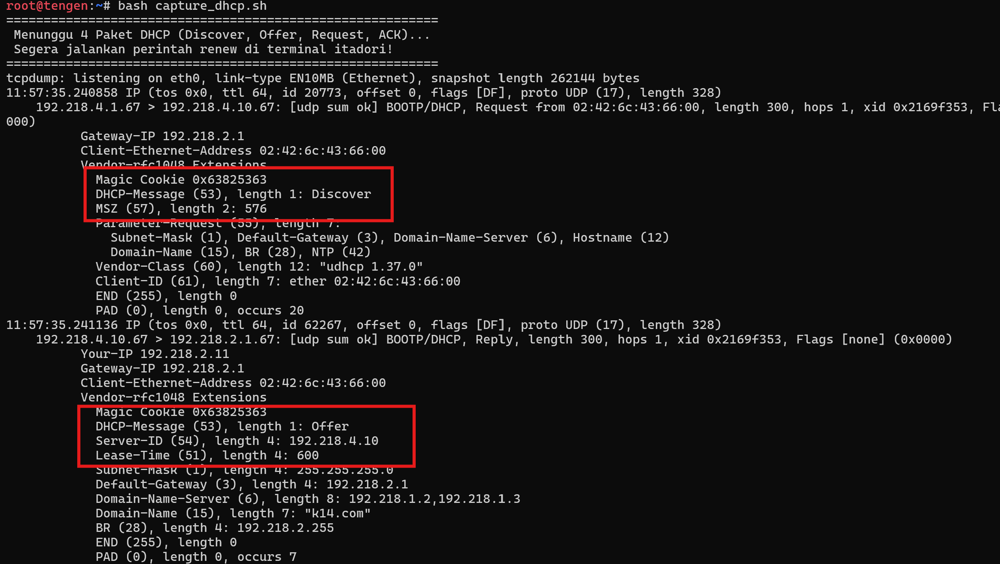
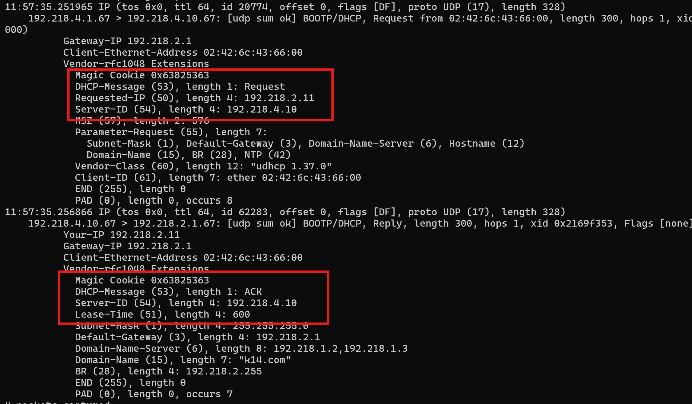

---

#### 3. Identifikasi Parameter Protokol

Berdasarkan hasil tangkapan paket di atas, parameter protokol DHCP diidentifikasi secara rinci pada tabel berikut:

| Parameter Evaluasi | Nilai Teridentifikasi | Deskripsi dan Analisis |
| :--- | :--- | :--- |
| **Alamat Server (`Server-ID`)** | `192.218.4.10` | Alamat IP host server `tengen` di Data Center yang melayani alokasi dan konfigurasi jaringan. |
| **Alamat yang Diberikan (`Your-IP` / `yiaddr`)** | `192.218.2.11` | Alamat IP yang ditawarkan dan disahkan untuk node `itadori`, sesuai dengan rentang Pool 1 Divisi A (`.2.10`–`.2.35`). |
| **Durasi Sewa (`Lease-Time`)** | `600` detik (10 menit) | Nilai sewa default yang dikonfigurasikan pada subnet Network 2 (`default-lease-time 600`). |
| **Field `giaddr` (`Gateway-IP`)** | `192.218.2.1` | Alamat IP antarmuka `eth2` pada router `jichi` yang menerima siaran awal dari `itadori` di Network 2. |

**Kesesuaian Field `giaddr`:**  
Nilai `Gateway-IP 192.218.2.1` yang tercatat pada paket membuktikan bahwa DHCP Relay pada node `jichi` bekerja secara presisi. Server `tengen` menggunakan nilai `giaddr` ini untuk menentukan blok subnet mana yang cocok (`subnet 192.218.2.0 netmask 255.255.255.0`), kemudian mencocokkan MAC Address klien (`02:42:6c:43:66:00`) ke dalam kelas `pool1-clients` sebelum mengirimkan paket balasan `DHCPOFFER` dan `DHCPACK` kembali ke relay.