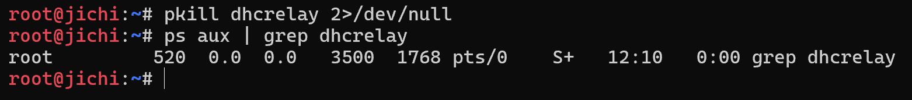
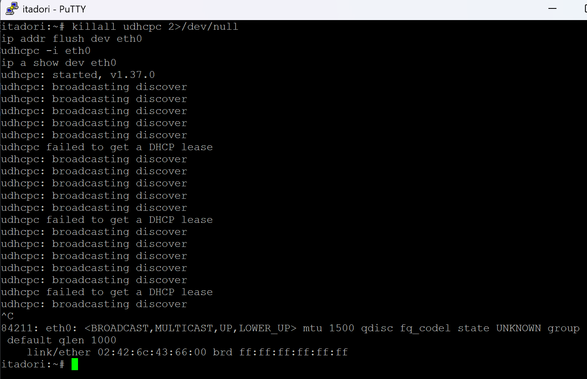
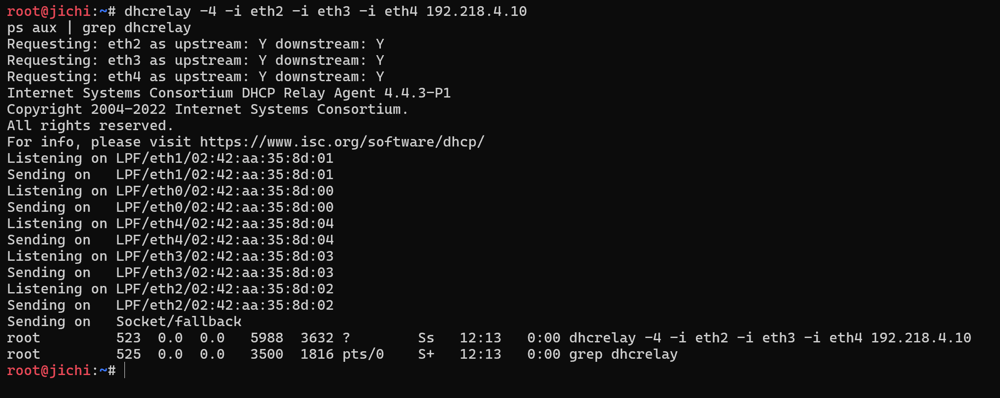
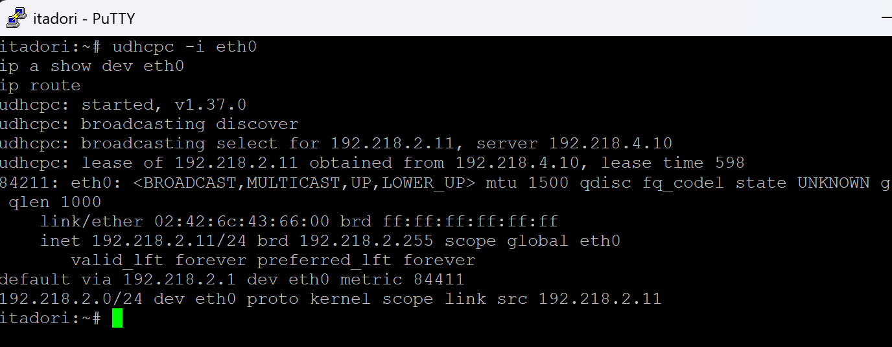
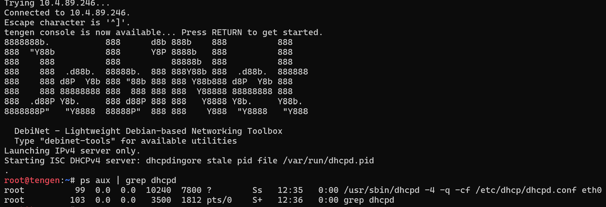
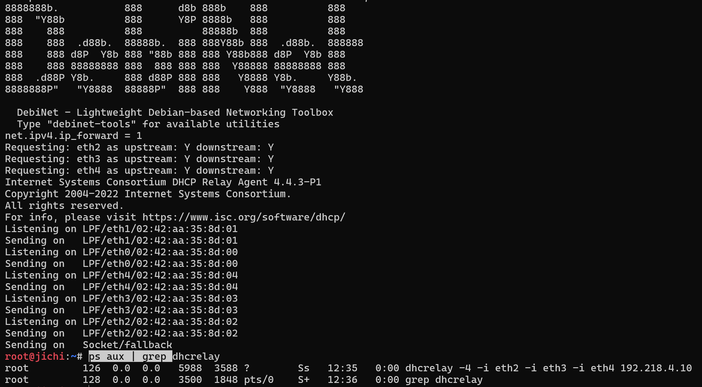
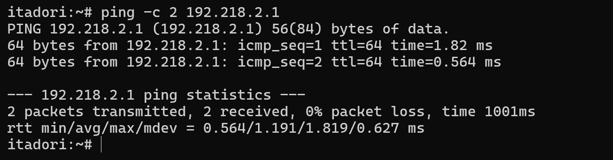
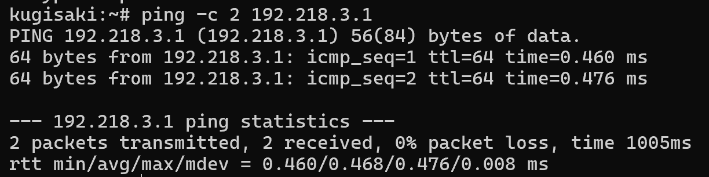

# Jarkom-Modul-3-2026-K-14
| No | Nama Anggota | NRP |
|:---:|---|:---:|
| 1 | Muhammad Satrio Utomo | 5027251022 |
| 2 | Sebastian Elroi Hasian Panjaitan | 5027251040 |

---

## Pengerjaan

### Soal 1 - Satrio
> Ketika Curtain menutup Shibuya, jalur komunikasi antar zona Jujutsu High terputus. Pulihkan konektivitas dasar dengan mengonfigurasi jichi: eth0 memperoleh WAN dari NAT, sedangkan eth1–eth4 menjadi gateway Network 1–4 sesuai tabel pemetaan. Aktifkan IPv4 forwarding dan source NAT, lalu tetapkan IP statis host infrastruktur sesuai tabel spesifikasi. Buktikan konektivitas setiap host ke gateway dan akses eksternal dari host yang relevan.

**Ringkasan Implementasi:**
Konfigurasi router sentral `jichi` untuk menghubungkan 4 subnet internal (`192.218.1.0/24` s.d. `192.218.4.0/24`) ke jaringan luar melalui `eth0` (NAT1), mengaktifkan IP forwarding dan Source NAT (`MASQUERADE`), serta menetapkan konfigurasi IP statis pada seluruh server infrastruktur di Network 1 (DMZ) dan Network 4 (Data Center).

---

#### 1. Perancangan Antarmuka dan Routing pada Router `jichi`
Pemetaan antarmuka pada router `jichi`:
- `eth0`: WAN terhubung ke `NAT1` (DHCP).
- `eth1`: Gateway Network 1 / DMZ (`192.218.1.1/24`).
- `eth2`: Gateway Network 2 / Divisi A (`192.218.2.1/24`).
- `eth3`: Gateway Network 3 / Divisi B (`192.218.3.1/24`).
- `eth4`: Gateway Network 4 / Data Center (`192.218.4.1/24`).


Konfigurasi antarmuka `/etc/network/interfaces` pada `jichi`:
```text
auto lo
iface lo inet loopback

auto eth0
iface eth0 inet dhcp

auto eth1
iface eth1 inet static
    address 192.218.1.1
    netmask 255.255.255.0

auto eth2
iface eth2 inet static
    address 192.218.2.1
    netmask 255.255.255.0

auto eth3
iface eth3 inet static
    address 192.218.3.1
    netmask 255.255.255.0

auto eth4
iface eth4 inet static
    address 192.218.4.1
    netmask 255.255.255.0
```


Skrip inisialisasi routing dan NAT pada `/root/setup_nat.sh`:
```bash
#!/bin/bash
# 1. Alokasi IP WAN dari NAT
dhclient eth0 2>/dev/null

# 2. Aktifkan IPv4 Forwarding
sysctl -w net.ipv4.ip_forward=1

# 3. Source NAT (MASQUERADE) pada eth0
iptables -t nat -A POSTROUTING -o eth0 -j MASQUERADE
```


---

#### 2. Penetapan IP Statis Host Infrastruktur
Konfigurasi antarmuka `/etc/network/interfaces` pada masing-masing server dengan default gateway mengarah ke router `jichi`:

* **Network 1 (DMZ - Switch 1):**
  - **utahime (DNS Master):** `192.218.1.2/24` | Gateway: `192.218.1.1` | DNS: `192.168.122.1`
  - **shoko (DNS Slave):** `192.218.1.3/24` | Gateway: `192.218.1.1`
  - **gojo (Reverse Proxy):** `192.218.1.4/24` | Gateway: `192.218.1.1`

* **Network 4 (Data Center - Switch 8):**
  - **tengen (DHCP Server):** `192.218.4.10/24` | Gateway: `192.218.4.1`
  - **geto (Load Balancer):** `192.218.4.2/24` | Gateway: `192.218.4.1`
  - **maki (Frontend Worker):** `192.218.4.3/24` | Gateway: `192.218.4.1`
  - **panda (Frontend Worker):** `192.218.4.4/24` | Gateway: `192.218.4.1`
  - **nanami (API Worker):** `192.218.4.5/24` | Gateway: `192.218.4.1`
  - **todo (API Worker):** `192.218.4.6/24` | Gateway: `192.218.4.1`
  - **kirara (API Worker Cadangan):** `192.218.4.7/24` | Gateway: `192.218.4.1`
  - **yaga (Database Master):** `192.218.4.8/24` | Gateway: `192.218.4.1`
  - **inumaki (Database Slave):** `192.218.4.9/24` | Gateway: `192.218.4.1`

---

#### 3. Prosedur Pengujian dan Verifikasi

**A. Verifikasi Konektivitas Host ke Default Gateway**
1. **Node `[utahime]` (Network 1):**
   ```bash
   ping -c 3 192.218.1.1
   ```
2. **Node `[tengen]` (Network 4):**
   ```bash
   ping -c 3 192.218.4.1
   ```
- **Parameter yang Diverifikasi:** Pengiriman paket ICMP menghasilkan respon *0% packet loss* ke masing-masing gateway interface `jichi`.


**B. Verifikasi Routing Lintas Subnet (Internal Routing)**
1. **Node `[utahime]` (Network 1):**
   ```bash
   ping -c 3 192.218.4.10
   ```
- **Parameter yang Diverifikasi:** Host DMZ berhasil menjangkau server `tengen` di Network 4 melalui perutean router `jichi`.


**C. Verifikasi Akses Internet Eksternal (Source NAT)**
1. **Node `[utahime]` atau `[tengen]`:**
   ```bash
   ping -c 3 8.8.8.8
   ping -c 3 google.com
   ```
- **Parameter yang Diverifikasi:** Host internal berhasil menerima balasan (*Reply*) dari IP publik dan domain eksternal, membuktikan aturan `iptables MASQUERADE` pada `jichi` telah aktif.


---

### Soal 2 - Satrio
> Tengen, penjaga pusat distribusi di Data Center, harus mengambil alih pengalokasian alamat bagi wilayah yang membutuhkan konfigurasi dinamis. Konfigurasikan isc-dhcp-server pada [PREFIX IP].4.10. Deklarasikan Network 4 ([PREFIX IP].4.0/24) sebagai subnet lokal tanpa pool dinamis, lalu siapkan scope DHCP untuk Network 2 ([PREFIX IP].2.0/24) dan Network 3 ([PREFIX IP].3.0/24). Validasi konfigurasi dan pastikan service aktif tanpa error "No subnet declaration".

**Ringkasan Implementasi:**
Mengonfigurasi layanan DHCP Server terpusat pada node `tengen` (`192.218.4.10`) menggunakan `isc-dhcp-server`. Subnet lokal Network 4 (`192.218.4.0/24`) dideklarasikan kosong tanpa dynamic pool untuk mencegah galat *"No subnet declaration for eth0"*, serta menyiapkan scope distribusi untuk Network 2 dan Network 3.

---

#### 1. Konfigurasi dan Skrip pada Node `tengen`
Skrip instalasi dan konfigurasi disimpan di `/root/setup_dhcp_server.sh`:
```bash
#!/bin/bash
# 1. Konfigurasi DNS resolver repositori
echo "nameserver 192.168.122.1" > /etc/resolv.conf
echo "nameserver 8.8.8.8" >> /etc/resolv.conf

# 2. Instalasi paket
apt-get update
DEBIAN_FRONTEND=noninteractive apt-get install -y isc-dhcp-server

# 3. Interface listening
echo 'INTERFACESv4="eth0"' > /etc/default/isc-dhcp-server

# 4. Berkas /etc/dhcp/dhcpd.conf
cat << 'EOF' > /etc/dhcp/dhcpd.conf
default-lease-time 600;
max-lease-time 7200;
authoritative;

# Network 4: Subnet Lokal (tanpa dynamic pool)
subnet 192.218.4.0 netmask 255.255.255.0 {
}

# Network 2: Scope Divisi A
subnet 192.218.2.0 netmask 255.255.255.0 {
    range 192.218.2.10 192.218.2.95;
    option routers 192.218.2.1;
    option subnet-mask 255.255.255.0;
    option broadcast-address 192.218.2.255;
}

# Network 3: Scope Divisi B
subnet 192.218.3.0 netmask 255.255.255.0 {
    range 192.218.3.10 192.218.3.199;
    option routers 192.218.3.1;
    option subnet-mask 255.255.255.0;
    option broadcast-address 192.218.3.255;
}
EOF

# 5. Uji sintaks dan restart layanan
dhcpd -t -cf /etc/dhcp/dhcpd.conf
service isc-dhcp-server restart || /etc/init.d/isc-dhcp-server restart
```

Tampilan konfigurasi `/etc/dhcp/dhcpd.conf`:


Tampilan konfigurasi `/etc/default/isc-dhcp-server`:


---

#### 2. Prosedur Pengujian dan Verifikasi

**A. Validasi Sintaks Konfigurasi DHCP**
1. **Node `[tengen]`:**
   ```bash
   dhcpd -t -cf /etc/dhcp/dhcpd.conf
   ```
- **Parameter yang Diverifikasi:** Perintah selesai tanpa pesan galat sintaks (*syntax ok / exit code 0*).


**B. Verifikasi Status Layanan dan Log Bebas Error**
1. **Node `[tengen]`:**
   ```bash
   service isc-dhcp-server status
   ```
- **Parameter yang Diverifikasi:**
  - Status layanan aktif berjalan (*running*).
  - Tidak ada pesan galat *"No subnet declaration for eth0"*.


---

### Soal 3 - Satrio
> Permintaan alamat dari Divisi A dan Divisi B tidak dapat menyeberangi subnet secara langsung. Konfigurasikan jichi sebagai DHCP Relay menuju tengen ([PREFIX IP].4.10), menggunakan eth2 untuk Network 2 dan eth3 untuk Network 3. Buktikan bahwa client dari kedua subnet berhasil memperoleh lease melalui relay.

**Ringkasan Implementasi:**
Mengaktifkan agen DHCP Relay (`isc-dhcp-relay`) pada router `jichi` untuk menangkap siaran lokal dari klien Divisi A (`eth2`) dan Divisi B (`eth3`), lalu meneruskannya secara unicast menuju DHCP Server `tengen` (`192.218.4.10`) melalui antarmuka `eth4`.

---

#### 1. Konfigurasi dan Skrip pada Router `jichi`
Skrip instalasi dan inisialisasi relay pada `/root/setup_dhcp_relay.sh`:
```bash
#!/bin/bash
# 1. DNS resolver repositori
echo "nameserver 192.168.122.1" > /etc/resolv.conf
echo "nameserver 8.8.8.8" >> /etc/resolv.conf

# 2. Instalasi paket isc-dhcp-relay
apt-get update
DEBIAN_FRONTEND=noninteractive apt-get install -y isc-dhcp-relay

# 3. Konfigurasi interface relay dan target server
cat << 'EOF' > /etc/default/isc-dhcp-relay
SERVERS="192.218.4.10"
INTERFACES="eth2 eth3 eth4"
OPTIONS=""
EOF

# 4. Jalankan daemon dhcrelay
pkill dhcrelay 2>/dev/null
dhcrelay -4 -i eth2 -i eth3 -i eth4 192.218.4.10
```


---

#### 2. Prosedur Pengujian dan Verifikasi

**A. Verifikasi Perolehan Alamat Klien Divisi A (Network 2)**
1. **Node `[itadori]`:**
   ```bash
   killall udhcpc 2>/dev/null
   udhcpc -i eth0
   ip a show dev eth0
   ```
- **Parameter yang Diverifikasi:** Klien menerima alokasi IP dinamis `192.218.2.12/24` dari server `192.218.4.10`.


**B. Verifikasi Perolehan Alamat Klien Divisi B (Network 3)**
1. **Node `[ino]`:**
   ```bash
   killall udhcpc 2>/dev/null
   udhcpc -i eth0
   ip a show dev eth0
   ```
- **Parameter yang Diverifikasi:** Klien menerima alokasi IP dinamis `192.218.3.12/24` dari server `192.218.4.10`.


**C. Verifikasi Riwayat Sewa pada Server `tengen`**
1. **Node `[tengen]`:**
   ```bash
   cat /var/lib/dhcp/dhcpd.leases
   ```
- **Parameter yang Diverifikasi:**
  - `192.218.2.12` terikat aktif (*active*) ke MAC `02:42:6c:43:66:00` milik `itadori`.
  - `192.218.3.12` terikat aktif (*active*) ke MAC `02:42:7a:76:5b:00` milik `ino`.


---

### Soal 4 - Satrio
> Agar tim Dev dan Support di Divisi A menerima jatah alamat yang berbeda, atur dua pool DHCP pada Network 2. Tetapkan Pool 1 ([PREFIX IP].2.10–[PREFIX IP].2.35) untuk itadori dan fushiguro, serta Pool 2 ([PREFIX IP].2.70–[PREFIX IP].2.95) untuk zenin dan okkotsu. Rentang [PREFIX IP].2.36–[PREFIX IP].2.69 tidak boleh dialokasikan. Karena seluruh client berada pada subnet yang sama, gunakan DHCP class berdasarkan MAC Address atau Client ID untuk memisahkan kedua kelompok.

**Ringkasan Implementasi:**
Segmentasi alokasi IP dinamis dalam Network 2 menggunakan DHCP Class berbasis MAC Address pada `tengen`:
- **Pool 1** (`192.218.2.10`–`192.218.2.35`): dialokasikan untuk `itadori` dan `fushiguro`.
- **Pool 2** (`192.218.2.70`–`192.218.2.95`): dialokasikan untuk `zenin` dan `okkotsu`.
- Rentang `192.218.2.36` s.d. `192.218.2.69` tidak dimasukkan ke dalam deklarasi `range` manapun untuk menjamin isolasi.

---

#### 1. Konfigurasi DHCP Class pada Node `tengen`
Potongan konfigurasi `/etc/dhcp/dhcpd.conf` pada `tengen`:
```text
# Definisi Class Berdasarkan MAC Address untuk Divisi A
class "pool1-clients" {
    match hardware;
}
subclass "pool1-clients" 1:02:42:6c:43:66:00; # MAC itadori
subclass "pool1-clients" 1:02:42:0e:6c:c7:00; # MAC fushiguro

class "pool2-clients" {
    match hardware;
}
subclass "pool2-clients" 1:02:42:cb:7a:f8:00; # MAC zenin
subclass "pool2-clients" 1:02:42:1d:9e:34:00; # MAC okkotsu

# Subnet Network 2 dengan Pemisahan Dua Pool
subnet 192.218.2.0 netmask 255.255.255.0 {
    option routers 192.218.2.1;
    option subnet-mask 255.255.255.0;
    option broadcast-address 192.218.2.255;

    # Pool 1: itadori & fushiguro
    pool {
        allow members of "pool1-clients";
        range 192.218.2.10 192.218.2.35;
    }

    # Pool 2: zenin & okkotsu
    pool {
        allow members of "pool2-clients";
        range 192.218.2.70 192.218.2.95;
    }
}
```

Validasi sintaks dan restart layanan:
```bash
dhcpd -t -cf /etc/dhcp/dhcpd.conf
service isc-dhcp-server restart
```


---

#### 2. Prosedur Pengujian dan Verifikasi

**A. Verifikasi Perolehan Alamat Klien Pool 1 (`itadori` & `fushiguro`)**
1. **Node `[itadori]`:**
   ```bash
   killall udhcpc 2>/dev/null && udhcpc -i eth0 && ip a show dev eth0
   ```
2. **Node `[fushiguro]`:**
   ```bash
   killall udhcpc 2>/dev/null && udhcpc -i eth0 && ip a show dev eth0
   ```
- **Parameter yang Diverifikasi:**
  - `itadori`: Memperoleh IP `192.218.2.10/24`.
  - `fushiguro`: Memperoleh IP `192.218.2.11/24`.
  - Kedua IP berada tepat dalam rentang Pool 1 (`192.218.2.10`–`192.218.2.35`).


**B. Verifikasi Perolehan Alamat Klien Pool 2 (`zenin` & `okkotsu`)**
1. **Node `[zenin]`:**
   ```bash
   killall udhcpc 2>/dev/null && udhcpc -i eth0 && ip a show dev eth0
   ```
2. **Node `[okkotsu]`:**
   ```bash
   killall udhcpc 2>/dev/null && udhcpc -i eth0 && ip a show dev eth0
   ```
- **Parameter yang Diverifikasi:**
  - `zenin`: Memperoleh IP `192.218.2.71/24`.
  - `okkotsu`: Memperoleh IP `192.218.2.70/24`.
  - Kedua IP berada tepat dalam rentang Pool 2 (`192.218.2.70`–`192.218.2.95`).


**C. Verifikasi Isolasi Rentang pada Basis Data Server**
1. **Node `[tengen]`:**
   ```bash
   cat /var/lib/dhcp/dhcpd.leases
   ```
- **Parameter yang Diverifikasi:** Seluruh lease berada di `.2.10`–`.2.35` atau `.2.70`–`.2.95`. Rentang reservasi kosong (`192.218.2.36` s.d. `192.218.2.69`) terbukti tidak dialokasikan.


---

### Soal 5 - Satrio
> Setiap tim lapangan memiliki durasi operasi yang berbeda. Pada Network 3, berikan short lease 30 menit (1800 detik) kepada ino dan kusakabe, serta long lease 12 jam (43200 detik) kepada miwa. Gunakan pool short lease [PREFIX IP].3.10–[PREFIX IP].3.89 dan pool long lease [PREFIX IP].3.100–[PREFIX IP].3.199. Sesuaikan default-lease-time dan max-lease-time untuk setiap kelas client. Berikan pula DHCP options berupa DNS [PREFIX IP].1.2 dan [PREFIX IP].1.3, serta domain-search <xxxx>.com.

**Ringkasan Implementasi:**
Konfigurasi kelas durasi sewa dan opsi jaringan dinamis pada Network 3 (Divisi B):
- **Short Lease (1800 detik / 30 menit)**: Rentang `192.218.3.10`–`192.218.3.89` untuk `ino` dan `kusakabe`.
- **Long Lease (43200 detik / 12 jam)**: Rentang `192.218.3.100`–`192.218.3.199` untuk `miwa`.
- **DHCP Options**: DNS Resolver `192.218.1.2`, `192.218.1.3` dan search domain `k14.com`.

---

#### 1. Konfigurasi pada Node `tengen`
Potongan konfigurasi `/etc/dhcp/dhcpd.conf` pada `tengen`:
```text
# Class Divisi B (Soal 5)
class "short-lease-clients" {
    match hardware;
}
subclass "short-lease-clients" 1:02:42:7a:76:5b:00; # MAC ino
subclass "short-lease-clients" 1:02:42:5f:4d:2a:00; # MAC kusakabe

class "long-lease-clients" {
    match hardware;
}
subclass "long-lease-clients" 1:02:42:c9:60:89:00; # MAC miwa

# Network 3: Divisi B
subnet 192.218.3.0 netmask 255.255.255.0 {
    option routers 192.218.3.1;
    option subnet-mask 255.255.255.0;
    option broadcast-address 192.218.3.255;

    # DHCP Options: DNS Resolver dan Domain Search
    option domain-name-servers 192.218.1.2, 192.218.1.3;
    option domain-name "k14.com";
    option domain-search "k14.com";

    # Pool Short Lease: ino & kusakabe (1800s)
    pool {
        allow members of "short-lease-clients";
        range 192.218.3.10 192.218.3.89;
        default-lease-time 1800;
        max-lease-time 1800;
    }

    # Pool Long Lease: miwa (43200s)
    pool {
        allow members of "long-lease-clients";
        range 192.218.3.100 192.218.3.199;
        default-lease-time 43200;
        max-lease-time 43200;
    }
}
```

Validasi sintaks dan restart layanan:
```bash
dhcpd -t -cf /etc/dhcp/dhcpd.conf
service isc-dhcp-server restart
```


---

#### 2. Prosedur Pengujian dan Verifikasi

**A. Verifikasi Short Lease dan Opsi Jaringan (`ino` & `kusakabe`)**
1. **Node `[ino]` atau `[kusakabe]`:**
   ```bash
   killall udhcpc 2>/dev/null
   udhcpc -i eth0
   ip a show dev eth0
   cat /etc/resolv.conf
   ```
- **Parameter yang Diverifikasi:**
  - IP berada di rentang `.3.10`–`.3.89`.
  - Output log `udhcpc` mencatat `lease time 1800` detik.
  - `/etc/resolv.conf` memuat `nameserver 192.218.1.2`, `nameserver 192.218.1.3`, dan `search k14.com`.


**B. Verifikasi Long Lease dan Opsi Jaringan (`miwa`)**
1. **Node `[miwa]`:**
   ```bash
   killall udhcpc 2>/dev/null
   udhcpc -i eth0
   ip a show dev eth0
   cat /etc/resolv.conf
   ```
- **Parameter yang Diverifikasi:**
  - IP berada di rentang `.3.100`–`.3.199`.
  - Output log `udhcpc` mencatat `lease time 43200` detik.
  - `/etc/resolv.conf` menerima konfigurasi resolver yang identik.


**C. Verifikasi Durasi Sewa pada Basis Data Server**
1. **Node `[tengen]`:**
   ```bash
   cat /var/lib/dhcp/dhcpd.leases
   ```
- **Parameter yang Diverifikasi:** Selisih timestamp antara `starts` dan `ends` pada sewa `ino`/`kusakabe` tercatat tepat 1800 detik (30 menit), sedangkan pada `miwa` tepat 43200 detik (12 jam).


---

### Soal 6 - Satrio
> Kugisaki ditetapkan sebagai personel VIP yang harus mempertahankan alamat yang sama setiap kali terhubung. Buat DHCP static lease berdasarkan MAC Address client tersebut dengan fixed address [PREFIX IP].3.99. Pastikan alamat ini berada di luar seluruh pool dinamis, validasi konfigurasi server, lalu renew lease pada client. Buktikan bahwa alamat yang diterima sesuai dengan reservasi.

**Ringkasan Implementasi:**
Menerapkan reservasi alamat statis (*DHCP Static Lease* / *Fixed Address*) pada `tengen` untuk klien `kugisaki` menggunakan IP `192.218.3.99`. Alamat ini berada di luar rentang dinamis Short Lease (`.3.10`–`.3.89`) dan Long Lease (`.3.100`–`.3.199`) sehingga terisolasi dari risiko tabrakan alamat.

---

#### 1. Identifikasi dan Konfigurasi Static Lease pada Node `tengen`
1. Cek MAC Address klien pada node `kugisaki`:
   ```bash
   cat /sys/class/net/eth0/address
   # Hasil: 02:42:61:52:58:00
   ```

2. Tambahkan blok reservasi host di dalam deklarasi subnet Network 3 pada `/etc/dhcp/dhcpd.conf`:
   ```text
   # Static Lease VIP: kugisaki (Soal 6)
   host kugisaki {
       hardware ethernet 02:42:61:52:58:00;
       fixed-address 192.218.3.99;
   }
   ```

3. Validasi sintaks dan restart layanan:
   ```bash
   dhcpd -t -cf /etc/dhcp/dhcpd.conf
   service isc-dhcp-server restart
   ```


---

#### 2. Prosedur Pengujian dan Verifikasi

**A. Pembaruan Sewa (*Renew Lease*) pada Klien `kugisaki`**
1. **Node `[kugisaki]`:**
   ```bash
   killall udhcpc 2>/dev/null
   ip addr flush dev eth0
   udhcpc -i eth0
   ip a show dev eth0
   ```
- **Parameter yang Diverifikasi:**
  - Log respon mencatat `lease of 192.218.3.99 obtained from 192.218.4.10`.
  - Antarmuka `eth0` terpasang alamat tepat `192.218.3.99/24`.
  - Alamat berada di luar seluruh batas pool dinamis Network 3.


---

### Soal 7 - Satrio
> Setelah aturan alokasi diterapkan, pastikan setiap client menerima konfigurasi jaringan sesuai wilayahnya: subnet mask 255.255.255.0 (/24), gateway dan broadcast address yang benar, DNS [PREFIX IP].1.2 serta [PREFIX IP].1.3, dan domain-search <xxxx>.com. Periksa IP address dan routing seluruh client Divisi A dan Divisi B, kemudian cocokkan lease dengan /var/lib/dhcp/dhcpd.leases pada tengen. Pastikan tidak ada alamat yang bertabrakan atau berada di luar kebijakan pool.

**Ringkasan Implementasi:**
Audit komprehensif distribusi parameter jaringan (IP, subnet mask `/24`, default gateway, broadcast, DNS resolver, dan domain-search `k14.com`) untuk seluruh klien Divisi A dan Divisi B, serta pencocokan konsistensi log basis data pada `/var/lib/dhcp/dhcpd.leases` di `tengen`.

---

#### 1. Tabel Ringkasan Audit Seluruh Klien

| Node | Subnet | Alamat IP / Netmask | Default Gateway | Broadcast | DNS Resolver & Search Domain | Status Kebijakan Pool |
| :--- | :---: | :--- | :--- | :--- | :--- | :--- |
| **itadori** | Net 2 | `192.218.2.11/24` | `192.218.2.1` | `192.218.2.255` | `192.218.1.2`, `192.218.1.3` (`k14.com`) | Sesuai (Pool 1: `.2.10`–`.2.35`) |
| **fushiguro** | Net 2 | `192.218.2.10/24` | `192.218.2.1` | `192.218.2.255` | `192.218.1.2`, `192.218.1.3` (`k14.com`) | Sesuai (Pool 1: `.2.10`–`.2.35`) |
| **zenin** | Net 2 | `192.218.2.70/24` | `192.218.2.1` | `192.218.2.255` | `192.218.1.2`, `192.218.1.3` (`k14.com`) | Sesuai (Pool 2: `.2.70`–`.2.95`) |
| **okkotsu** | Net 2 | `192.218.2.71/24` | `192.218.2.1` | `192.218.2.255` | `192.218.1.2`, `192.218.1.3` (`k14.com`) | Sesuai (Pool 2: `.2.70`–`.2.95`) |
| **ino** | Net 3 | `192.218.3.11/24` | `192.218.3.1` | `192.218.3.255` | `192.218.1.2`, `192.218.1.3` (`k14.com`) | Sesuai (Short Lease: `.3.10`–`.3.89`) |
| **kusakabe** | Net 3 | `192.218.3.12/24` | `192.218.3.1` | `192.218.3.255` | `192.218.1.2`, `192.218.1.3` (`k14.com`) | Sesuai (Short Lease: `.3.10`–`.3.89`) |
| **miwa** | Net 3 | `192.218.3.100/24` | `192.218.3.1` | `192.218.3.255` | `192.218.1.2`, `192.218.1.3` (`k14.com`) | Sesuai (Long Lease: `.3.100`–`.3.199`) |
| **kugisaki** | Net 3 | `192.218.3.99/24` | `192.218.3.1` | `192.218.3.255` | `192.218.1.2`, `192.218.1.3` (`k14.com`) | Sesuai (Static Lease VIP) |

---

#### 2. Prosedur Pengujian dan Verifikasi

**A. Verifikasi Klien Divisi A (Network 2)**
1. **Node `[itadori]` (Pool 1) dan `[zenin]` (Pool 2):**
   ```bash
   ip a show dev eth0
   ip route
   cat /etc/resolv.conf
   ```
- **Parameter yang Diverifikasi:** Subnet mask `/24`, default gateway `192.218.2.1`, broadcast `192.218.2.255`, DNS resolver `192.218.1.2` dan `192.218.1.3`.


**B. Verifikasi Klien Divisi B (Network 3)**
1. **Node `[ino]`, `[miwa]`, dan `[kugisaki]`:**
   ```bash
   ip a show dev eth0
   ip route
   cat /etc/resolv.conf
   ```
- **Parameter yang Diverifikasi:** Subnet mask `/24`, default gateway `192.218.3.1`, broadcast `192.218.3.255`, DNS resolver `192.218.1.2` dan `192.218.1.3`.


**C. Audit Basis Data Sewa pada Server `tengen`**
1. **Node `[tengen]`:**
   ```bash
   cat /var/lib/dhcp/dhcpd.leases
   ```
- **Parameter yang Diverifikasi:**
  - Tidak ada tabrakan IP (*zero IP collision*).
  - Alokasi IP mematuhi rentang pool masing-masing.
  - Rentang reservasi kosong (`192.218.2.36` s.d. `192.218.2.69`) tetap steril dari alokasi.


---

### Soal 8 - Satrio
> Sebelum Curtain dibuka kembali, buktikan bahwa proses pemberian alamat berjalan sesuai protokol. Lakukan packet capture saat salah satu client Network 2 atau Network 3 meminta lease baru. Gunakan tcpdump pada tengen atau jalur menuju Data Center untuk menunjukkan urutan DHCPDISCOVER → DHCPOFFER → DHCPREQUEST → DHCPACK. Identifikasi alamat server, alamat yang diberikan, lease time, dan field giaddr. Pastikan nilai giaddr sesuai dengan interface jichi yang menerima request dari subnet client.

**Ringkasan Implementasi:**
Pembuktian transaksi *4-way handshake* DHCP (`DHCPDISCOVER` → `DHCPOFFER` → `DHCPREQUEST` → `DHCPACK`) melalui penangkapan paket (*packet capture*) pada antarmuka `eth0` node `tengen` (`192.218.4.10`) menggunakan `tcpdump`, serta verifikasi nilai `giaddr` (*Gateway IP Address*) dari perantara router `jichi`.

---

#### 1. Prosedur Pengujian dan Verifikasi

**A. Eksekusi Penangkapan Paket dan Trigger Klien**
1. **Buka Terminal Node `[tengen]`:**
   Jalankan sniffer paket untuk 4 pertukaran DHCP:
   ```bash
   tcpdump -i eth0 -nvvv -c 4 'udp and (port 67 or port 68)'
   ```

2. **Buka Terminal Node `[itadori]` (Network 2):**
   Lepas IP lama dan minta sewa alamat baru:
   ```bash
   killall udhcpc 2>/dev/null && ip addr flush dev eth0 && udhcpc -i eth0
   ```


---

#### 2. Analisis Hasil Tangkapan Paket
Log transaksi pertukaran 4 paket yang ditangkap pada `tengen`:

```text
# 1. DHCPDISCOVER (Klien -> Relay -> Server)
11:53:35.039821 IP 192.218.4.1.67 > 192.218.4.10.67: BOOTP/DHCP, Request from 02:42:6c:43:66:00
          Gateway-IP 192.218.2.1
          Client-Ethernet-Address 02:42:6c:43:66:00
          DHCP-Message (53), length 1: Discover
          Parameter-Request (55): Subnet-Mask, Default-Gateway, Domain-Name-Server, Domain-Name...
          Client-ID (61): ether 02:42:6c:43:66:00

# 2. DHCPOFFER (Server -> Relay)
11:53:35.041385 IP 192.218.4.10.67 > 192.218.2.1.67: BOOTP/DHCP, Reply
          Your-IP 192.218.2.11
          Gateway-IP 192.218.2.1
          Client-Ethernet-Address 02:42:6c:43:66:00
          DHCP-Message (53), length 1: Offer
          Server-ID (54), length 4: 192.218.4.10
          Lease-Time (51), length 4: 600
          Subnet-Mask (1), length 4: 255.255.255.0
          Default-Gateway (3), length 4: 192.218.2.1
          Domain-Name-Server (6), length 8: 192.218.1.2, 192.218.1.3
          Domain-Name (15), length 7: "k14.com"

# 3. DHCPREQUEST (Klien -> Relay -> Server)
11:53:35.053931 IP 192.218.4.1.67 > 192.218.4.10.67: BOOTP/DHCP, Request from 02:42:6c:43:66:00
          Gateway-IP 192.218.2.1
          Client-Ethernet-Address 02:42:6c:43:66:00
          DHCP-Message (53), length 1: Request
          Requested-IP (50), length 4: 192.218.2.11
          Server-ID (54), length 4: 192.218.4.10

# 4. DHCPACK (Server -> Relay)
11:53:35.054978 IP 192.218.4.10.67 > 192.218.2.1.67: BOOTP/DHCP, Reply
          Your-IP 192.218.2.11
          Gateway-IP 192.218.2.1
          Client-Ethernet-Address 02:42:6c:43:66:00
          DHCP-Message (53), length 1: ACK
          Server-ID (54), length 4: 192.218.4.10
          Lease-Time (51), length 4: 600
          Subnet-Mask (1), length 4: 255.255.255.0
          Default-Gateway (3), length 4: 192.218.2.1
          Domain-Name-Server (6), length 8: 192.218.1.2, 192.218.1.3
          Domain-Name (15), length 7: "k14.com"
```


---

#### 3. Parameter Protokol yang Diverifikasi

| Parameter Evaluasi | Nilai Teridentifikasi | Deskripsi dan Analisis |
| :--- | :--- | :--- |
| **Alamat Server (`Server-ID`)** | `192.218.4.10` | Alamat IP host server `tengen` di Data Center yang melayani alokasi dan konfigurasi jaringan. |
| **Alamat yang Diberikan (`Your-IP`)** | `192.218.2.11` | Alamat IP yang ditawarkan dan disahkan untuk node `itadori` (masuk ke dalam Pool 1 Divisi A: `.2.10`–`.2.35`). |
| **Durasi Sewa (`Lease-Time`)** | `600` detik (10 menit) | Nilai sewa default yang dikonfigurasikan pada subnet Network 2. |
| **Field `giaddr` (`Gateway-IP`)** | `192.218.2.1` | Alamat IP antarmuka `eth2` pada router `jichi` yang menerima siaran awal dari klien `itadori`. |

- **Validasi `giaddr`:** Nilai `Gateway-IP 192.218.2.1` pada paket membuktikan perantara DHCP Relay bekerja dengan benar. Server `tengen` membaca field `giaddr` ini untuk mencocokkan scope subnet tujuan (`subnet 192.218.2.0 netmask 255.255.255.0`) dan memvalidasi keanggotaan class sebelum mengirim balasan.

---

### Soal 9 - Satrio
> Sebuah gangguan memutus jalur relay dan membuat permintaan alamat tidak sampai ke Data Center. Hentikan service DHCP Relay pada jichi, lalu paksa salah satu client di Network 2 atau Network 3 meminta lease baru dan catat gejalanya. Pulihkan service relay, ulangi permintaan DHCP, lalu buktikan bahwa client kembali memperoleh alamat dari pool yang benar dengan gateway semula.

**Ringkasan Implementasi:**
Simulasi kegagalan layanan DHCP Relay pada router `jichi`, pencatatan gejala kegagalan pada klien saat mencoba meminta IP baru tanpa perantara, serta pembuktian pemulihan layanan setelah daemon diaktifkan kembali.

---

#### 1. Prosedur Pengujian dan Verifikasi

**A. Simulasi Gangguan: Penghentian Layanan DHCP Relay**
1. **Node `[jichi]`:**
   Hentikan proses daemon `dhcrelay`:
   ```bash
   pkill dhcrelay 2>/dev/null
   ps aux | grep dhcrelay
   ```
- **Parameter yang Diverifikasi:** Tidak ada proses `dhcrelay` yang berjalan di router.


**B. Pengamatan dan Pencatatan Gejala pada Klien**
1. **Node `[itadori]` (Network 2):**
   Paksa pelepasan IP dan minta lease baru:
   ```bash
   killall udhcpc 2>/dev/null
   ip addr flush dev eth0
   udhcpc -i eth0
   ip a show dev eth0
   ```
- **Gejala yang Teramati:**
  1. Klien mengirim broadcast pencarian secara terus menerus (`broadcasting discover`) tanpa pernah menerima balasan `DHCPOFFER`.
  2. Proses `udhcpc` mengalami *timeout* dan berhenti tanpa hasil.
  3. Antarmuka `eth0` kehilangan alamat IP (*no inet*), dan konektivitas jaringan terputus total.


**C. Pemulihan Layanan DHCP Relay pada Router**
1. **Node `[jichi]`:**
   Jalankan kembali daemon relay:
   ```bash
   dhcrelay -4 -i eth2 -i eth3 -i eth4 192.218.4.10
   ps aux | grep dhcrelay
   ```
- **Parameter yang Diverifikasi:** Daemon `dhcrelay` kembali aktif mendengarkan antarmuka `eth2`, `eth3`, dan `eth4`.


**D. Pembuktian Pemulihan pada Klien**
1. **Node `[itadori]`:**
   Ulangi permintaan sewa alamat dinamis:
   ```bash
   udhcpc -i eth0
   ip a show dev eth0
   ip route
   ```
- **Parameter yang Diverifikasi:**
  - Klien langsung menerima respon `lease of 192.218.2.11 obtained from 192.218.4.10`.
  - Alamat IP `192.218.2.11` kembali berada dalam rentang Pool 1 Divisi A (`.2.10`–`.2.35`).
  - Default route kembali terpasang normal: `default via 192.218.2.1 dev eth0`.


---

### Soal 10 - Satrio
> Setelah gangguan Shibuya tertangani, pastikan pemulihan bertahan setelah restart. Aktifkan autostart DHCP Server pada tengen dan DHCP Relay pada jichi, lalu restart kedua node. Verifikasi status layanan, IP, gateway, lease, dan konektivitas client Network 2–3. Pastikan kebijakan Pool 1, Pool 2, short lease, long lease, dan fixed address tetap berlaku.

**Ringkasan Implementasi:**
Konfigurasi skrip persistensi otomatis (*autostart*) pada file `/etc/rc.local` dan `/root/.bashrc` di node `tengen` (DHCP Server) dan `jichi` (Gateway & DHCP Relay), diikuti pengujian restart container untuk membuktikan seluruh kebijakan alokasi pool dan rute tetap berfungsi tanpa intervensi manual.

---

#### 1. Konfigurasi Autostart pada Node Infrastruktur

**A. Autostart DHCP Server pada Node `tengen`**
Skrip inisialisasi `/root/autostart_dhcp.sh`:
```bash
#!/bin/bash
ip addr flush dev eth0 2>/dev/null
ip addr add 192.218.4.10/24 dev eth0
ip link set eth0 up
ip route replace default via 192.218.4.1 dev eth0

pkill dhcpd 2>/dev/null
service isc-dhcp-server start || dhcpd -4 -cf /etc/dhcp/dhcpd.conf
```

Registrasi ke `/etc/rc.local` dan `/root/.bashrc`:
```bash
cat << 'EOF' > /etc/rc.local
#!/bin/bash
/root/autostart_dhcp.sh
exit 0
EOF
chmod +x /etc/rc.local
grep -q "autostart_dhcp.sh" /root/.bashrc || echo '/root/autostart_dhcp.sh' >> /root/.bashrc
```

**B. Autostart Routing dan DHCP Relay pada Node `jichi`**
Skrip inisialisasi `/root/autostart_relay.sh`:
```bash
#!/bin/bash
ip link set eth1 up && ip addr flush dev eth1 && ip addr add 192.218.1.1/24 dev eth1
ip link set eth2 up && ip addr flush dev eth2 && ip addr add 192.218.2.1/24 dev eth2
ip link set eth3 up && ip addr flush dev eth3 && ip addr add 192.218.3.1/24 dev eth3
ip link set eth4 up && ip addr flush dev eth4 && ip addr add 192.218.4.1/24 dev eth4

sysctl -w net.ipv4.ip_forward=1
iptables -t nat -A POSTROUTING -o eth0 -j MASQUERADE 2>/dev/null

pkill dhcrelay 2>/dev/null
dhcrelay -4 -i eth2 -i eth3 -i eth4 192.218.4.10
```

Registrasi ke `/etc/rc.local` dan `/root/.bashrc`:
```bash
cat << 'EOF' > /etc/rc.local
#!/bin/bash
/root/autostart_relay.sh
exit 0
EOF
chmod +x /etc/rc.local
grep -q "autostart_relay.sh" /root/.bashrc || echo '/root/autostart_relay.sh' >> /root/.bashrc
```

---

#### 2. Prosedur Pengujian dan Verifikasi Pasca-Restart

**A. Restart Node dan Verifikasi Status Layanan**
1. Lakukan restart container node `tengen` dan `jichi` melalui GNS3.
2. **Node `[tengen]`:**
   ```bash
   ps aux | grep dhcpd
   ```
   - **Parameter yang Diverifikasi:** Daemon `dhcpd` otomatis berjalan aktif melayani antarmuka `eth0`.
   

3. **Node `[jichi]`:**
   ```bash
   ps aux | grep dhcrelay
   sysctl net.ipv4.ip_forward
   ```
   - **Parameter yang Diverifikasi:** Daemon `dhcrelay` aktif dan `net.ipv4.ip_forward = 1`.
   

---

**B. Verifikasi Alokasi dan Konektivitas Seluruh Klien Pasca-Restart**

| Node Klien | Wilayah / Kebijakan | Alamat IP Didapat | Durasi Sewa (*Lease*) | Default Gateway | Uji Ping Gateway |
| :--- | :--- | :--- | :--- | :--- | :--- |
| **itadori** | Divisi A (Pool 1) | `192.218.2.11` | 600 detik | `192.218.2.1` | Sukses (0% loss) |
| **zenin** | Divisi A (Pool 2) | `192.218.2.70` | 600 detik | `192.218.2.1` | Sukses (0% loss) |
| **ino** | Divisi B (Short Lease) | `192.218.3.11` | 1800 detik (30 mnt) | `192.218.3.1` | Sukses (0% loss) |
| **miwa** | Divisi B (Long Lease) | `192.218.3.100` | 43200 detik (12 jam) | `192.218.3.1` | Sukses (0% loss) |
| **kugisaki** | Divisi B (VIP Static) | `192.218.3.99` | Static (Fixed) | `192.218.3.1` | Sukses (0% loss) |

1. **Uji Klien Divisi A (`itadori` & `zenin`):**
   ```bash
   udhcpc -i eth0
   ip a show dev eth0
   ping -c 2 192.218.2.1
   ```
- **Parameter yang Diverifikasi:** Klien Pool 1 dan Pool 2 tetap memperoleh alokasi IP yang sesuai rentangnya dan dapat melakukan ping ke gateway.


2. **Uji Klien Divisi B (`ino`, `miwa`, `kugisaki`):**
   ```bash
   udhcpc -i eth0
   ip a show dev eth0
   ping -c 2 192.218.3.1
   ```
- **Parameter yang Diverifikasi:** `ino` menerima short lease (1800s), `miwa` menerima long lease (43200s), dan `kugisaki` tetap menerima fixed IP `192.218.3.99`. Seluruh node terhubung ke gateway `192.218.3.1`.
